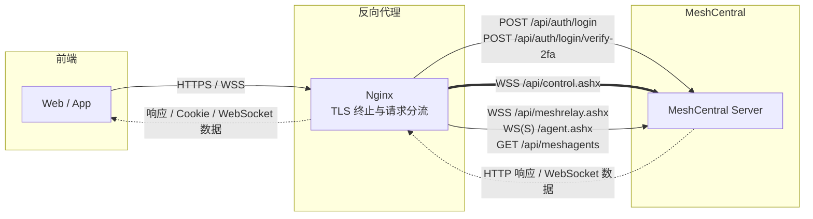

# 部署目录

本目录统一管理本地基础设施和生产部署输入。项目使用同一套全局 YAML 配置契约，但开发和生产采用不同运行方式：

- 开发：MongoDB 运行在 Docker 中，Web、Gateway、MeshCentral 和 Expo App 在宿主机运行源码，以获得热更新。
- 生产：配置初始化器读取全局 YAML 和 Docker secrets，生成各服务配置；Nginx、Gateway、MeshCentral 和 MongoDB 全部运行在 Compose 中。

## 目录结构

```text
deploy/
  .env.example
  compose.infra.yaml
  compose.production.yaml
  config/
    development.example.yaml
    production.example.yaml
  generated/
    .gitkeep
  secrets/
    README.md
```

真实的 `.env`、`config/*.yaml`、`generated/*` 和 `secrets/*` 不提交到 Git。

## 开发环境

1. 创建本地部署文件：

```powershell
Copy-Item deploy/.env.example deploy/development.env
Copy-Item deploy/config/development.example.yaml deploy/config/development.yaml
```

1. 创建开发 Secret，参见 [secrets/README.md](secrets/README.md)。

1. 启动 MongoDB：

```text
docker compose --env-file deploy/development.env -f deploy/compose.infra.yaml up -d
```

1. 在配置生成器实现后，生成本地派生配置：

```text
pnpm config generate --config deploy/config/development.yaml --output deploy/generated/development
```

1. 启动源码应用：

```text
pnpm dev:gateway
pnpm --filter @meshcentral/server dev -- --configfile ../../deploy/generated/development/meshcentral.json
pnpm dev:web
pnpm dev:app
```

当前仓库尚未实现 `config` CLI。完成生成器前，Gateway 仍使用 `apps/gateway/.env`，MeshCentral 需要手工提供原生 `config.json`。`compose.infra.yaml` 已经可以单独启动 MongoDB。

## 生产环境

生产环境不应在镜像构建阶段复制真实配置或 Secret。推荐流程：

1. 构建并发布固定版本的配置初始化器、Web/Nginx、Gateway 和 MeshCentral 镜像。
2. 将 `production.example.yaml` 复制为不提交 Git 的 `production.yaml`。
3. 通过 Docker secrets 或受控文件准备所有密钥。
4. 设置镜像地址和 `APP_CONFIG_FILE`。
5. 启动 Compose。

```text
docker compose --env-file deploy/production.env -f deploy/compose.production.yaml up -d
```

`compose.production.yaml` 是生产编排契约。由于当前仓库还没有 Dockerfile 和配置生成器镜像，在这些镜像产出前它不能直接完成部署。

## 请求逻辑流程

生产环境由 Nginx 统一接收前端请求，并将登录、控制、中继和 Agent 流量直接转发到 MeshCentral。登录请求由 `jsonauth` 插件处理并返回 MeshCentral 原生会话 Cookie，后续控制和中继连接携带同一 Cookie 完成认证。



图中的分流由 `config/production.example.yaml` 的 `proxy.routes` 定义。`login`、`control`、`relay`、`meshagents` 和 `agent` 均指向 `meshcentral`，Gateway 不再参与浏览器认证链路。

## JSON 登录插件

MeshCentral 镜像内置 `jsonauth` 插件，并在容器启动时将它同步到
`/var/lib/meshcentral/data/plugins/jsonauth`。同步只更新该插件，不会删除数据卷中的其他插件。

生成的 MeshCentral 配置必须启用插件系统并加载 `jsonauth`：

```json
{
  "settings": {
    "plugins": {
      "enabled": true,
      "list": ["jsonauth"]
    }
  }
}
```

启动后可向 `/api/auth/login` 提交空 JSON。插件正确加载时会返回 JSON 格式的
`PARAM_ERROR`；404 或 HTML 响应表示插件未加载或代理路由错误。

Web 直接使用该插件完成本地账号密码认证，并支持 TOTP、备用恢复码和可信设备 Cookie。
LDAP、SSPI、OIDC、SAML、WebAuthn、邮件和短信验证不属于当前 Web 登录流程。

## 配置职责

全局配置文件负责描述部署意图：

- `project`、`public`：环境标识和公网地址。
- `web`、`app`：公开运行时或构建期配置。
- `gateway`：Gateway 监听、上游和超时。
- `meshcentral`：生成 MeshCentral 原生 `config.json` 所需的项目级配置。
- `proxy`：生成 Nginx 配置所需的路由、TLS 和超时。
- `health`：Compose 健康检查默认值。

配置初始化器应生成：

```text
/output/gateway.json
/output/meshcentral.json
/output/nginx.conf
/output/web-runtime-config.json
/output/manifest.json
```

生成必须全部成功后再原子发布，并在 `manifest.json` 中记录 Schema 版本和源配置哈希，避免服务读取旧的命名卷内容。

## 配置变更

- Gateway 配置变更：重新生成并重启 Gateway。
- MeshCentral 配置变更：重新生成并重启 MeshCentral。
- Nginx 路由或 TLS 变更：重新生成后 reload 或重启 Nginx。
- Web 运行时配置变更：重新生成后刷新浏览器。
- Expo 构建期配置变更：重新构建 App。
