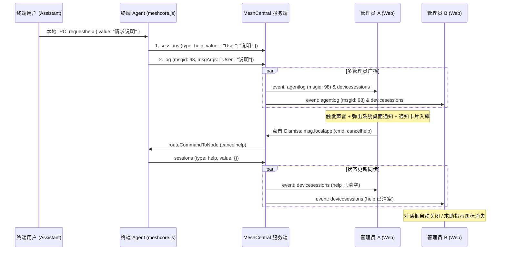

# 03 - 终端求助与即时聊天协议分析 (`Help Request` 与 `Chat / Messenger`)

---

## 一、终端求助请求 (`Help Request`)

MeshCentral 终端求助由位于受管设备的客户端组件（如 **MeshCentral Assistant**）触发，通过本地 IPC 通道与终端 Agent 交互，并沿 WebSocket 链路向控制台管理员主动广播。

### 1. 完整生命周期流转图



### 2. 求助发起时的两类关键推送 JSON

#### 2.1 事件日志通知包 (`action: "agentlog"`, `msgid: 98`)

此消息直接驱动 Web 前端**创建通知卡片、发出钟声并弹出桌面通知**：

```json
{
  "action": "event",
  "event": {
    "etype": "node",
    "action": "agentlog",
    "nodeid": "node//abc123def456",
    "domain": "",
    "msg": "Help Requested, user: Alice, details: Need help configuring printer",
    "msgid": 98,
    "msgArgs": [
      "Alice",
      "Need help configuring printer"
    ]
  }
}
```

#### 2.2 设备会话状态更新包 (`action: "devicesessions"`)

此消息驱动设备列表与详情页的**求助小圆点/问号图标高亮**以及求助弹窗内容刷新：

```json
{
  "action": "event",
  "event": {
    "etype": "node",
    "action": "devicesessions",
    "nodeid": "node//abc123def456",
    "domain": "",
    "sessions": {
      "help": {
        "Alice": "Need help configuring printer"
      }
    },
    "nolog": 1
  }
}
```

### 3. 字段对照表

| 字段路径 | 类型 | 含义 | 备注 |
| --- | --- | --- | --- |
| `event.nodeid` | string | 请求求助的设备 ID | 形如 `"node//..."` |
| `event.msgid` | number | 消息模板 ID | 固定为 `98` |
| `event.msgArgs[0]` | string | 发起求助的终端用户名 | 如 `"Alice"` |
| `event.msgArgs[1]` | string | 详细求助诉求文本 | 如 `"Need help configuring printer"` |
| `event.msg` | string | 完整后备日志文本 | 模板：`"Help Requested, user: {0}, details: {1}"` |
| `event.sessions.help` | object | 当前设备挂起的求助哈希表 | 键为用户名，值为诉求内容。若无求助则该键为空或被移除 |

### 4. 关键问题答复

1. **多个管理员是否同时收到**？
   **是**。服务端分发目标为 `parent.CreateMeshDispatchTargets(obj.dbMeshKey, [obj.dbNodeKey])`，所有对该设备所在设备组拥有查看权限的在线管理员均会同时收到推送。
2. **哪些权限允许收到求助**？
   前端判定：`GetNodeRights(nodeid) > 0`。只要拥有该设备的任何非零权限（查看/控制），即可收到。
3. **点击通知后的跳转路径**：
   在 `notificationSelectedEx` 中，因为求助通知未携带专用子标签，进入 `gotoDevice(n.nodeid, 10)`，即打开该设备的 **General（概览）界面**。在概览页上可见跳动的设备通知图标。
4. **管理员接手/关闭后的同步**：
   管理员点击处理窗口中的 **Dismiss** 后，前端向服务端下发：
   `{ action: 'msg', type: 'localapp', nodeid: nodeid, appid: appid, value: { cmd: 'cancelhelp' } }`；
   Agent 取消求助并向服务端上报清空后的 `{ action: 'sessions', type: 'help', value: {} }`，服务端广播 `devicesessions`，所有管理员端该求助状态瞬间消失。
5. **声音与 HTML5 桌面通知**：
   **完全支持**。前端在收到 `msgid === 98` 时显式调用 `addNotification`，受用户本地声音开关与系统 Notification 权限控制。

---

## 二、聊天 / 即时消息请求 (`Chat / Messenger`)

MeshCentral 的聊天系统分为**通知/信令阶段**与**数据传输阶段**。本次仅聚焦进入通知系统的邀请信令。

### 1. 聊天邀请消息协议（用户到用户）

当管理员或用户通过界面发起用户间聊天时，服务端通过 `/control.ashx` 向目标用户推送：

```json
{
  "action": "msg",
  "type": "notify",
  "id": 0.3849102934,
  "title": "Bob",
  "value": "Chat Request, Click here to accept.",
  "userid": "user//admin",
  "username": "Bob",
  "tag": "meshmessenger/user%2F%2Ftargetuser/user%2F%2Fadmin",
  "msgid": 11
}
```

### 2. 字段定义表

| 字段路径 | 类型 | 必填 | 含义 | 格式/示例 |
| --- | --- | --- | --- | --- |
| `action` | string | 是 | 顶层指令 | 固定为 `"msg"` |
| `type` | string | 是 | 子类型 | 固定为 `"notify"` |
| `id` | number | 是 | 随机消息 ID | `Math.random()` |
| `title` | string | 是 | 发起人姓名 | `"Bob"` |
| `value` | string | 是 | 提示文案 | `"Chat Request, Click here to accept."` |
| `msgid` | number | 是 | 模板索引 | 固定为 `11` |
| `userid` | string | 是 | 发起人用户 ID | `"user//admin"` |
| `username` | string | 是 | 发起人名称 | `"Bob"` |
| `tag` | string | 是 | Messenger 路由标签 | `"meshmessenger/<URL编码TargetUser>/<URL编码SenderUser>"` |

### 3. 设备聊天邀请（用户到设备）

当管理员请求与设备终端用户聊天时（`action: "meshmessenger", nodeid: "..."`）：

1. **权限检查**：服务端检查用户对该设备是否具备 `MESHRIGHT_CHATNOTIFY` 权限：
   ```javascript
   const MESHRIGHT_CHATNOTIFY = 0x00004000; // 16384
   if ((rights & MESHRIGHT_CHATNOTIFY) == 0) return;
   ```
2. **终端拉起**：服务端不向该设备发送通知弹窗，而是通过控制通道向 Agent 下发：
   `routeCommandToNode({ action: 'openUrl', nodeid: ..., url: 'https://.../messenger?id=meshmessenger/node/.../user/...' })`；
   终端 Agent 调起默认浏览器直接打开独立 Messenger 网页。

### 4. 关键问题答复

1. **聊天邀请使用的顶层 action 与 type**：
   顶层为 `action: "msg"`, `type: "notify"`。
2. **点击通知后如何打开 Messenger**：
   在 `notificationSelectedEx` 中捕获到 `tag.startsWith('meshmessenger/')`：
   ```javascript
   safeNewWindow('/messenger?id=' + n.tag + '&title=' + encodeURIComponentEx(n.username), n.tag.split('/')[2]);
   notificationDelete(id);
   ```
   浏览器将弹出一个小尺寸的独立 Messenger 窗口。
3. **数据通道与通知通道的划分**：
   - `/control.ashx` 上仅存在上述 `msgid: 11` 这一条邀请通知。
   - 随后的聊天文本、WebRTC 音视频协商、文件发送全部在独立页面建立的 `/meshrelay.ashx` 隧道中传输，不再进入全局通知中心。
4. **声音与 HTML5 桌面通知**：
   作为 `addNotification` 的一员，收到聊天邀请时会立即触发钟声与桌面通知。
