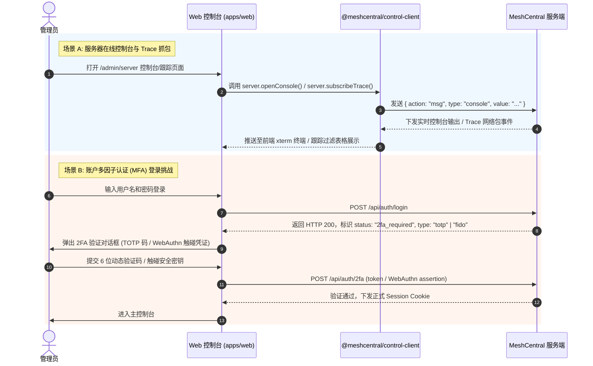

# 阶段一实施计划：运维管理闭环与账号安全

本阶段聚焦于解决系统管理盲区，建立直观高效的服务器端可观测运维通道，并为用户身份筑牢多因子认证（MFA）与口令合规防线。

---

## 1. 背景与目标

当前项目已具备基础的设备、群组及用户管理能力，但根据 [docs/meshcentral/meshcentral-config-schema.json](docs/meshcentral/meshcentral-config-schema.json) 的对照分析，存在以下严重缺失：
1. **运维通道缺失**：[apps/web/src/app/AppRouter.tsx](apps/web/src/app/AppRouter.tsx) 中 `/admin/*` 路由大多指向未就绪页面，管理员无法直接在 Web 界面查看服务端日志（ErrorLog）、执行服务控制台命令（Console）或监控协议通信轨迹（Trace）。
2. **账号安全机制单一**：仅支持最基本的用户名/密码比对，缺少 TOTP、FIDO2/WebAuthn 硬件密钥、登录暴力破解防护与强密码策略。

**阶段目标**：
- 在 Web 控制台打通“我的服务器（My Server）”运维中心，支持在线控制台、实时网络抓包追踪与崩溃错误日志查看。
- 完整接入 TOTP 与 WebAuthn 双因素认证体系，实现防爆破锁定与口令生命周期管理。

---

## 2. 核心架构与数据流设计



---

## 3. 详细任务分解与实施清单

### 任务 1.1：SDK 运维资源扩展 (`ServerAdminResource`)
- **归属包**：[packages/control-client](packages/control-client)
- **交付内容**：
  1. 封装 `server.sendConsoleCommand(command: string): Promise<void>`，对应协议 `action: "console"`。
  2. 封装 `server.subscribeConsole(listener: (line: string) => void): () => void`，监听服务端控制台回显。
  3. 封装 `server.subscribeTrace(categories: string[], listener: (packet: TracePacket) => void)`，控制 `log` 调试跟踪流（支持 `web`, `agent`, `relay`, `db`, `mps` 等分类过滤）。
  4. 封装 `server.fetchErrorLog(): Promise<string>` 与 `server.clearErrorLog(): Promise<void>`，对接服务端 `mesherrorlog.txt`。
  5. 封装 `server.fetchServerConfig(): Promise<Record<string, unknown>>`，读取脱敏后的运行态配置。

### 任务 1.2：Web 端“我的服务器 (My Server)”运维中心
- **归属页面**：[apps/web/src/pages](apps/web/src/pages)
- **交付内容**：
  1. 创建 `ServerConsolePage`（路径：`/admin/server/console`）：集成 xterm.js 命令行终端，支持自动补全常用命令（`help`, `version`, `maintenance`, `stats`）。
  2. 创建 `ServerTracePage`（路径：`/admin/server/trace`）：提供按类别过滤、关键字高亮、暂停滚动及数据包导出功能的网络封包调试板。
  3. 创建 `ServerErrorLogPage`（路径：`/admin/server/logs`）：展示崩溃堆栈、时间线检索，支持一键清空与日志下载。
  4. 路由更新：在 [apps/web/src/app/AppRouter.tsx](apps/web/src/app/AppRouter.tsx) 与 [apps/web/src/app/appRoutes.tsx](apps/web/src/app/appRoutes.tsx) 注册新管理路由，设置 `capability: "siteAdmin"` 准入守护。

### 任务 1.3：多因子认证 (MFA / 2FA) 流程建设
- **归属范围**：[packages/meshcentral-plugins/src/plugins/jsonauth](packages/meshcentral-plugins/src/plugins/jsonauth) 与 [apps/web/src/features/profile](apps/web/src/features/profile)
- **交付内容**：
  1. **用户安全中心 (ProfilePage)**：
     - TOTP 绑定向导：生成基于 RFC 6238 的 Base32 密钥与二维码，用户录入 6 位验证码校验激活。
     - 紧急备份码生成：激活 2FA 时一次性生成 10 个 8 位救援备份码（`backupcode2factor`），支持复制与下载。
     - FIDO2 / WebAuthn 硬件密钥绑定：调用浏览器 `navigator.credentials.create` 注册 YubiKey/指纹密钥（支持 `fidopininput: preferred`）。
  2. **登录挑战拦截器 (LoginPage)**：
     - 在 [apps/web/src/pages/LoginPage.tsx](apps/web/src/pages/LoginPage.tsx) 增加第二阶段验证弹窗。
     - 支持“在此设备上记住 30 天”（`twoFactorCookieDurationDays`）。
     - 支持输入一次性应急备份码登录。

### 任务 1.4：防暴力破解与密码策略实施
- **交付内容**：
  1. **防暴力破解前端联动**：解析服务端返回的锁定状态（`maxInvalidLogin`、`maxInvalid2fa`），在界面展示冷却倒计时提示，禁止无效高频重试。
  2. **密码合规校验器**：根据配置中的 `passwordRequirements`（最小长度、大小写、数字、特殊符号、弱口令黑名单），在用户修改密码和管理员创建用户界面引入实时强度提示。
  3. **强制密码重置流程**：处理用户属性 `resetNextLogin: true`，首次登录后强制重定向至修改密码页，不可跳过。

---

## 4. 关键接口与协议规范

### 控制台交互 (WebSocket)
```json
// 发送命令
{
  "action": "console",
  "cmd": "help"
}

// 接收输出 (控制通道广播)
{
  "action": "console",
  "value": "Available commands: help, version, maintenance, dump, showconfig..."
}
```

### Trace 跟踪订阅 (WebSocket)
```json
// 订阅请求
{
  "action": "trace",
  "enable": true,
  "types": ["web", "relay", "agent"]
}

// 接收跟踪日志事件
{
  "action": "trace",
  "time": 1773302400123,
  "type": "relay",
  "msg": "Relay connection established from 192.168.1.100"
}
```

---

## 5. 验收标准与测试矩阵

| 序号 | 验证场景 | 预期结果 |
| :--- | :--- | :--- |
| 1 | 管理员在控制台输入 `version` | 终端正确返回并高亮渲染当前 MeshCentral 运行版本 |
| 2 | 开启 `relay` 跟踪后发起桌面会话 | 跟踪面板实时跳出中继连接建立、认证、隧道关闭的数据帧 |
| 3 | 用户绑定 TOTP | Google Authenticator 扫码绑定成功，下发 10 个备份码 |
| 4 | 开启 2FA 的账号登录 | 验证密码后弹出 2FA 挑战，未通过前不建立有效会话 |
| 5 | 连续输错 10 次密码 | 触发 `maxInvalidLogin`，返回 IP/账号锁定状态及冷却时间 |
