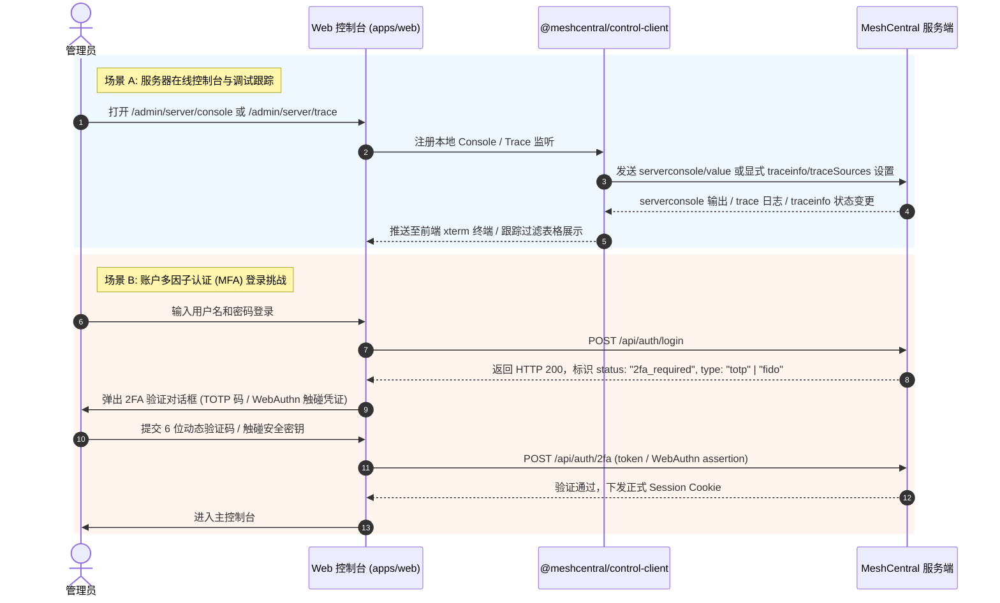

# 阶段一实施计划：运维管理闭环与账号安全

本阶段聚焦于解决系统管理盲区，建立直观高效的服务器端可观测运维通道，并为用户身份筑牢多因子认证（MFA）与口令合规防线。

---

## 1. 背景与目标

当前项目已具备基础的设备、群组及用户管理能力，但根据 [docs/meshcentral/meshcentral-config-schema.json](docs/meshcentral/meshcentral-config-schema.json) 的对照分析，存在以下严重缺失：
1. **运维通道缺失**：[apps/web/src/app/AppRouter.tsx](apps/web/src/app/AppRouter.tsx) 中 `/admin/*` 路由大多指向未就绪页面，管理员无法直接在 Web 界面查看服务端日志（ErrorLog）、执行服务控制台命令（Console）或监控协议通信轨迹（Trace）。
2. **账号安全机制单一**：仅支持最基本的用户名/密码比对，缺少 TOTP、FIDO2/WebAuthn 硬件密钥、登录暴力破解防护与强密码策略。

**阶段目标**：
- 在 Web 控制台打通“我的服务器（My Server）”运维中心，支持在线控制台、实时调试日志跟踪与崩溃错误日志查看（不承诺完整网络抓包）。
- 完整接入 TOTP 与 WebAuthn 双因素认证体系，实现防爆破锁定与口令生命周期管理。

---

## 2. 核心架构与数据流设计



---

## 3. 详细任务分解与实施清单

### 任务 1.1：SDK 运维资源扩展（现有 `ServerResource`）
- **归属包**：[packages/control-client](../../packages/control-client)
- **验证基线**：MeshCentral 1.1.54 安装包源码及脱敏协议样本；静态协议验证不代替目标实例联调。
- **交付内容**：
  1. `server.sendConsoleCommand(command: string): Promise<void>` 发送 `serverconsole`，命令字段为 `value`。Promise 仅代表已发送，不代表命令完成；断线后不重放命令。
  2. `server.subscribeConsole(listener)` 提供结构化输出（`text`、可选 `tag`、`receivedAt`）。命令可输出多条消息，无通用完成标记；与 Agent 的 `msg/console` 分离。
  3. `server.setTraceSources(categories)` 显式修改实例全局跟踪设置；`getTraceSources()` / `subscribeTraceSources(listener)` 获取缓存及变更；`subscribeTrace(listener)` 只注册本地监听。取消本地监听、离页和重连均不修改全局跟踪设置。未知状态与已知空列表分开表示。
  4. `server.fetchErrorLog(): Promise<{ content?: string }>` 与 `server.clearErrorLog(): Promise<void>` 对接 `mesherrors.txt`。读取按 action 串行关联；缺失内容不等于确认无错误。清理无 ACK，Promise 仅表示请求发送。
  5. **明确暂缓** `fetchServerConfig()`：原生 `serverconfig` 返回原始配置文件文本，并非脱敏运行态配置。后续必须先定义服务端白名单投影，禁止将原始配置下载到浏览器后再打码。

### 任务 1.2：Web 端“我的服务器 (My Server)”运维中心
- **归属页面**：[apps/web/src/pages](apps/web/src/pages)
- **交付内容**：
  1. 创建 `ServerConsolePage`（`/admin/server/console`）：复用现有 xterm 依赖，实现整行编辑、历史和 `help`、`info`、`versions`、`maintenance` 补全；不推断服务端命令成功或完成。
  2. 创建 `ServerTracePage`（`/admin/server/trace`）：显式确认修改全局来源，支持本地分类过滤、关键字高亮、暂停自动滚动和 JSON 导出。记录有界缓存；这是调试日志，不承诺完整网络载荷或 PCAP。
  3. 创建 `ServerErrorLogPage`（`/admin/server/logs`）：原文堆栈、全文检索、下载及确认清空。清空后有限回读，不自动重复删除；无内容响应不作为删除成功证明。时间线解析暂缓到日志格式证据充足时。
  4. 在 [appRoutes.tsx](../../apps/web/src/app/appRoutes.tsx) 注册路由和导航，增加 `siteAdmin` 能力，复用 [AppRouter.tsx](../../apps/web/src/app/AppRouter.tsx) 的能力守护；中英文文案同步。页面只装配，状态与协议调用放在功能 Hook，视图组件独立。

### 任务 1.3：多因子认证 (MFA / 2FA) 流程建设
- **归属范围**：[packages/meshcentral-plugins/src/plugins/jsonauth](packages/meshcentral-plugins/src/plugins/jsonauth) 与 [apps/web/src/features/profile](apps/web/src/features/profile)
- **交付内容**：
  1. **用户安全中心 (ProfilePage)**：
     - TOTP 绑定向导：生成基于 RFC 6238 的 Base32 密钥与二维码，用户录入 6 位验证码校验激活。
     - 紧急备份码生成：激活 2FA 时一次性生成 10 个 8 位救援备份码（`backupcode2factor`），支持复制与下载。
     - FIDO2 / WebAuthn 硬件密钥绑定：调用浏览器 `navigator.credentials.create` 注册 YubiKey/指纹密钥（支持 `fidopininput: preferred`）。
  2. **登录挑战拦截器 (LoginPage)**：
     - 在 [apps/web/src/pages/LoginPage.tsx](apps/web/src/pages/LoginPage.tsx) 增加第二阶段验证弹窗。
     - 支持“在此设备上记住 30 天”（`twoFactorCookieDurationDays`）。
     - 支持输入一次性应急备份码登录。

### 任务 1.4：防暴力破解与密码策略实施
- **交付内容**：
  1. **防暴力破解前端联动**：解析服务端返回的锁定状态（`maxInvalidLogin`、`maxInvalid2fa`），在界面展示冷却倒计时提示，禁止无效高频重试。
  2. **密码合规校验器**：根据配置中的 `passwordRequirements`（最小长度、大小写、数字、特殊符号、弱口令黑名单），在用户修改密码和管理员创建用户界面引入实时强度提示。
  3. **强制密码重置流程**：处理用户属性 `resetNextLogin: true`，首次登录后强制重定向至修改密码页，不可跳过。

---

## 4. 关键接口与协议规范

### 控制台交互 (WebSocket)
发送（可携带字符串 `tag` 关联输出；不能依赖 `responseid`）：
```json
{"action":"serverconsole","value":"help","tag":"console-001"}
```
接收（一条命令可能有多次输出，部分异步分支不含 tag）：
```json
{"action":"serverconsole","value":"Available commands: ...","tag":"console-001"}
```

### Trace 全局设置与本地监听 (WebSocket)
设置请求（完整替换全局来源，`[]` 关闭全部）：
```json
{"action":"traceinfo","traceSources":["web","relay","agent"]}
```
初始化状态（`null` 表示没有启用来源，不是可用类别目录）：
```json
{"action":"traceinfo","traceSources":null}
```
设置变更广播：
```json
{"action":"event","event":{"action":"traceinfo","traceSources":["relay"],"userid":"user//admin","username":"admin","nolog":1,"domain":""}}
```
日志（`args` 可含结构化 JSON 值；`time` 为毫秒时间戳）：
```json
{"action":"trace","source":"relay","args":["Relay connection established"],"time":1773302400123}
```
完整管理员可接收 Trace；设置受域 `myserver.trace` 开关限制，设置变更不属于单个页面。来源选项使用当前版本官方界面清单，不从已启用来源推断全部可选项。

### 错误日志 (WebSocket)
```json
{"action":"servererrors"}
```
响应为 `{"action":"servererrors","data":"日志原文"}`，也可能省略 `data`。省略内容无法区分文件不存在和读取失败；权限或功能限制还可能导致无响应。

清理发送 `{"action":"serverclearerrorlog"}`，服务端异步删除且无 ACK。后续读取是状态观察，不是删除操作的可靠成功确认。

---

## 5. 验收标准与测试矩阵

| 序号 | 验证场景 | 预期结果 |
| :--- | :--- | :--- |
| 1 | 管理员输入 `info`、`versions`、`help`，另输入未知命令 `version` | 原文输出正确；未知命令显示服务端文本；多条输出不当成一次完成 |
| 2 | 显式开启 `relay` 后发起桌面会话 | 展示服务端发出的 relay 调试日志，支持过滤、高亮与导出 |
| 2a | 两位管理员打开 Trace，一方变更设置，另一方离页 | 在线页面同步全局设置；离页不发送全局关闭请求 |
| 2b | 日志存在、空、无 data、读取超时；清空后回读 | 区分空内容与无内容响应/错误；不虚报清空成功 |
| 2c | 普通用户直达运维 URL；管理员断线重连 | 普通用户被拦截；断线禁用操作；不重放命令或旧全局设置 |
| 3 | 用户绑定 TOTP | Google Authenticator 扫码绑定成功，下发 10 个备份码 |
| 4 | 开启 2FA 的账号登录 | 验证密码后弹出 2FA 挑战，未通过前不建立有效会话 |
| 5 | 连续输错 10 次密码 | 触发 `maxInvalidLogin`，返回 IP/账号锁定状态及冷却时间 |
