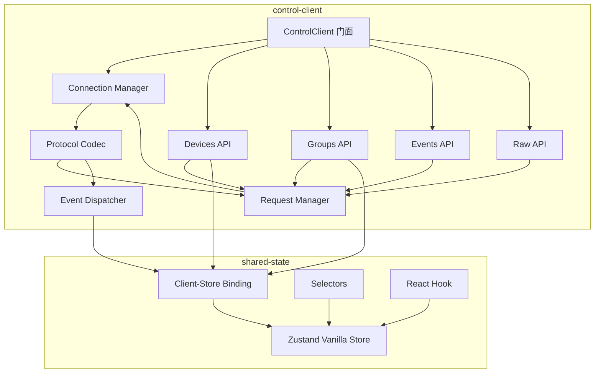
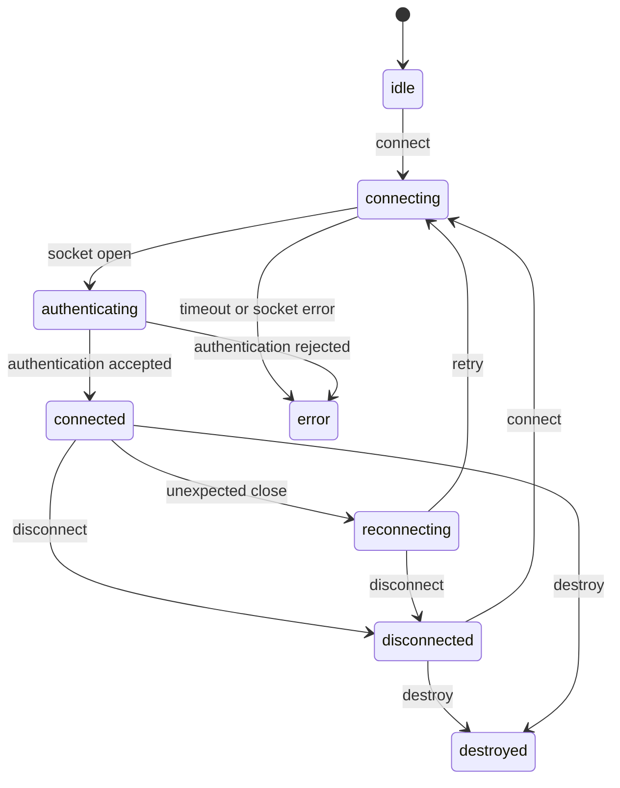
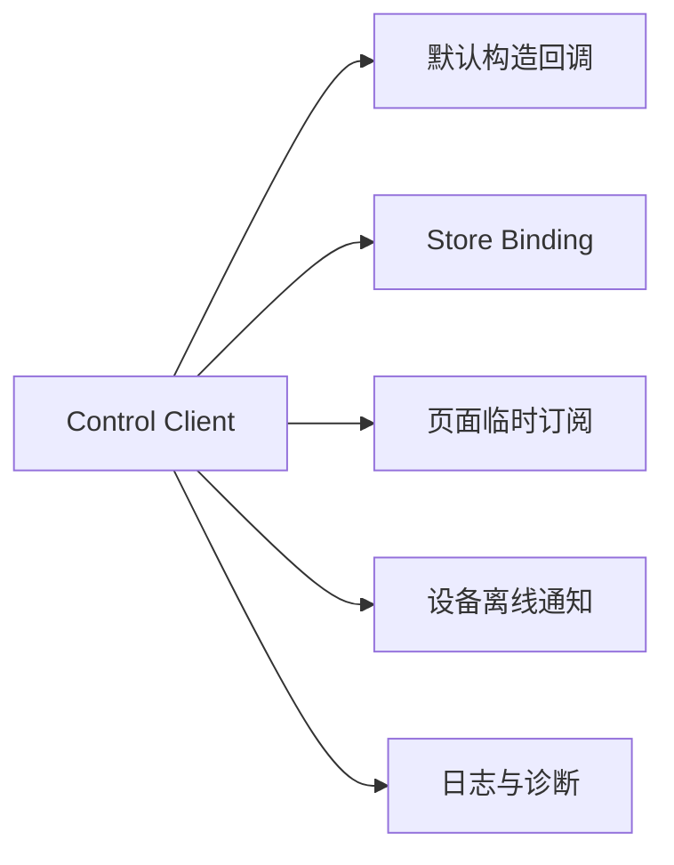
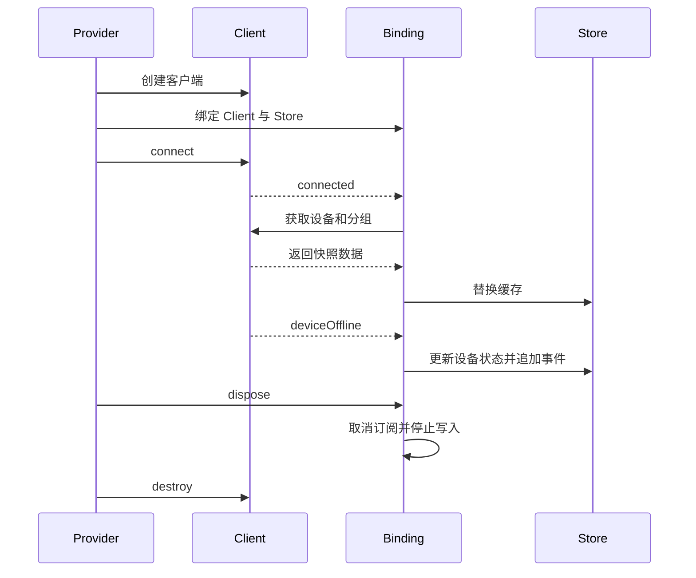

# 目标架构与实现策略

## 1. 总体策略

采用两个包：

| 包 | 定位 | 主要消费者 |
| --- | --- | --- |
| `@meshcentral/control-client` | 无状态、无框架依赖的控制通道 SDK | Web、App、shared-state、relay、脚本 |
| `@meshcentral/shared-state` | Zustand 状态缓存和 React 适配 | Web、App |

实施原则：

1. 先保持现有行为，再扩展资源 API；
2. 先建立对外契约，再移动代码；
3. 连接与业务缓存严格单向依赖；
4. 请求返回数据，推送产生事件；
5. 所有隐藏副作用都应可配置或可观察；
6. 原始协议入口保留，但业务代码优先使用资源方法。

## 2. 目标组件



## 3. 控制客户端职责

### 3.1 客户端门面

对外提供一个实例，统一暴露：

- 连接生命周期；
- 连接状态查询和订阅；
- 通用请求和单向发送；
- 设备资源；
- 分组资源；
- 历史事件资源；
- 实时事件订阅；
- 销毁和资源清理。

推荐采用“一个实例 + 资源模块”，而不是把全部方法平铺到一个巨型类。

```text
客户端
├─ connect / disconnect / destroy
├─ request / send
├─ devices
│  ├─ list
│  ├─ listByGroup
│  ├─ details
│  ├─ systemInfo
│  ├─ networkInfo
│  ├─ lastConnect
│  ├─ update
│  ├─ remove
│  └─ powerAction
├─ groups
│  ├─ list
│  ├─ create
│  ├─ update
│  └─ remove
└─ events
   ├─ list
   ├─ listByDevice
   └─ listByUser
```

第一阶段可以只迁移现有方法与最急需的方法，但目录和契约应允许后续扩展。

### 3.2 Connection Manager

负责：

- 创建 WebSocket；
- 连接超时；
- 鉴权初始化；
- 心跳；
- 手动断开；
- 异常关闭后的退避重连；
- 连接状态转换；
- 销毁后禁止再次使用。

连接状态建议：



需要明确：`connect()` 完成表示“已通过客户端定义的鉴权初始化条件”，不能只表示 WebSocket 已 `open`。

### 3.3 Request Manager

所有资源方法和通用请求共用一个 Request Manager。

匹配优先级：

1. `responseid` 精确匹配；
2. `tag` 精确匹配；
3. 协议声明的特殊关联规则；
4. `action + deviceId` 唯一候选匹配；
5. action 唯一候选匹配；
6. 无法唯一确定时不消费请求，并产生诊断通知。

必须保留的特殊策略：

- `authcookie` 响应可能没有 `responseid`，同类请求串行执行；
- `getsysinfo` 响应可能没有 `responseid`，允许按 action 和设备 ID 匹配；
- 连接关闭时拒绝全部 pending 请求；
- 请求超时后必须从 pending 集合移除；
- 迟到响应不能完成已经超时或取消的请求。

### 3.4 Protocol Codec

协议层只做纯转换：

```text
原始消息
  → JSON 解析
  → 消息分类
  → 响应 / 实时事件 / 系统消息 / 未知消息
  → 标准化业务数据
```

协议层不得：

- 导入 Store；
- 读取或修改 Zustand 状态；
- 产生 `GatewayMutation`；
- 决定 UI 是否展示某条事件；
- 保存设备列表或事件历史。

协议输出建议分为：

| 类别 | 用途 |
| --- | --- |
| Response | 完成等待中的请求 |
| Domain Event | 设备在线、离线、变化、删除及审计事件 |
| Connection Message | 鉴权、初始化、服务信息和警告 |
| Diagnostic Message | 无法识别或无法匹配的消息 |

## 4. 事件策略

### 4.1 构造回调与动态订阅并存

构造参数允许传入默认回调，满足创建实例时直接接收消息的需求；客户端同时提供动态订阅，允许 Store、页面、通知和日志模块独立消费。



监听器要求：

- 订阅返回取消函数；
- 一个监听器抛错不能中断其他监听器；
- 监听器异常应进入错误或诊断通道；
- `destroy()` 后清理全部监听器；
- 业务事件、连接状态、错误和原始消息应分通道通知。

### 4.2 标准事件

第一阶段至少支持：

- 设备上线；
- 设备离线；
- 设备属性变化；
- 设备删除；
- Agent 日志；
- Relay 日志；
- 用户 WebSocket 会话数量变化；
- 未知事件；
- 连接状态变化；
- 客户端错误和协议诊断。

状态包可以选择不保存 `deviceChanged`、`ifchange` 或未知事件，但控制客户端不应静默丢弃所有未知消息，应至少提供诊断入口。

## 5. 资源方法策略

### 5.1 查询方法

统一流程：

```text
校验参数
→ 生成协议请求
→ Request Manager 发送并等待
→ 检查服务端错误
→ 标准化响应
→ 返回业务数据
```

查询方法不直接写 Store。

### 5.2 修改方法

统一流程：

```text
校验修改内容
→ 发送修改请求
→ 等待确认
→ 返回操作结果
→ 后续实时变化事件独立通知
```

修改成功后不在客户端内部假设设备或分组缓存已更新。

### 5.3 通用请求入口

保留：

- `request`：等待响应；
- `send`：无需等待响应。

用途：

- Relay 授权和 Agent 通知；
- 批量上传现有业务；
- 尚未封装的 MeshCentral action；
- 协议调试。

业务页面新增功能时应优先增加资源方法，避免原始 action 广泛散布在 UI 层。

## 6. 状态包策略

### 6.1 Client-Store Binding

新增显式绑定器，负责：

- 订阅连接状态并更新 Store；
- 订阅业务事件并转换为 Store 操作；
- 初次连接后获取设备、分组和必要用户信息；
- 重连成功后重新同步快照；
- 解绑时取消全部订阅；
- 防止旧客户端在替换后继续写入 Store。

绑定生命周期：



### 6.2 Mutation 的归属

`GatewayMutation` 可以保留为状态包内部实现细节，但必须满足：

- 不从控制客户端包导出；
- 不作为协议解码结果；
- 不成为 Client 与 Store 的公共边界；
- 可以被更直接的 Store 操作替代。

## 7. 重连恢复策略

核心客户端默认只恢复连接并通知 `reconnected`，不隐藏地拉取全部业务数据。

由状态绑定器执行：

1. 收到首次 `connected` 或后续 `reconnected`；
2. 并行请求设备和分组；
3. 请求最近连接信息或其他必要快照；
4. 使用本次同步结果替换 Store；
5. 同步失败时保留连接状态并设置数据同步错误；
6. 下一次重连或用户手动刷新时再次同步。

这样 Node.js 或 Relay 等消费者不会因为连接成功而产生不需要的隐藏请求。

## 8. 错误策略

建议控制客户端至少区分：

| 错误 | 含义 |
| --- | --- |
| Authentication Error | 鉴权被拒绝 |
| Connection Error | 建连失败或 WebSocket 错误 |
| Connection Closed Error | 请求期间连接关闭 |
| Request Timeout Error | 请求超时 |
| Protocol Error | 消息格式或协议结构无效 |
| Server Error | 服务端明确返回错误 |
| Validation Error | 调用参数无效 |
| Client Destroyed Error | 销毁后继续使用 |

错误中尽量携带 action、请求 ID、设备 ID、原始响应和是否可重试等上下文，但不得包含密码、Token 或完整认证参数。

## 9. 包边界结果

完成后：

```text
control-client
  只知道 WebSocket、协议、请求、资源和事件

shared-state
  只知道 Store、缓存、selector、React Hook 和绑定策略

应用 Provider
  只负责凭据、客户端生命周期、绑定器生命周期和导航
```

这将使控制客户端可在无 Zustand、无 React 的环境中独立实例化和测试。
