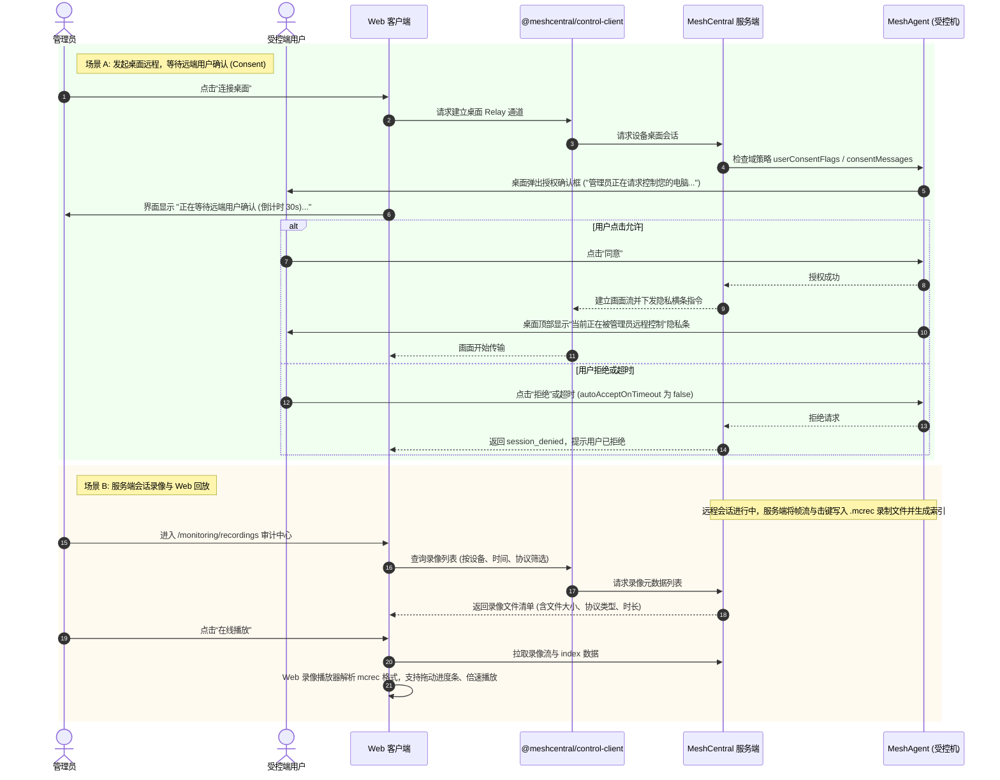

# 阶段二实施计划：知情同意、访客共享与会话录制

本阶段聚焦于远程操作的**安全合规**、**终端用户隐私尊重**与**全链路操作事后审计**，消除未经许可静默控制引发的合规风险，并提供完整的屏幕/终端回放取证能力。

---

## 1. 背景与目标

根据 [docs/meshcentral/meshcentral-config-schema.json](docs/meshcentral/meshcentral-config-schema.json) 与现有项目代码对照：
1. **知情同意（Consent）断层**：当前 [apps/web/src/pages/DeviceWorkspacePage.tsx](apps/web/src/pages/DeviceWorkspacePage.tsx) 在发起远程桌面或终端时，直接请求控制通道，缺少远端受控端用户授权确认（Consent Prompt）的交互状态处理、隐私横条（Privacy Bar）及无人值守条件分支。
2. **访客临时共享缺失**：无法生成受控设备的临时协助 Web 链接（Guest Sharing Link），阻碍了一次性远程支持与外包协同场景。
3. **会话录制不可视**：尽管服务端支持多协议录像，但前端缺少录制策略下发、录像文件归档检索，以及专用 Web 会话播放器（Recording Player）。

**阶段目标**：
- 实现端到端受控端用户授权确认（Consent）与无人值守/锁屏自动同意策略。
- 交付临时访客共享（Guest Device Sharing）链接生成、管理与撤销功能。
- 构建全协议会话录像落盘、索引检索与 Web 录像回放播放器系统。

---

## 2. 核心架构与数据流设计



---

## 3. 详细任务分解与实施清单

### 任务 2.1：知情同意（Consent）与隐私保护集成
- **归属模块**：[packages/control-client](packages/control-client) 与 [apps/web/src/components/device-workspace](apps/web/src/components/device-workspace)
- **交付内容**：
  1. **SDK 协议扩展**：
     - 在桌面、终端、文件会话握手中处理 `consent`、`consent_timeout`、`consent_denied` 等事件。
     - 支持读取域级授权策略：`userConsentFlags`、`consentMessages`。
  2. **前端交互适配**：
     - 在 [apps/web/src/pages/DeviceWorkspacePage.tsx](apps/web/src/pages/DeviceWorkspacePage.tsx) 桌面、终端、文件面板中，实现“正在等待远端用户同意”的等待模态框（含秒级倒计时、取消连接按钮）。
     - 若命中“设备无用户登录自动放行”（`autoAcceptIfNoUser`）或“设备锁屏自动放行”（`autoAcceptIfLocked`），在界面记录提示日志。
     - 远程会话建立后，检测隐私保护条（`desktopprivacybar`）状态并展示受控端提示状态。

### 任务 2.2：访客设备共享中心 (Guest Device Sharing)
- **归属模块**：[apps/web/src/pages](apps/web/src/pages) 与 [packages/control-client](packages/control-client)
- **交付内容**：
  1. **共享链接生成向导**：
     - 设备工作区工具栏增加“分享协助链接”功能。
     - 支持选择协议权限：仅桌面（`desktop`）、仅终端（`terminal`）、查看模式（`viewonly`）。
     - 支持配置有效生命周期：15分钟、1小时、自定义分钟数（受 `guestDeviceSharing.maxSessionTime` 约束）。
  2. **免登录访客专用客户端页面**：
     - 创建 `GuestSessionPage`（路由：`/sharing/:guestToken`）。
     - 该页面为独立极简窗口，免受系统全局导航干扰，仅包含远程画布与必要工具条。
  3. **共享会话管理面板**：
     - 支持列出当前设备所有生效中的临时访客链接，支持管理员随时一键“强制撤销/失效”。

### 任务 2.3：会话录像管理与在线 Web 播放器
- **归属模块**：`apps/web/src/features/recordings` 与 [apps/web/src/pages/ReportsPage.tsx](apps/web/src/pages/ReportsPage.tsx)
- **交付内容**：
  1. **录像检索与管理中心**（路径：`/monitoring/recordings`）：
     - 列表展示所有历史会话录像：设备名、操作管理员、协议类型（桌面/终端/PowerShell/文件）、录制开始时间、文件大小。
     - 支持按设备 ID、日期范围、协议类型检索过滤。
     - 支持原始 `.mcrec` 录像文件直接打包下载。
  2. **Web 录像回放播放器组件 (`SessionPlayerModal`)**：
     - **桌面录像回放**：基于 Canvas 逐帧渲染屏幕像素差异，结合 `index: true` 索引实现进度条任意拖动跳转。
     - **终端录像回放**：基于 xterm.js 按照时间戳逐行播放击键与屏幕输出。
     - **播放控制器**：支持播放/暂停、快进快退（10s）、1x/2x/4x 倍速播放、全屏模式。
     - **敏感操作标记**：在时间轴上高亮标注文件传输、Ctrl+Alt+Del 等关键操作节点。

---

## 4. 关键协议数据结构规范

### 访客分享链接生成 (WebSocket)
```json
// 请求生成访客分享
{
  "action": "guestshare",
  "nodeid": "node//abc123def",
  "protocol": 2, // 2: Desktop, 1: Terminal
  "rights": 1,   // 1: View-only, 2: Full-control
  "duration": 60 // 分钟
}

// 响应结果
{
  "action": "guestshare",
  "nodeid": "node//abc123def",
  "url": "https://mesh.example.com/sharing?token=eyJh...",
  "expire": 1773306000000
}
```

### 录像列表查询 (WebSocket)
```json
{
  "action": "recordings",
  "nodeid": "node//abc123def",
  "limit": 50
}
```

---

## 5. 验收标准与测试矩阵

| 序号 | 验证场景 | 预期结果 |
| :--- | :--- | :--- |
| 1 | 开启 Consent 的设备发起远程控制 | 受控机桌面弹出授权弹窗，管理端界面出现倒计时并同步等待 |
| 2 | 受控端用户点击拒绝 | 管理端优雅关闭会话并弹出“用户拒绝了远程协助请求”提示 |
| 3 | 生成有效期 30 分钟的只读分享链接 | 访客浏览器无需登录即可打开画面，但鼠标键盘事件被拦截屏蔽 |
| 4 | 管理员手动撤销进行中的访客链接 | 访客端画面立即中断并提示“分享已被发起者撤销” |
| 5 | 查看历史桌面会话录像 | Web 播放器能流畅加载，拖动进度条至 50% 时精准渲染对应时刻画面 |
