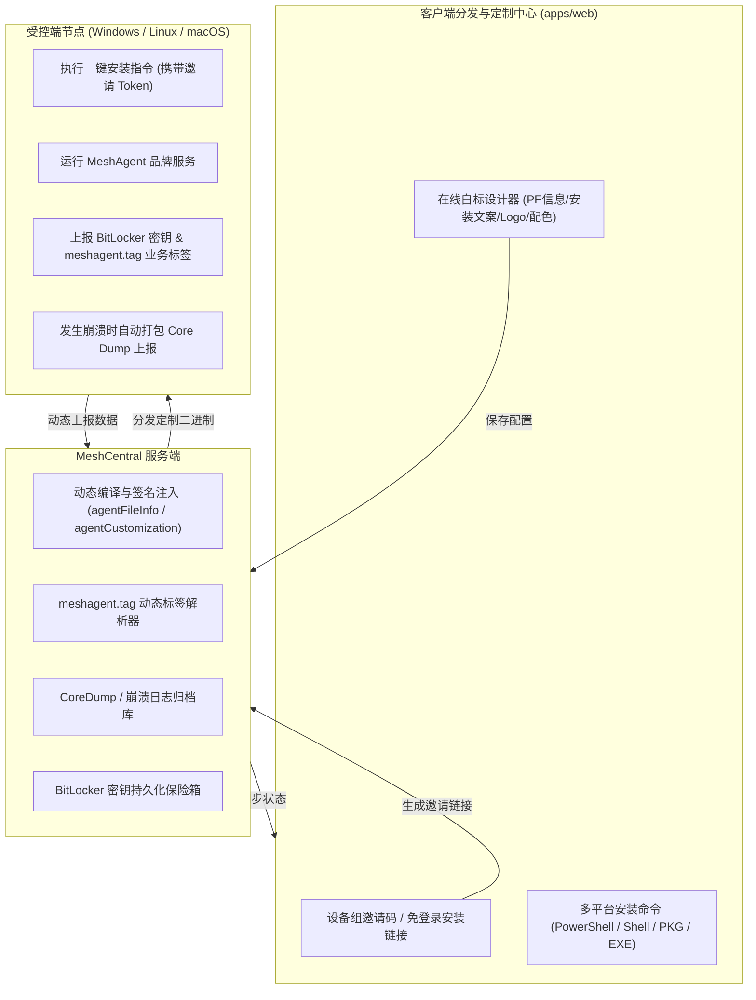

# 阶段三实施计划：客户端部署、白标定制与端点治理

本阶段聚焦于**终端资产规模化上线**、**品牌化白标定制（White-labeling）**以及**端点自动化运维治理**，解决安装分发门槛高、资产归集标签繁琐、系统崩溃排查难及 Windows 磁盘加密密钥丢失等痛点。

---

## 1. 背景与目标

根据 [docs/meshcentral/meshcentral-config-schema.json](docs/meshcentral/meshcentral-config-schema.json) 与现有项目代码对照：
1. **客户端分发体验原始**：目前缺乏设备组免密邀请链接与邀请码（`agentInviteCodes`）功能，管理员无法一键分发免配置安装包。
2. **白标定制无法视化**：虽然服务端原生支持 Windows PE 信息定制（`agentFileInfo`）、服务名称与前景色定制（`agentCustomization`）、托盘助手与移动端品牌化定制，但缺少 Web 端在线预览、配置与构建生成。
3. **关键资产安全与自动化运维缺失**：
   - Windows BitLocker 恢复密钥抓取与安全托管（`bitlockerKeyRetentionDays`）未在 Web 界面呈现。
   - 依赖远端文件的资产动态标签与别名映射机制（`agentTag`：解析 `meshagent.tag` 的 `ServerName`, `ServerDesc`, `ServerTags`）未接入。
   - 缺少预置运维脚本库（`PreconfiguredScripts`：bat/ps1/sh/agent，支持 `runas: "user" | "agent"`）的配置与批量派发。
   - 客户端崩溃日志与 Core Dump 文件（`agentCoreDump`）缺乏检索界面。

**阶段目标**：
- 打造开箱即用的多平台客户端分发中心，支持免密邀请链接、一键安装命令生成。
- 交付客户端白标定制与构建中心，支持在线定制图标、服务名、PE 版权与配色。
- 建立端点安全与自动化治理台：BitLocker 密钥保险箱、动态资产标签同频、预设运维脚本库及崩溃日志分析。

---

## 2. 核心架构与数据流设计



---

## 3. 详细任务分解与实施清单

### 任务 3.1：客户端安装分发中心 (`AgentDeploymentPage`)
- **归属页面**：`apps/web/src/pages/AgentDeploymentPage.tsx`（路由：`/devices/deploy`）
- **交付内容**：
  1. **设备组邀请码与链接体系 (`agentInviteCodes`)**：
     - 支持为指定设备组创建带过期时间或使用次数限制的“免登录安装邀请码”。
     - 自动组装一键安装命令行（Windows PowerShell 极简命令、Linux `curl | bash`、macOS 终端指令）。
  2. **平台安装包直接下载**：
     - 智能检测当前管理员操作系统，提供 Windows 64/32位免安装体验版（Assistant）、服务后台驻留版、Linux DEB/RPM/通用二进制、macOS PKG。
  3. **受控下载防护 (`lockAgentDownload`)**：
     - 若开启该选项，限制非授权匿名用户下载 Agent，确保安装包仅在持有有效邀请码时开放。

### 任务 3.2：企业品牌化白标设计器 (White-label Designer)
- **交付内容**：
  1. **Windows PE 资源元数据编辑 (`agentFileInfo`)**：
     - 支持在 Web 端配置 `productName`（产品名称）、`fileDescription`（程序描述）、`fileVersion`（版本号）、`legalCopyright`（公司版权）、`icon`（上传自定义 `.ico` 图标）。
  2. **安装器与运行态定制 (`agentCustomization`)**：
     - 支持自定义 `displayName`（服务展示名）、`serviceName`（系统底层服务代号）、`installText`（安装引导说明）、`foregroundColor` 与 `backgroundColor`（安装器主题配色）。
     - 支持上传安装向导左侧 Logo 图与 macOS 安装背景图（`macosinstallerimage`）。
  3. **实时预览沙盒**：
     - 前端提供 Windows 安装窗口与托盘助手的仿真预览组件，即时渲染填写的配色与 Logo。

### 任务 3.3：端点安全与 BitLocker 密钥托管
- **归属模块**：`apps/web/src/pages/DeviceWorkspacePage.tsx` 与 [packages/control-client](packages/control-client)
- **交付内容**：
  1. **BitLocker 恢复密钥保险箱 (`bitlockerKeyRetentionDays`)**：
     - 在设备工作区激活“安全与加密”面板。
     - 安全解密并展示 Windows 各物理磁盘卷的驱动器盘符、加密算法、保护器 ID 与 48 位数字恢复密钥。
     - 支持敏感数据脱敏展示（点击眼睛图标显示）、权限控制（仅限特权管理员查看并记入审计日志）。
     - 支持离线保留策略展示（设备离线后密钥保留指定天数）。

### 任务 3.4：动态资产标签与非活跃清理
- **交付内容**：
  1. **`meshagent.tag` 动态资产映射 (`agentTag`)**：
     - 识别远端受控机本地部署文件中的 `~ServerName:name`、`~ServerDesc:desc`、`~ServerTags:tag1,tag2`。
     - 在 Web 端设备概览中高亮区分“服务端自定义标签”与“端点动态同步标签”。
     - 支持规则配置：`0=忽略`, `1=强行覆盖`, `2=为空时填入`, `3=追加标签`。
  2. **非活跃设备自动淘汰 (`autoRemoveInactiveDevices`)**：
     - 配置面板增加设备自动回收阈值（0~2000天），提供即将超期设备的筛选告警与批量延期保活。

### 任务 3.5：预设运维脚本库 (Preconfigured Scripts)
- **交付内容**：
  1. **脚本库管理中心**（路由：`/devices/scripts`）：
     - 维护企业常用自动化脚本清单，支持分类标签。
     - 字段支持：脚本名称、脚本类型（`bat`, `ps1`, `sh`, `agent`）、执行身份（`runas: "agent" | "user" | "userfirst"`）。
  2. **一键派发与右键执行**：
     - 在设备工作区及设备批量操作菜单中，支持下拉选择预设脚本一键异步分发。
     - 结果实时流式回显至弹窗或写入“任务中心”。

---

## 4. 关键协议与数据结构规范

### 邀请码创建请求 (WebSocket)
```json
{
  "action": "createinvitecode",
  "meshid": "mesh//group_office_pc",
  "expire": 1773388800000,
  "flags": 1
}
```

### BitLocker 密钥查询响应 (WebSocket)
```json
{
  "action": "bitlocker",
  "nodeid": "node//abc123def",
  "volumes": [
    {
      "drive": "C:",
      "protectionStatus": 1,
      "encryptionPercentage": 100,
      "recoveryKey": "481920-318273-192837-129384-582910-482910-182930-102938",
      "keyIdentifier": "{E4F8A3B2-1234-5678-9ABC-DEF012345678}"
    }
  ]
}
```

---

## 5. 验收标准与测试矩阵

| 序号 | 验证场景 | 预期结果 |
| :--- | :--- | :--- |
| 1 | 生成某设备组的安装邀请码 | 复制的一键 PowerShell 命令无需管理员登录凭据即可将新设备纳管至该组 |
| 2 | 配置 White-label 并重新下载 Agent | Windows 安装包属性中的详细信息（产品名、版本、公司）与设置完全一致 |
| 3 | Windows 设备开启 BitLocker | 安全工作区能立即显示 48 位数字恢复密钥，并在审计中心记录密钥读取事件 |
| 4 | 在远端设备写入 `meshagent.tag` | 刷新 Web 页面后，设备别名与 Tag 按照设置策略自动更新同步 |
| 5 | 以当前登录用户身份执行预置脚本 | 脚本以当前桌面用户而非 LocalSystem 权限执行，图形弹窗正常显示在用户屏幕上 |
