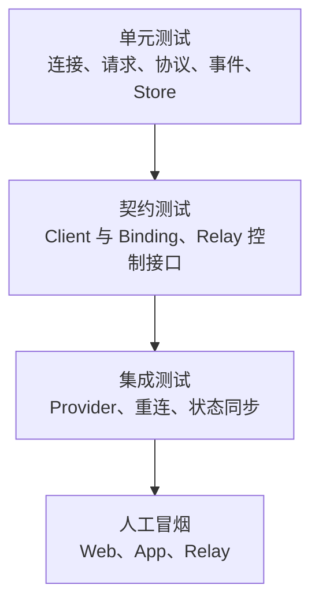
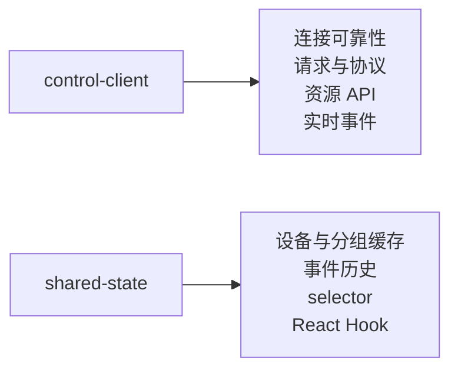

# 验收、风险、回滚与结果

## 1. 验收策略

验收分为四层：



任何一层失败都不能进入旧实现清理阶段。

## 2. 自动化验收清单

### 2.1 Control Client

#### 连接生命周期

- [ ] 首次连接状态顺序正确；
- [ ] 重复调用 connect 不创建多个连接；
- [ ] WebSocket open 后等待鉴权条件；
- [ ] 收齐初始化信号后连接成功；
- [ ] 鉴权拒绝返回 Authentication Error；
- [ ] 连接超时返回 Connection Error；
- [ ] 手动 disconnect 不触发重连；
- [ ] 异常 close 触发退避重连；
- [ ] destroy 后不能再次连接；
- [ ] 心跳只在 connected 状态发送。

#### 请求管理

- [ ] 自动生成唯一 `responseid`；
- [ ] 按 `responseid` 完成请求；
- [ ] 按 `tag` 完成请求；
- [ ] `getsysinfo` 可按设备 ID 降级匹配；
- [ ] 并发 `getsysinfo` 不串包；
- [ ] `authcookie` 无 ID 响应按顺序匹配；
- [ ] 请求超时产生专用错误；
- [ ] 连接关闭拒绝全部 pending 请求；
- [ ] 服务端错误转为 Server Error；
- [ ] 无法匹配的响应进入诊断通道。

#### 协议与资源

- [ ] MeshCentral `nodes` 字典结构被正确展开；
- [ ] `_id`、`meshid`、`conn`、`agent.ver` 等字段正确标准化；
- [ ] `meshes` 响应正确标准化；
- [ ] 用户信息和时间戳正确标准化；
- [ ] 设备详情组合请求返回预期结构；
- [ ] 设备与分组修改请求字段正确；
- [ ] 历史事件过滤参数正确发送；
- [ ] 原始响应仍可访问。

#### 实时事件

- [ ] `nodeconnect + conn>0` 产生设备上线；
- [ ] `nodeconnect + conn=0` 产生设备离线；
- [ ] `changenode` 携带最新设备数据；
- [ ] `removenode` 产生设备删除；
- [ ] `agentlog` 和 `relaylog` 正确标准化；
- [ ] 未知消息不会导致消息循环停止；
- [ ] 多个订阅者都能收到事件；
- [ ] 取消订阅后不再收到事件；
- [ ] 单个监听器抛错不影响其他监听器。

### 2.2 Shared State

- [ ] Binding 首次连接后同步设备和分组；
- [ ] Binding 重连后重新同步；
- [ ] 同步期间保留旧缓存；
- [ ] 设备在线和离线事件更新状态；
- [ ] 设备变化合并字段且保留已有在线状态；
- [ ] 设备删除从缓存移除；
- [ ] `deviceChanged` 不进入事件历史；
- [ ] `ifchange` 默认不进入事件历史；
- [ ] 事件历史仍限制为 100 条；
- [ ] 解绑后 Client 不再写入 Store；
- [ ] selector 引用稳定性保持不变；
- [ ] Store 测试不依赖原始协议解码器。

### 2.3 契约兼容

- [ ] Control Client 满足 Relay 所需的 request/send 结构；
- [ ] Batch Upload Manager 可以继续发送请求和单向消息；
- [ ] Web 与 App 使用相同的客户端公共类型；
- [ ] 工作区不存在循环依赖；
- [ ] Control Client 包依赖中没有 React 和 Zustand。

## 3. 人工冒烟清单

### 3.1 Web

- [ ] 正确账号可登录；
- [ ] 错误账号显示明确错误；
- [ ] 需要二次验证时提示不回退；
- [ ] 刷新页面可恢复已保存凭据；
- [ ] 退出后清除凭据并断开连接；
- [ ] 设备和分组列表正常加载；
- [ ] 设备详情正常加载；
- [ ] 设备离线后页面状态实时变化；
- [ ] 断网后显示重连，恢复网络后重新同步；
- [ ] 文件 Relay 与批量上传仍可建立控制流程。

### 3.2 React Native

- [ ] 登录与错误提示正常；
- [ ] AsyncStorage 恢复登录正常；
- [ ] App 进入后台后连接处理正常；
- [ ] 回到前台后能恢复连接与数据；
- [ ] 无有效凭据时跳转登录页；
- [ ] 设备离线事件更新列表和详情；
- [ ] 退出后清除状态和凭据。

## 4. 工程验证

完成前必须通过仓库既有验证命令：

| 验证 | 目的 |
| --- | --- |
| lint | 检查代码规范和潜在错误 |
| typecheck | 检查包边界和消费者类型 |
| test | 验证连接、协议、Store 与业务行为 |
| build | 验证 workspace 构建顺序和声明生成 |
| format check | 保证文档和源码格式一致 |

建议在每个阶段执行受影响包验证，在阶段 9 执行全仓验证。

## 5. 主要风险与缓解策略

| 风险 | 影响 | 概率 | 缓解策略 |
| --- | --- | --- | --- |
| 协议层改造时丢失特殊匹配 | 请求超时或串包 | 高 | 先迁移测试，再迁移实现；固定 authcookie/getsysinfo 场景 |
| Client 不再自动请求快照后页面无数据 | Web/App 空列表 | 高 | Binding 明确负责首次连接和重连同步 |
| 新旧 Client 同时写 Store | 重复事件和状态抖动 | 中 | Provider 替换时先解绑，再销毁旧 Client |
| 认证关闭不再进入事件历史 | 登录失效无法识别 | 高 | 使用专用连接错误/关闭通知，不依赖业务事件列表 |
| React Native WebSocket 行为差异 | App 无法连接或关闭异常 | 中 | 保留 WebSocket 工厂抽象和 App 冒烟测试 |
| 资源类型从状态包迁移导致大量导入变化 | 类型检查大面积失败 | 高 | 分阶段迁移类型；必要时短期从状态包转发类型 |
| Relay 类型不兼容 | 文件管理和上传失效 | 中 | 维持结构化 request/send 契约测试 |
| 重连后重复注册监听器 | 重复写入、内存泄漏 | 中 | Binding 提供幂等 dispose，Provider 严格管理生命周期 |
| 未知事件被静默丢弃 | 服务端版本问题难排查 | 中 | 增加诊断订阅和可选 raw message 回调 |
| 错误对象泄露认证参数 | 安全风险 | 低但严重 | URL、Token、密码不进入错误上下文和日志 |
| 拆包与新增大量 API 同时进行 | 回归定位困难 | 高 | 先等价迁移，再逐步增加资源 API |

## 6. 回滚策略

### 6.1 阶段回滚

每一阶段形成独立提交或变更集：

1. 新包骨架可以直接删除，不影响旧应用；
2. 新 Client 未接入消费者前，旧 Client 保持权威实现；
3. Web 和 App 分开迁移，可单独回退；
4. 旧导出只在全部消费者完成迁移且验收通过后删除；
5. 清理阶段前保留一个稳定标签或提交点。

### 6.2 兼容层

如果不能一次完成全部消费者迁移，可短期在状态包中转发：

```text
旧导入位置
  → 转发新 Client 和类型
  → 输出弃用提示
  → 应用逐个迁移
  → 删除转发
```

兼容层只能转发，不能保留第二套连接逻辑。

### 6.3 触发回滚的条件

出现以下任一情况应停止清理并回退到上一稳定阶段：

- 登录成功率下降；
- 出现请求串包；
- 自动重连形成连接风暴；
- App 前后台恢复失败；
- Relay 或批量上传不可用；
- 状态绑定产生重复事件；
- 全仓构建或关键测试无法在当前阶段修复。

## 7. 可观测性建议

客户端应提供可选诊断事件，但默认不输出敏感信息。

建议记录：

- 连接状态转换；
- 重连次数与延迟；
- 请求 action、请求 ID 和耗时；
- 超时和未匹配响应；
- 协议解析错误；
- 监听器错误；
- Binding 同步开始、成功和失败。

禁止记录：

- 用户密码；
- 完整认证参数；
- Access Token；
- Cookie 和 Relay Cookie；
- 含敏感查询参数的完整 WebSocket URL。

## 8. 预期最终结果

### 8.1 包职责结果



### 8.2 开发体验结果

- 新增控制通道方法时，主要修改 Client 的资源模块和测试；
- 新增页面状态时，主要修改 Store 和 selector；
- Node.js 或脚本可以只安装控制客户端；
- Web/App 页面不需要理解 `responseid` 和协议降级匹配；
- Relay 继续只依赖最小控制通道接口；
- 设备离线等事件可以同时交给 Store、通知系统和日志模块。

### 8.3 结果判定表

| 结果 | 判定方式 |
| --- | --- |
| 解耦完成 | Client 构造参数没有 Store，源码无 Zustand/React 导入 |
| 行为保持 | 基线测试、契约测试和冒烟测试通过 |
| 可扩展 | 设备、分组、事件按资源模块组织 |
| 可复用 | Client 可在不创建 Store 的测试或脚本中运行 |
| 可维护 | 协议特殊匹配集中在 Request Manager/Protocol 内 |
| 可恢复 | Binding 在重连后重新同步缓存 |
| 可回滚 | 每阶段独立提交，旧实现最后删除 |

## 9. 完成报告模板

实施结束后建议在本目录补充完成报告，记录：

- 实际新增和删除的包、入口与文件；
- 最终公共 API；
- 与计划不同的设计决策及原因；
- 自动化验证结果；
- Web/App/Relay 冒烟结果；
- 已知限制；
- 后续可选工作，例如进一步拆分协议包或增加更多资源模块。
