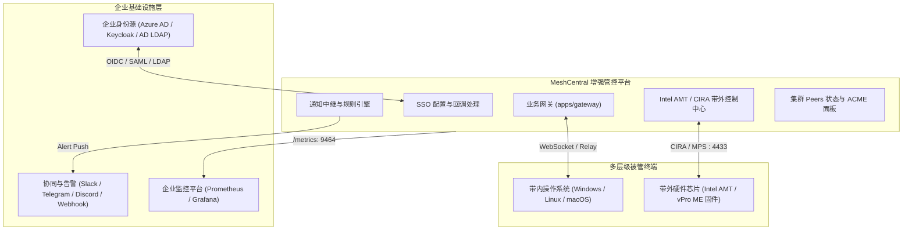

# 阶段四实施计划：企业集成、高级协议与高可用架构

本阶段聚焦于系统对**大型政企客户 IT 体系的横向融合**，涵盖企业统一身份认证（SSO）、全渠道告警协同（ChatOps）、硬件级带外管理（Intel AMT/vPro）、证书自动化更新及多节点集群高可用。

---

## 1. 背景与目标

根据 [docs/meshcentral/meshcentral-config-schema.json](docs/meshcentral/meshcentral-config-schema.json) 的完整定义：
1. **统一身份缺失**：企业级客户普遍要求接入内部统一身份源（OIDC、SAML 2.0、Active Directory / LDAP），并实现企业部门与 MeshCentral 用户组的递归映射（`groups.sync` / `groups.recursive`）及管理员权限自动同步（`groups.siteadmin`）。
2. **缺乏多渠道告警联动**：系统未打通邮件合并通知（`emailDelaySeconds`）、短信（SMS）、浏览器离线推送（Web Push）以及企业协同通讯机器人（钉钉/企业微信/Slack/Telegram/Discord）。
3. **硬件级带外运维空白**：缺少 Intel AMT 远程开机、BIOS 级 KVM、裸机零接触激活（ACM / MEBx / USB setup.bin）与 CIRA 架构支持。
4. **基础设施与集群治理欠缺**：缺少自动化证书（Let's Encrypt / ZeroSSL）、分布式节点对等互联（Peers）、CrowdSec 威胁联动及 Prometheus 监控端点管理。

**阶段目标**：
- 实现企业级 OIDC、SAML、LDAP 单点登录及用户组自动同步。
- 交付全渠道告警通知中心（邮件、SMS、即时通讯机器人、Web Push）。
- 建立 Intel AMT / CIRA 带外硬件管理控制台与零接触部署工具。
- 完善 ACME 证书自动化、集群高可用拓扑监控与 Prometheus/Watchdog 治理面板。

---

## 2. 核心架构与多协议拓扑设计



---

## 3. 详细任务分解与实施清单

### 任务 4.1：企业级单点登录 (SSO) 与目录集成
- **归属模块**：`apps/web/src/pages/admin/sso` 与认证中间层
- **交付内容**：
  1. **OIDC (OpenID Connect) 接入中心 (`authStrategies.oidc`)**：
     - 支持 Azure AD 与 Google 预设，支持标准 Discovery Issuer 自动探测。
     - 支持自定义 Claims 映射（Email、DisplayName、UUID）。
     - 用户组同步策略：开启 `groups.sync`，配置白名单过滤规则与站点管理员映射组（`groups.siteadmin`）。
  2. **SAML 2.0 企业联合认证 (`authStrategies.saml`)**：
     - 配置 Entity ID、IdP URL、X.509 签名证书，支持容忍时钟偏移（`acceptedClockSkewMs`）。
  3. **LDAP / Active Directory 目录集成 (`domains.*.auth: "ldap"`)**：
     - 配置 LDAP 连接池、SSL/TLS、Base DN 及搜索过滤模板。
     - 属性映射：`ldapUserBinaryKey: "objectSid"`（自动 Hex 转换作为系统唯一标识）、真实姓名、邮箱与电话映射。
     - 用户组准入控制：仅属于特定 Active Directory 组（`ldapUserRequiredGroupMembership`）的用户允许登录。

### 任务 4.2：全渠道通知与 ChatOps 告警网关
- **归属模块**：`apps/web/src/pages/admin/notifications`
- **交付内容**：
  1. **邮件网关可视化管理 (`smtp`, `sendgrid`, `sendmail`)**：
     - 支持 SMTP（包含 OAuth2、TLS Strict、自签名 CA 导入）、SendGrid API Key 配置。
     - 发信测试向导与事件合并防抖配置（`emailDelaySeconds: 300`，避免设备闪断引发告警风暴）。
  2. **SMS 短信通道 (`sms`)**：
     - 集成 Twilio、Plivo、Telnyx 及自定义 HTTP URL Webhook 发信模板。
  3. **ChatOps 即时通讯告警机器人 (`messaging`)**：
     - 配置 Telegram（API ID / Hash / Session）、Discord Bot Token、Slack Webhook、Pushover、ntfy.sh、Zulip。
     - 支持灵活订阅规则：设备上下线、密码修改、特权会话发起、系统错误日志触发。
  4. **浏览器离线推送 (`webPush`)**：
     - 支持管理员录入 VAPID 邮箱与密钥，前端提供 Service Worker 浏览器桌面通知权限订阅。

### 任务 4.3：Intel AMT / vPro 带外管理与 CIRA
- **归属模块**：`apps/web/src/pages/device-workspace/oob` 与 [packages/control-client](packages/control-client)
- **交付内容**：
  1. **Management Presence Server (MPS) 状态看板**：
     - 展示 MPS 端口监听（4433）、TLS 卸载、已连接 CIRA 带外设备列表。
  2. **带外控制工作台 (Out-of-Band Control)**：
     - 在设备工作区提供“带外控制（AMT）”面板。
     - 支持真正的硬件关机、冷启动（Power On）、进入 BIOS、强制断电重启。
     - 基于 AMT Redirection 协议的硬件级远程 KVM（操作系统崩溃蓝屏时仍可查看画面与输入）。
  3. **AMT 裸机零接触激活服务 (`amtProvisioningServer`)**：
     - 配置局部网络 ACM 激活端口（默认 9971）、MEBx 密码复杂度生成。
     - 一键生成并导出用于激活新裸机的 USB 启动盘镜像（`setup.bin`）。
  4. **带外网络与 802.1X 配置文件 (`WifiProfiles`, `802.1x`)**：
     - 预置 AMT 独立 Wi-Fi 接入凭据及有线 802.1X EAP-TLS/PEAP 证书。

### 任务 4.4：证书自动化、集群高可用与安全防护
- **交付内容**：
  1. **ACME 自动化证书管理 (`letsEncrypt`, `zerossl`)**：
     - Web 端配置 DNS 域名列表、管理员邮箱、EAB Key（ZeroSSL / 私有 ACME）。
     - 展示证书到期时间倒计时、自检状态（`skipChallengeVerification`）与自动续期日志。
  2. **Peers 集群与多节点状态拓扑 (`peers`)**：
     - 可视化展示 MeshCentral 负载均衡集群中各节点的连接状态、延迟与对等同步包计数。
  3. **安全威胁联动与 IP 访问控制**：
     - **CrowdSec Bouncer (`crowdsec`)**：配置 LAPI 实例地址与 API Key，展示黑名单实时拦截封禁统计。
     - **IP / CIDR 准入白名单**：管理用户端（`userAllowedIP` / `userBlockedIP`）与 Agent 端网络边界。
  4. **系统健康监控 (`prometheus`, `watchdog`)**：
     - 暴露 Prometheus Metrics（`0.0.0.0:9464/metrics`），提供 Grafana 推荐仪表盘模版。
     - 事件循环看门狗延迟监控（`watchdog`），实时捕捉 Node.js I/O 阻塞并告警。

---

## 4. 关键协议与配置数据结构规范

### OIDC 策略配置结构示例
```json
{
  "authStrategies": {
    "oidc": {
      "newAccounts": true,
      "client": {
        "client_id": "azure-client-id-uuid",
        "client_secret": "super-secret-value",
        "redirect_uri": "https://mesh.example.com/auth-oidc-callback"
      },
      "custom": {
        "preset": "azure",
        "tenant_id": "tenant-id-uuid",
        "scope": "openid profile email groups"
      },
      "groups": {
        "sync": true,
        "siteadmin": ["Domain Admins", "Global Admins"],
        "recursive": true
      }
    }
  }
}
```

### AMT 带外电源控制指令 (WebSocket)
```json
{
  "action": "amtpower",
  "nodeid": "node//abc123def",
  "poweraction": 2 // 2: Power Up, 8: Power Cycle, 10: Reset to BIOS
}
```

---

## 5. 验收标准与测试矩阵

| 序号 | 验证场景 | 预期结果 |
| :--- | :--- | :--- |
| 1 | 用户点击 “使用 Azure AD 登录” | 成功跳转企业登录页，返回后自动创建本地映射账号并加入匹配用户组 |
| 2 | 设备在夜间发生意外离线 | 触发防抖合并机制，在第 5 分钟向绑定的 Telegram 群发送聚合告警卡片 |
| 3 | 远端主机蓝屏（BSOD）时使用带外控制 | 仍可通过 AMT KVM 实时捕获蓝屏画面，并成功发送“冷重启进入 BIOS”指令 |
| 4 | 配置并申请 Let's Encrypt 证书 | ACME 协议握手成功，自动下载并替换当前服务的 TLS 证书，无缝重载 |
| 5 | 配置了限制范围的客户端 IP 白名单 | 处于允许网段外的设备尝试连接时被立即拒绝连接并计入安全审计日志 |
