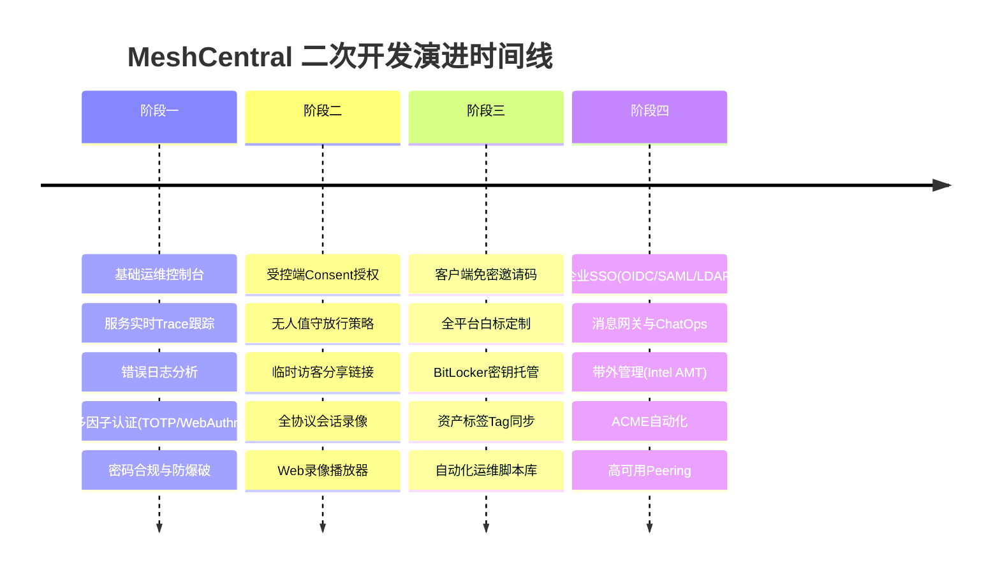

# MeshCentral 二次开发功能实施计划与演进路线

本目录根据 [docs/meshcentral/meshcentral-config-schema.json](docs/meshcentral/meshcentral-config-schema.json) 的原生配置能力定义与差距分析结果，制定 MeshCentral 二次开发的详细演进计划。

工程将按照“**运维管理闭环与账号安全 → 受控端知情同意与审计闭环 → 资产部署与端点治理 → 企业级集成与高级协议**”四个阶段有序推进。

---

## 阶段演进概览

---

## 各阶段计划文档索引

1. **[阶段一：运维管理闭环与账号安全](01-operations-and-account-security.md)**
   - 目标：补齐控制台管理盲区，建立完整的服务端可观测运维通道与账户多因子安全防线。
   - 核心任务：服务器控制台（Console）、协议跟踪（Trace）、服务错误日志（ErrorLog）、TOTP/WebAuthn 二次验证、密码强度与防暴力破解策略。

2. **[阶段二：受控端知情同意、访客共享与会话录制](02-consent-sharing-and-recording.md)**
   - 目标：解决远程控制中的安全合规、用户隐私保护与事后追溯审计诉求。
   - 核心任务：桌面/终端/文件操作前受控端授权弹窗（Consent）、隐私提示条、无人值守自动放行规则、临时协助链接（Guest Sharing）、全协议会话录像落盘、索引建立与 Web 画布播放器。

3. **[阶段三：客户端部署、白标定制与端点治理](03-agent-deployment-and-endpoint-governance.md)**
   - 目标：打造企业级客户端分发安装中心与自动化端点资产运维能力。
   - 核心任务：设备组免密邀请码与一键下载链接、Windows PE 及多平台安装器白标定制、代码签名锁定、BitLocker 恢复密钥抓取与托管、基于 `meshagent.tag` 的资产标签同步、预设运维脚本库（Preconfigured Scripts）。

4. **[阶段四：企业级集成、高级协议与高可用架构](04-enterprise-integrations-and-advanced-protocols.md)**
   - 目标：满足大型组织与跨平台混合环境的系统集成、带外管理与高可用容灾。
   - 核心任务：企业 SSO（OIDC、SAML、LDAP/AD）统一认证源、告警通知网关（邮件/SMS/Telegram/Discord/Webhook）、Intel AMT/CIRA 带外网络激活与控制、Let's Encrypt 证书自动化、Peers 集群负载协同与多域（Multi-Domain）配额治理。

---

## 跨阶段核心架构规范

所有阶段的开发均必须遵循当前 Monorepo 的分层解耦规范：

1. **底层 SDK 层**：在 [packages/control-client](packages/control-client) 中封装标准协议 Action、Normalizer 解析器及强类型定义，严禁引入 React 或 UI 框架依赖。
2. **状态绑定层**：在 [packages/shared-state](packages/shared-state) 中通过 Zustand 管理数据流与会话生命周期，提供标准化 React Hook。
3. **前端呈现层**：在 [apps/web](apps/web) 中遵循 Ant Design 设计规范，按能力（Capability）进行路由守护与鉴权展示。
4. **移动端适配**：在 [apps/app](apps/app) 复用核心状态逻辑，针对移动设备交互特性提供精简的管理与协助界面。
