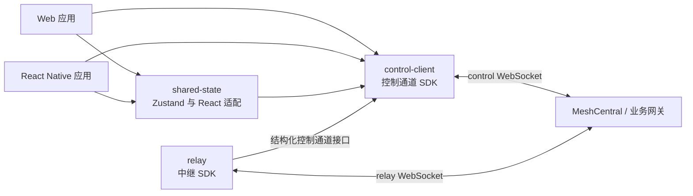
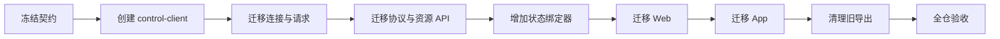

# Control Client 拆包计划

本计划以“方案一：控制客户端包 + Zustand 状态包”为实现目标，将现有 `@meshcentral/shared-state` 中的 WebSocket 控制通道能力拆到独立的 `@meshcentral/control-client`，并让状态包通过订阅和方法返回值消费客户端数据。

## 文档导航

1. [00-goals-and-scope.md](00-goals-and-scope.md)：目标、范围、约束和成功标准。
2. [01-target-architecture.md](01-target-architecture.md)：目标架构、职责边界、对外契约和关键策略。
3. [02-implementation-steps.md](02-implementation-steps.md)：分阶段实施步骤、迁移顺序和阶段产物。
4. [03-validation-risks-and-results.md](03-validation-risks-and-results.md)：验收、测试、风险、回滚和最终结果。
5. [04-completion-report.md](04-completion-report.md)：实际变更、最终公共 API、验证结果和已知限制。

## 一句话目标

> 把连接、鉴权、心跳、重连、请求关联、协议解析和资源方法放进无 React、无 Zustand 的控制客户端包；把设备、分组、事件和用户缓存继续留在状态包。

## 实施状态

- [x] 创建 `@meshcentral/control-client` 包；
- [x] 迁移连接、鉴权、心跳、重连和请求关联；
- [x] 迁移协议标准化与实时事件分发；
- [x] 实现 devices、groups、events 和 raw API；
- [x] 增加 Client-Store Binding；
- [x] 迁移 Web 与 React Native Provider；
- [x] 删除 shared-state 中的旧 Client、协议适配器和 Mutation 边界；
- [x] 完成全仓自动化验证；人工冒烟需要实际网关环境。

## 最终依赖方向

依赖约束：

- `@meshcentral/control-client` 不得依赖 `@meshcentral/shared-state`、Zustand 或 React。
- `@meshcentral/shared-state` 可以依赖 `@meshcentral/control-client`。
- `@meshcentral/relay` 继续只依赖结构化控制通道能力，不访问客户端内部 WebSocket。
- Web 与 App 可以同时使用状态包和控制客户端类型。

## 推荐执行顺序

迁移过程中优先保持行为不变，再增加新的资源方法，避免“拆包”和“业务功能扩展”同时造成过大的回归范围。
