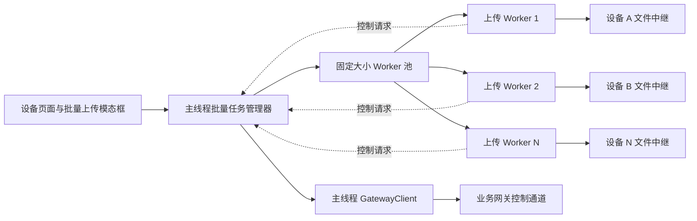
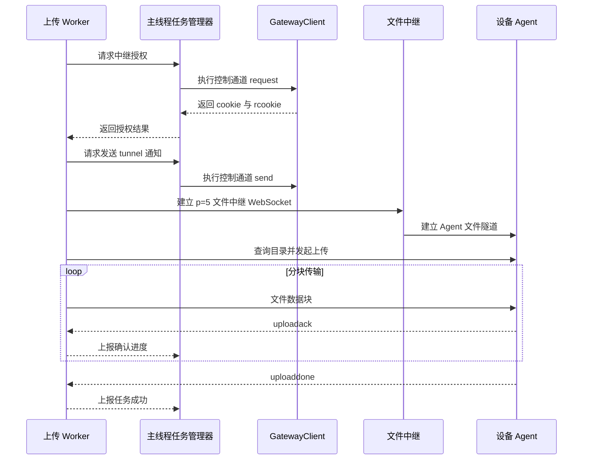

# Web 端批量文件上传架构与实施计划

## 1. 文档目的

本文档定义 Web 端“批量上传文件到设备”功能的架构、交互、任务模型、Worker 调度、通信方式、错误处理和实施步骤。

本文档只描述设计和实现方案，不包含具体代码。

## 2. 背景与目标

设备页面目前具备以下基础能力：

- 展示设备及在线状态。
- 通过表格复选框选择设备。
- 对单台在线设备建立文件中继连接并上传文件。
- 通过 `@meshcentral/relay` 创建 `p=5` 文件中继会话。
- 按块读取浏览器文件，根据 Agent 的确认消息更新上传进度。
- 支持上传取消、无活动超时和连接中断处理。

本次功能需要在“添加设备”按钮旁增加“批量上传文件”入口，允许用户：

1. 从设备表格中选择多台目标设备。
2. 选择一个本地文件。
3. 输入远端目标目录和目标文件名。
4. 选择同名文件处理策略。
5. 限制同时执行上传的设备数量。
6. 查看每台设备的排队、连接、上传、成功、失败和取消状态。
7. 取消单台设备任务或取消整个批量任务。
8. 对失败设备进行重试。

## 3. 设计结论

该方案可行，推荐采用以下总体结构：

- React 主线程负责界面、设备选择、任务状态和调度控制。
- 使用固定大小的 Web Worker 池，而不是为每台设备创建一个 Worker。
- 每个 Worker 同一时间只处理一台设备，完成后继续处理队列中的下一台设备。
- 文件中继 WebSocket、`RelayClient`、`RelaySession` 和 `FilesSession` 在 Worker 内创建和使用。
- 现有业务网关控制连接继续保留在主线程，由 Worker 通过消息 RPC 请求主线程执行控制通道的 `request` 和 `send`。
- 每台设备拥有独立文件中继连接和独立上传状态。
- 并发数同时约束活动 Worker 数量和活动文件中继连接数量。
- 第一版不实现离线排队和跨页面刷新恢复。

## 4. 范围与非目标

### 4.1 第一版范围

- 对当前勾选的多台设备上传同一个本地文件。
- 仅立即执行在线设备的上传任务。
- 支持 Windows、Linux 和 macOS 目标目录输入。
- 支持配置目标文件名。
- 支持“同名时跳过”和“同名时覆盖”策略，但覆盖能力必须先验证 Agent 行为。
- 支持固定并发上传。
- 支持每台设备独立进度和结果展示。
- 支持单任务取消、全部取消和失败项重试。
- 模态框关闭前明确处理正在运行的任务。

### 4.2 第一版不包含

- 向离线设备持久化排队并等待上线。
- 浏览器刷新后的任务恢复。
- 断点续传。
- 多文件或目录批量上传。
- 服务端后台任务。
- 多浏览器实例之间同步任务。
- 上传结果长期保存和审计报表。
- 在不同操作系统上自动转换任意远端目录。

## 5. 用户交互设计

### 5.1 设备选择

设备表格的复选框改为受控选择状态。页面保存选中的设备 ID，并根据当前设备快照得到对应设备信息。

选择规则：

- 允许用户勾选在线和离线设备，以便清楚看到离线设备为何未执行。
- 打开批量上传模态框时，对选中设备生成不可变的任务快照。
- 模态框打开后，设备表格选择变化不影响当前批次。
- 当前批次中的设备名称、ID、平台和初始在线状态均以创建任务时为准。

### 5.2 页面入口

在“添加设备”按钮旁增加“批量上传文件”按钮。

按钮状态：

- 没有选择设备时禁用。
- 网关未连接时禁用。
- 按钮显示选中设备数量，例如“批量上传文件（12）”。
- 若当前已有批量上传任务，可以改为“查看上传任务”，避免创建相互冲突的第二个任务管理器。

### 5.3 配置区域

批量上传模态框顶部提供以下字段：

| 字段 | 设计说明 |
| --- | --- |
| 本地文件 | 单文件选择，展示文件名、大小和 MIME 类型 |
| 目标目录 | 必填，如 `C:\Temp` 或 `/tmp` |
| 目标文件名 | 默认使用本地文件名，允许修改 |
| 同名文件策略 | “跳过”或“覆盖” |
| 最大并发数 | 默认 4，允许范围 1～8 |
| 离线设备策略 | 第一版固定为“跳过并记录” |

目标位置建议拆分为“目标目录”和“目标文件名”，不要只提供一个完整路径输入框。当前文件协议本身也是分别传递目录和文件名，拆分后更容易验证路径合法性，也可以避免 Windows 和 POSIX 路径分隔符解析错误。

### 5.4 兼容性提示

当选中设备包含多个平台时，模态框应显示提示：

- 目标目录必须在所有目标设备上有效。
- Windows 路径通常使用盘符和反斜杠。
- Linux/macOS 路径通常使用绝对 POSIX 路径。
- 第一版不会根据设备平台自动转换用户输入的路径。

后续可以增加按平台配置目标目录，但不建议纳入第一版。

### 5.5 启动确认

点击“开始上传”前展示摘要：

- 目标设备总数。
- 在线设备数量。
- 离线设备数量。
- 文件名称和大小。
- 目标目录和文件名。
- 同名文件策略。
- 最大并发数。

如果存在离线设备，应明确告知这些设备会被跳过，而不是在上传结束后才显示失败。

### 5.6 进度区域

任务启动后，配置区域进入只读状态，主体展示设备任务表格。

建议列：

| 列 | 内容 |
| --- | --- |
| 设备 | 设备名称和设备 ID |
| 平台 | Windows、Linux、macOS 或未知 |
| 状态 | 等待、连接中、检查中、上传中、成功、跳过、失败、取消中、已取消 |
| 进度 | 百分比进度条 |
| 已传输 | Agent 已确认字节数 / 文件总字节数 |
| 耗时 | 从任务开始到当前或结束的耗时 |
| 详情 | 错误原因或跳过原因 |
| 操作 | 取消、重试 |

顶部同时显示批次汇总：

- 总设备数。
- 等待数。
- 执行中数量。
- 成功数。
- 跳过数。
- 失败数。
- 已取消数。
- 总体进度。

总体进度按所有需要上传的设备的确认字节数加权计算。离线跳过和同名跳过的设备不进入总字节分母。这样总进度反映实际需要传输的数据量，而不是简单平均任务状态。

## 6. 分层架构

### 6.1 页面集成层

职责：

- 管理设备表格的受控选择。
- 打开批量上传模态框。
- 将设备快照、业务网关客户端和中继基础地址交给批量上传功能。
- 在页面卸载时通知任务管理器进行生命周期处理。

页面不应直接维护 Worker、上传连接或上传队列的细节。

### 6.2 批量上传模态框

职责：

- 收集和验证上传配置。
- 显示任务汇总和设备进度。
- 提供开始、取消、重试和关闭操作。
- 将用户操作委托给批量任务管理器。

模态框不直接创建中继会话。这样可以避免 UI 重渲染或关闭动画影响底层任务。

### 6.3 批量任务管理器

批量任务管理器运行在主线程，是整个功能的业务核心。

职责：

- 创建批次和设备任务快照。
- 校验并发数并创建 Worker 池。
- 维护等待队列、运行集合和终态集合。
- 把任务分配给空闲 Worker。
- 接收 Worker 状态和进度事件。
- 合并高频进度更新并通知 React。
- 转发 Worker 的控制通道请求。
- 处理单任务取消、全部取消和重试。
- 回收 Worker 和未完成的控制 RPC。
- 保证活动任务数永远不超过并发上限。

任务管理器应是独立于 React 的 TypeScript 模块。React 通过订阅快照读取任务状态，避免把调度逻辑放进组件生命周期。

### 6.4 Worker 池

Worker 池由固定数量的 Worker 组成。

设计原则：

- Worker 数量不随设备总数增长。
- 一个 Worker 同时只执行一个设备任务。
- Worker 完成任务后回到空闲状态并领取下一项。
- Worker 异常退出后，管理器负责标记当前任务并补充 Worker。
- 所有任务结束后销毁整个 Worker 池。

每个 Worker 在单个任务内负责：

1. 获取任务配置。
2. 通过主线程 RPC 获取中继授权。
3. 通知 Agent 建立文件隧道。
4. 在 Worker 内创建文件中继 WebSocket。
5. 创建文件协议会话。
6. 检查目标目录和同名文件。
7. 分块读取 `File` 并上传。
8. 上报连接状态、上传进度和最终结果。
9. 关闭文件会话和中继连接。
10. 回到空闲状态。

### 6.5 中继协议层

继续复用 `@meshcentral/relay`：

- `RelayClient` 负责申请中继授权、通知 Agent 并建立中继连接。
- `RelaySession` 负责通用中继生命周期。
- `FilesSession` 负责文件目录读取、上传消息、分块传输、ACK 进度、超时和取消。
- `browserFileSource` 或等价的浏览器文件源负责按区间读取 `File`，不会一次性把完整文件加载到内存。

批量功能不重复实现文件协议，也不直接处理二进制 ACK 状态机。

## 7. 为什么不直接把 GatewayClient 传给 Worker

现有 `GatewayClient` 包含类实例、状态和 WebSocket，不能通过浏览器结构化克隆直接传递给 Worker。WebSocket 也不是可转移对象。

不建议每个 Worker 独立创建完整业务网关控制连接，原因包括：

- 会重复建立认证连接。
- 可能重复接收设备快照和事件。
- 增加网关连接数量和服务端压力。
- 可能产生控制状态不一致。
- 扩大凭据暴露范围。

因此采用主线程控制通道桥接：

- Worker 需要调用控制通道 `request` 时，发送 RPC 消息给主线程。
- 主线程调用现有 `GatewayClient.request`，再把结果或错误返回 Worker。
- Worker 需要调用控制通道 `send` 时，将消息交给主线程转发。
- 文件中继 WebSocket 仍由 Worker 直接创建，避免大文件传输经过 React 主线程。

## 8. Worker 数量与并发约束

### 8.1 默认值和硬上限

建议：

- 默认并发数：4。
- 最低并发数：1。
- 用户可选上限：8。
- 应用硬上限：8。

实际 Worker 数量取以下值中的最小值：

- 用户选择的并发数。
- 在线且需要执行的设备数量。
- 应用配置的硬上限。

无论选中多少设备，都不能超过硬上限。

### 8.2 与硬件并发数的关系

可以参考浏览器提供的逻辑处理器数量生成默认建议，但不能直接把逻辑处理器数量作为 Worker 上限。

文件上传主要受以下因素限制：

- 中继 WebSocket 数量。
- 浏览器网络资源。
- 服务端中继能力。
- 设备网络质量。
- Agent 文件写入速度。

因此 Worker 数量必须保留独立的应用硬上限，并通过实际环境压测调整。

### 8.3 Worker 复用

例如需要上传 100 台设备，并发数为 4：

- 只创建 4 个 Worker。
- 前 4 台设备开始上传。
- 任意任务结束后，对应 Worker 领取下一台设备。
- 最多同时存在 4 条活动文件中继连接。
- 所有任务结束后销毁 4 个 Worker。

## 9. 任务模型

### 9.1 批次状态

批次状态建议包含：

- 配置中。
- 准备中。
- 运行中。
- 正在取消。
- 已完成。
- 已取消。
- 异常终止。

批次完成表示所有设备任务都进入终态，不代表所有设备都上传成功。

### 9.2 设备任务状态

每台设备任务的状态建议包含：

- `queued`：等待 Worker。
- `connecting`：申请授权并建立中继连接。
- `checking`：读取目标目录并检查同名文件。
- `uploading`：文件上传中。
- `success`：远端确认上传完成。
- `skipped`：离线或根据同名策略跳过。
- `failed`：连接、协议、路径、权限、超时或其他错误。
- `cancelling`：已请求取消，等待清理。
- `cancelled`：任务已取消并清理完成。

### 9.3 设备任务数据

每台任务至少保存：

- 批次 ID。
- 任务 ID。
- 设备 ID。
- 设备名称。
- 平台信息。
- 创建任务时的在线状态。
- 当前任务状态。
- Agent 已确认字节数。
- 已发送字节数。
- 文件总字节数。
- 百分比。
- 开始时间。
- 完成时间。
- 错误代码。
- 用户可读错误信息。
- 重试次数。
- 当前 Worker 标识。

任务状态必须由任务管理器统一修改，避免 UI 和 Worker 同时直接写入造成竞态。

## 10. 主线程与 Worker 通信协议

通信消息应使用可序列化的判别联合结构，并进行运行时校验。

### 10.1 主线程发送的消息类别

- 执行设备上传任务。
- 取消指定任务。
- 关闭 Worker。
- 返回控制通道请求结果。
- 返回控制通道请求错误。

上传任务消息包含：

- 任务和设备标识。
- 文件对象。
- 目标目录。
- 目标文件名。
- 同名文件策略。
- 中继基础地址。
- 超时和分块配置。

### 10.2 Worker 返回的消息类别

- 请求执行控制通道 `request`。
- 请求执行控制通道 `send`。
- 上报任务状态变化。
- 上报上传进度。
- 上报任务完成。
- 上报任务失败。
- 上报任务取消完成。
- 上报 Worker 内部异常。

### 10.3 RPC 关联

每个 Worker 控制请求必须包含唯一请求 ID。主线程维护待响应请求表，返回时同时携带：

- Worker 标识。
- 请求 ID。
- 成功结果或错误信息。

Worker 被销毁、任务取消或网关断开时，相关待响应 RPC 必须立即失败，不能一直等待超时。

### 10.4 进度节流

底层协议可能在每次状态变化和 ACK 时产生进度更新。为了避免频繁触发 React 渲染：

- Worker 可以按 100～200 毫秒节流上报。
- `completed`、`failed` 和 `cancelled` 等终态事件不节流。
- 主线程可以在动画帧或固定时间窗口内合并多个设备更新。
- UI 应更新变化的任务，不重新构造所有任务对象。

## 11. 文件传输与内存设计

浏览器 `File` 可以通过结构化克隆传递给 Worker。浏览器底层通常仍引用同一文件数据，不应主动把整个文件转换成 `ArrayBuffer` 后再传递。

上传必须保持流式分块读取：

- 每次只读取当前上传块。
- 等待 Agent 对当前块确认后再读取或发送下一块。
- 默认分块大小继续使用中继包的现有策略。
- 不在主线程复制每个上传块。
- 不为每台设备创建一份完整文件内存副本。

同一个 `File` 会被多个 Worker 独立读取。并发数限制也间接限制了同时进行的文件读取数量。

## 12. 路径和文件名校验

开始任务前在主线程做基础校验，Worker 内和协议层仍保留最终校验。

### 12.1 目标目录

- 不能为空，除非明确支持设备文件根目录。
- 禁止空字节。
- 禁止不安全的相对父目录跳转。
- Windows 盘符路径和 POSIX 绝对路径分别处理。
- 不对未知设备平台自动改写路径。

### 12.2 目标文件名

- 默认使用本地文件名。
- 必须是单个安全路径段。
- 不能包含 `/` 或 `\`。
- 不能是 `.` 或 `..`。
- 不能包含空字节。
- 应限制合理长度，并在界面提示非法原因。

### 12.3 混合平台

如果设备平台不一致，第一版只发出警告，不自动拆分任务。后续版本可扩展为：

- 按 Windows、Linux、macOS 分别设置目标目录。
- 在任务生成时按平台选择对应目录。
- 未配置的平台任务直接跳过。

## 13. 同名文件与覆盖策略

### 13.1 当前能力限制

当前文件上传协议消息主要包含目标目录、文件名、文件大小和请求 ID，没有明确的 `overwrite` 字段。现有协议封装也没有独立的覆盖选项。

因此“是否覆盖原文件”不能只作为界面布尔值处理，必须结合当前 MeshCentral Agent 的实际行为进行验证。

### 13.2 跳过策略

“同名时跳过”可以可靠实现：

1. Worker 建立文件中继连接。
2. 读取目标目录。
3. 查找同名文件。
4. 如果存在，则将任务标记为 `skipped`。
5. 如果不存在，则开始上传。

目录检查和上传必须在同一个设备文件会话中连续完成，以减少状态变化窗口。

### 13.3 覆盖策略

实施前需要验证目标 Agent 版本：

- 同名上传是否直接替换原文件。
- 是否返回冲突错误。
- 是否写入临时文件。
- 上传中断时是否破坏已有文件。
- Windows 和 POSIX Agent 行为是否一致。

如果 Agent 原生保证安全替换，则“覆盖”可以直接执行同名上传。

如果 Agent 不支持可靠替换，则需要先扩展文件协议层，支持删除和重命名，采用更安全的临时文件替换流程：

1. 上传到同目录下的唯一临时文件名。
2. 等待远端确认上传完成。
3. 删除或替换原目标文件。
4. 将临时文件重命名为目标文件。
5. 失败时清理临时文件。

在删除和重命名能力完成且经过验证之前，产品界面不应承诺“强制覆盖”。第一版可以：

- 默认提供“同名时跳过”。
- 将“覆盖”标记为实验能力，仅在验证通过后启用。
- 或暂时隐藏覆盖选项，避免产生数据损坏风险。

### 13.4 竞态说明

即使上传前目录检查未发现同名文件，检查完成后也可能有其他进程创建同名文件。因此最终行为仍以 Agent 的文件写入语义为准，前置检查不能提供严格的原子保证。

## 14. 任务执行流程

### 14.1 创建批次

1. 用户从设备表格选择设备。
2. 打开模态框并形成设备快照。
3. 用户选择文件并填写上传参数。
4. 主线程校验文件、路径、文件名和并发数。
5. 离线设备立即标记为 `skipped`。
6. 在线设备进入等待队列。
7. 根据有效任务数创建固定大小 Worker 池。

### 14.2 分配任务

1. 空闲 Worker 向管理器表示可接受任务，或由管理器主动分配。
2. 管理器从等待队列取出一项任务。
3. 任务状态变为 `connecting`。
4. Worker 接收设备和上传配置。
5. Worker 开始创建文件中继。

### 14.3 建立连接

1. Worker 通过 RPC 请求主线程执行中继授权请求。
2. 主线程调用现有业务网关控制连接。
3. 主线程返回授权信息。
4. Worker 请求主线程发送 Agent 隧道通知。
5. Worker 创建独立文件中继 WebSocket。
6. Worker 创建 `FilesSession`。

### 14.4 检查并上传

1. 任务状态变为 `checking`。
2. Worker读取目标目录。
3. 根据同名文件策略决定继续或跳过。
4. 任务状态变为 `uploading`。
5. Worker 分块读取本地文件。
6. 每收到 Agent ACK 后更新已确认字节数。
7. Worker 节流上报进度。
8. 收到远端完成确认后，任务标记为 `success`。

### 14.5 清理和继续调度

1. Worker 释放 `FilesSession`。
2. Worker 关闭中继会话和 WebSocket。
3. Worker 通知管理器任务已结束。
4. 管理器将 Worker 标记为空闲。
5. 若队列仍有任务，则分配下一项。
6. 所有任务进入终态后，批次标记为已完成。
7. 销毁 Worker 池并清理控制 RPC。

## 15. 取消与关闭设计

### 15.1 取消等待任务

等待中的任务尚未分配 Worker，可以直接从队列移除并标记为 `cancelled`。

### 15.2 取消运行任务

运行中的任务取消流程：

1. 主线程把任务标记为 `cancelling`。
2. 向对应 Worker 发送取消消息。
3. Worker 触发当前连接或文件操作的取消信号。
4. 文件协议尽力通知 Agent 取消上传。
5. Worker 关闭文件会话和中继连接。
6. Worker 返回取消完成事件。
7. 主线程把任务标记为 `cancelled`。

取消需要设置清理超时。如果 Worker 在限定时间内没有响应，主线程终止该 Worker，当前任务标记为取消或失败，并创建替代 Worker 继续处理剩余队列。

### 15.3 取消全部

1. 批次状态变为正在取消。
2. 清空等待队列并标记对应任务为已取消。
3. 向全部正在运行的 Worker 发送取消消息。
4. 等待正常清理。
5. 对超时 Worker 执行强制终止。
6. 清理全部控制 RPC。
7. 批次状态变为已取消。

### 15.4 关闭模态框

第一版如果任务只存在于模态框生命周期内，上传中点击关闭时必须显示确认：

- 返回任务列表。
- 取消全部并关闭。

不应允许用户直接关闭并使任务静默继续，因为用户将失去进度和取消入口。

更完善的后续方案是把批量任务管理器提升到应用级 Provider，使模态框关闭后任务可以后台继续，并在页面顶部或全局任务中心重新打开。

## 16. 错误处理

### 16.1 错误分类

建议统一为以下类别：

- 设备离线。
- 网关未连接。
- 中继授权失败。
- Agent 隧道通知失败。
- 中继连接失败。
- 中继握手超时。
- 目标目录不存在。
- 路径无效。
- 权限不足。
- 同名文件跳过。
- 上传无活动超时。
- 设备中途离线。
- 用户取消。
- Worker 异常。
- 未知协议错误。

UI 显示用户可读消息，同时保存结构化错误代码供重试策略和后续日志使用。

### 16.2 单设备失败隔离

任何单台设备失败都不能终止整个批次：

- 当前任务进入失败终态。
- Worker 完成资源清理。
- Worker 继续领取下一台设备。
- 批次最终汇总所有结果。

### 16.3 Worker 崩溃

Worker 出现未捕获错误或异常退出时：

1. 当前任务标记为 `failed`，错误类型为 Worker 异常。
2. 清理与该 Worker 关联的控制 RPC。
3. 终止异常 Worker。
4. 如果队列未结束，创建替代 Worker。
5. 第一版不自动重试当前任务，交由用户点击“重试失败项”。

避免自动无限重试造成重复上传或连接风暴。

### 16.4 网关断开

主线程发现业务网关断开时：

- 暂停向 Worker 分配新任务。
- 尚未开始的任务保留在等待队列或标记为失败，第一版建议标记失败并允许手动重试。
- 已建立文件中继的任务可能短时间继续，但若中继断开则按实际错误结束。
- 网关恢复后不静默自动重传，避免用户不知情地重复覆盖文件。

### 16.5 设备中途离线

设备中途离线时，文件中继通常会关闭。任务应：

- 标记为连接丢失或设备离线失败。
- 保留已确认字节数。
- 不自动断点续传。
- 允许用户在设备重新在线后重新开始完整上传。

## 17. 重试策略

第一版提供“重试失败项”：

- 只重新创建 `failed` 状态的任务。
- `skipped` 不默认重试，除非用户明确选择。
- 重试使用当前批次原始文件和上传配置。
- 重试任务重新进入等待队列。
- 每次重试重新建立文件中继连接。
- 重试次数显示在任务详情中。

如果本地 `File` 已不可访问、页面已刷新或浏览器回收了相关资源，应要求用户重新选择文件。

不建议默认自动重试上传，因为无法确定远端是否已写入部分内容，以及覆盖语义是否安全。

## 18. 状态持有与生命周期

### 18.1 第一版建议

第一版可以把批量任务管理器挂载在设备页面或批量上传功能容器中，但必须保证：

- 模态框内部普通重渲染不会销毁管理器。
- 上传过程中不能无提示卸载管理器。
- 页面离开或应用卸载前执行取消和资源清理。

### 18.2 后续全局任务中心

如果需要支持关闭模态框后继续上传，应将管理器提升到应用级：

- 全局只存在一个批量上传任务服务。
- 页面仅订阅任务状态。
- 顶部导航显示进行中任务数量。
- 用户可从任意页面重新打开任务详情。
- 路由切换不会终止 Worker。

即使采用全局任务中心，浏览器刷新后任务仍会中断；跨刷新恢复需要服务端后台任务，不属于纯前端 Worker 能力。

## 19. 安全设计

- Worker 不保存 MeshCentral 管理员凭据。
- Worker 只获得当前任务所需的中继地址、设备 ID、文件和短期授权结果。
- 业务网关控制连接和登录状态仍由主线程统一管理。
- 不把认证信息写入日志、错误详情或任务快照。
- 路径和文件名在主线程、Worker 和协议层进行分层校验。
- 覆盖操作必须明确提示可能替换远端文件。
- 文件内容只发送到用户选择的设备。
- 任务开始前再次展示设备数量和目标路径，降低误操作风险。
- 大批量或覆盖操作可增加二次确认。

## 20. 性能与资源控制

### 20.1 连接限制

并发数同时限制：

- Worker 数量。
- 活动文件中继 WebSocket 数量。
- 同时读取本地文件的任务数量。
- 同时申请中继授权的任务数量。

必要时还可以对“正在建立连接”的任务单独设置更低上限，避免瞬间向网关发送大量授权请求。

### 20.2 React 渲染

- 任务状态使用按任务 ID 索引的结构保存。
- 进度消息批量合并。
- 设备表格采用稳定行键。
- 大规模任务列表使用分页或虚拟滚动。
- 只更新变化的行，避免每次 ACK 重建完整任务数组。

### 20.3 大文件

- 保持按块读取，不转换完整文件。
- 不在主线程转发文件块。
- 进度以 Agent 已确认字节数为准。
- 超时按等待远端活动计算，不把整个大文件限制在固定总时长内。
- 所有结束路径都必须关闭 WebSocket 和释放监听器。

## 21. 可观测性与日志

建议为开发和问题定位记录以下非敏感信息：

- 批次 ID。
- 任务 ID。
- 设备 ID 的安全标识或截断值。
- Worker 标识。
- 状态变化时间。
- 连接耗时。
- 上传耗时。
- 文件大小。
- 最终确认字节数。
- 错误代码。
- 重试次数。

不得记录：

- 登录凭据。
- 中继认证 Cookie。
- 完整授权消息。
- 文件内容。
- 用户未明确允许的敏感路径信息。

第一版日志可以只存在浏览器开发日志；后续若需要审计，应由业务网关接收结构化任务结果。

## 22. 实施阶段

### 阶段一：协议和环境验证

目标是消除覆盖语义和并发连接的不确定性。

实施内容：

1. 在目标 MeshCentral 和 Agent 版本验证同名上传行为。
2. 验证 Windows、Linux 和 macOS 的目标目录规则。
3. 验证多个并发中继授权请求。
4. 验证业务网关是否允许主线程同时代理多个 Worker 控制请求。
5. 测试 1、2、4、8 个并发文件中继的稳定性。
6. 验证中断上传后远端文件状态。
7. 根据结果决定是否正式开放覆盖选项。

交付物：

- 协议验证记录。
- 推荐默认并发数和硬上限。
- 覆盖能力结论。

### 阶段二：任务模型和调度器设计

实施内容：

1. 定义批次状态和设备任务状态。
2. 定义任务快照和错误模型。
3. 定义等待队列、运行集合和终态集合。
4. 定义固定并发调度规则。
5. 定义取消、清理和重试状态转换。
6. 定义 React 订阅接口。

交付物：

- 独立于 UI 的任务管理器设计。
- 状态转换图。
- 调度和取消测试清单。

### 阶段三：Worker 通信与控制通道桥接

实施内容：

1. 定义主线程与 Worker 的消息协议。
2. 定义 Worker 控制请求 RPC。
3. 定义 RPC 超时、取消和 Worker 销毁处理。
4. 定义 Worker 生命周期和池复用方式。
5. 定义 Worker 异常替换策略。
6. 定义进度节流规则。

交付物：

- Worker 消息契约。
- 控制通道桥接设计。
- Worker 生命周期说明。

### 阶段四：单 Worker 上传流程

实施内容：

1. Worker 内建立文件中继会话。
2. Worker 内执行目录检查。
3. 根据同名策略跳过或上传。
4. 上报协议确认进度。
5. 支持任务取消和资源清理。
6. 将底层错误映射为统一任务错误。

交付物：

- 可由调度器驱动的单设备上传执行单元。
- 连接、上传、取消和失败验证结果。

### 阶段五：批量上传界面

实施内容：

1. 增加页面入口。
2. 将设备复选框改为受控选择。
3. 增加文件、路径、文件名、同名策略和并发配置。
4. 增加任务汇总和总体进度。
5. 增加设备级进度表格。
6. 增加取消单项、取消全部和重试失败项。
7. 增加上传中关闭确认。
8. 增加混合平台、离线设备和覆盖风险提示。

交付物：

- 完整批量上传交互。
- 可访问性和响应式检查结果。

### 阶段六：测试与调优

实施内容：

1. 验证并发上限不会被突破。
2. 验证大量设备时 Worker 数量固定。
3. 验证 Worker 能连续复用。
4. 验证高频进度不会阻塞页面。
5. 验证所有结束路径都释放连接。
6. 根据实际环境调整默认并发和超时。
7. 执行安全和误操作检查。

交付物：

- 自动化测试。
- 手工兼容性测试记录。
- 性能和并发建议。

## 23. 测试计划

### 23.1 调度测试

- 0 台、1 台和多台设备。
- 并发数小于、等于和大于设备数量。
- 用户输入超过硬上限时被限制。
- 100 台设备只创建固定数量 Worker。
- Worker 完成任务后正确领取下一项。
- 单台失败不影响其他设备。
- 所有任务结束后 Worker 全部销毁。

### 23.2 文件测试

- 空文件。
- 小文件。
- 大文件。
- 文件名包含空格和中文。
- 非法文件名。
- Windows 目标目录。
- POSIX 目标目录。
- 不存在目录。
- 无写入权限目录。
- 同名文件跳过。
- 同名文件覆盖。
- 上传过程中取消。
- 上传过程中设备断开。

### 23.3 网络和连接测试

- 网关未连接时禁止启动。
- 创建中继授权超时。
- Agent 不响应。
- 文件中继握手失败。
- 上传 ACK 超时。
- 网关上传期间断开。
- Worker 异常退出。
- 浏览器网络从在线变为离线。

### 23.4 UI 测试

- 未选择设备时按钮禁用。
- 离线设备提示准确。
- 混合平台提示准确。
- 进度和统计数量一致。
- 错误详情可见但不泄漏授权信息。
- 上传中关闭会触发确认。
- 失败任务可以重试。
- 取消后的状态不会重新变成上传中。
- 大量任务时列表仍可操作。

### 23.5 资源泄漏测试

- 成功后无遗留 Worker。
- 失败后无遗留 Worker。
- 取消后无遗留 Worker。
- 无遗留文件中继 WebSocket。
- 无遗留控制 RPC 定时器。
- 无遗留事件监听器。
- 重复打开和关闭模态框不会累积资源。

## 24. 验收标准

功能达到以下条件后可以验收：

1. 用户能够从设备页面选择多台设备并打开批量上传模态框。
2. 用户能够选择一个文件并设置目标目录、目标文件名和并发数。
3. 离线设备不会建立中继连接，并显示明确跳过原因。
4. Worker 数量和活动中继连接数量始终不超过配置上限。
5. 每台在线设备使用独立文件中继完成上传。
6. 页面能显示每台设备的状态、进度、已确认字节数和错误。
7. 单台失败不会中断其他任务。
8. 用户能够取消单台任务和全部任务。
9. 用户能够重试失败任务。
10. 所有任务结束后 Worker、WebSocket、监听器和定时器均被释放。
11. 同名“跳过”行为经过验证。
12. “覆盖”选项只有在目标 Agent 行为验证通过后才可启用。
13. 大文件上传不会把完整文件加载到主线程内存。
14. 页面在高频进度更新下保持可操作。

## 25. 风险与决策记录

| 风险 | 影响 | 应对措施 |
| --- | --- | --- |
| Agent 同名上传行为不明确 | 可能无法安全覆盖或损坏原文件 | 先完成协议验证；默认跳过；未验证前不开放正式覆盖 |
| Worker 不能直接使用现有 GatewayClient | 无法直接申请中继授权 | 使用主线程控制通道 RPC 桥接 |
| 过多 Worker 和 WebSocket | 浏览器、网关和服务端压力过高 | 固定 Worker 池，默认 4，硬上限 8 |
| 高频进度导致 UI 卡顿 | 大批量任务时页面不可操作 | Worker 和主线程双层节流、增量更新 |
| 页面关闭或刷新 | 前端任务丢失 | 第一版关闭时确认取消；跨刷新恢复需服务端任务 |
| 中途断开后远端文件状态未知 | 自动重试可能覆盖或污染文件 | 不自动重试，由用户确认后重试 |
| 混合操作系统路径不同 | 部分设备路径无效 | 提示风险；后续支持按平台配置路径 |
| 浏览器文件被重复并发读取 | 磁盘和内存压力 | 通过并发上限控制同时读取数量 |

## 26. 后续演进方向

第一版稳定后可以继续演进：

1. 应用级全局上传任务中心。
2. 关闭模态框后后台继续上传。
3. 按操作系统分别配置目标目录。
4. 支持多文件队列。
5. 支持目录上传和相对路径保持。
6. 支持服务端批量任务和跨刷新恢复。
7. 支持离线设备上线后执行。
8. 支持结果审计和任务历史。
9. 支持限速和动态并发调整。
10. 支持更安全的临时文件上传、校验和原子替换。
11. 支持文件哈希校验。
12. 支持断点续传，但需要协议端和 Agent 共同支持。

## 27. 最终推荐

建议第一版采用以下确定方案：

- 仅对当前选中设备创建批次。
- 离线设备立即跳过并显示原因。
- 默认并发 4，应用硬上限 8。
- 使用固定 Worker 池复用 Worker。
- Worker 内创建文件中继连接和执行文件上传。
- 主线程保留唯一业务网关控制连接，并通过 RPC 为 Worker 提供控制通道能力。
- 每台设备使用独立 `p=5` 文件会话。
- 进度以 Agent 已确认字节数为准。
- 默认同名策略为跳过。
- 覆盖能力必须在当前 MeshCentral Agent 版本验证后再启用。
- 第一版上传期间不允许无提示关闭任务界面。
- 不自动重试失败任务，由用户明确触发重试。
- 所有成功、失败和取消路径都必须释放 Worker、中继连接、RPC 和监听器。
