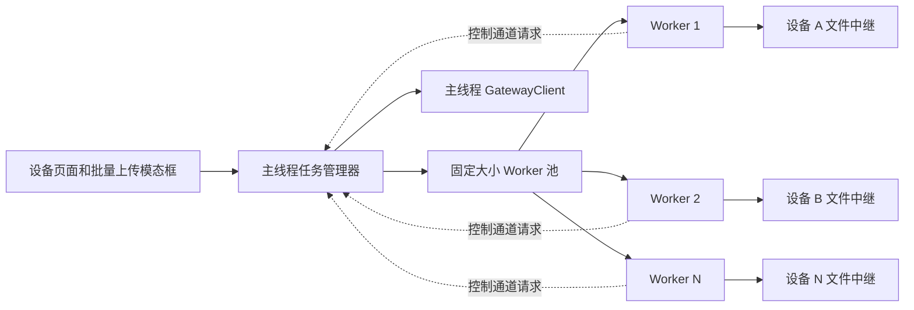
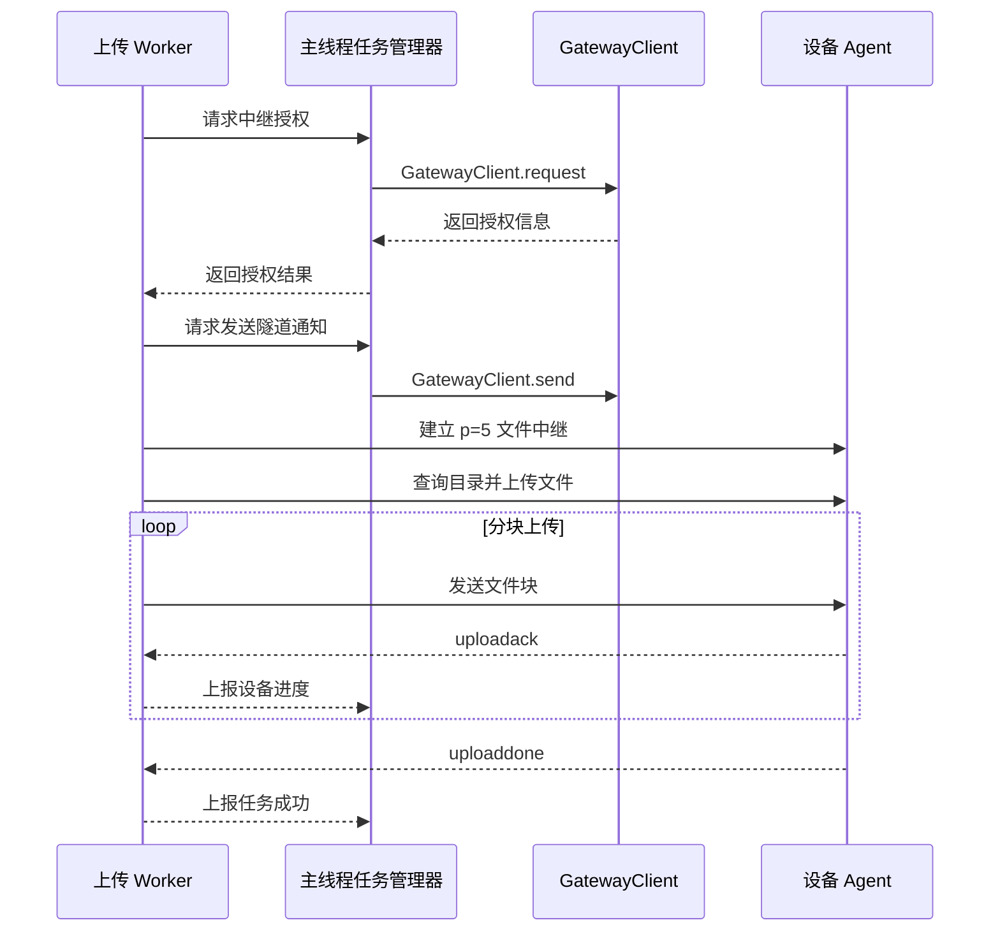

# Web 端批量文件上传实现计划

## 1. 实现目标

在设备页面的“添加设备”按钮旁增加“批量上传文件”按钮。

用户勾选多台设备后，可以：

1. 选择一个本地文件。
2. 输入远端目标目录。
3. 修改远端文件名。
4. 选择同名文件是否覆盖。
5. 设置最大并发上传数量。
6. 查看每台设备的连接状态、上传进度和最终结果。
7. 取消单台任务或全部任务。
8. 重试上传失败的设备。

批量上传必须限制同时创建的 Worker 和文件中继连接数量，避免设备数量较多时占用过多浏览器、网关和服务端资源。

## 2. 总体架构

采用“主线程任务管理器 + 固定大小 Worker 池 + 每台设备独立文件中继”的结构。

各层职责如下：

### 设备页面

- 管理设备表格的勾选状态。
- 打开批量上传模态框。
- 将选中设备、网关连接和中继地址交给任务管理器。
- 不直接创建 Worker 或文件中继连接。

### 批量上传模态框

- 收集文件、目标路径、文件名、覆盖策略和并发数。
- 显示设备任务列表和总体进度。
- 提供开始、取消和重试操作。
- 不直接执行上传协议。

### 主线程任务管理器

- 创建批量任务和设备任务快照。
- 管理等待队列、运行任务和已完成任务。
- 创建并维护固定大小 Worker 池。
- 将等待任务分配给空闲 Worker。
- 接收 Worker 上报的状态和进度。
- 通过现有 `GatewayClient` 代理 Worker 的控制通道请求。
- 处理取消、失败、重试和资源回收。
- 保证活动任务数量不超过并发上限。

### 上传 Worker

每个 Worker 同一时间只负责一台设备：

1. 申请文件中继授权。
2. 通知 Agent 建立文件隧道。
3. 创建独立文件中继 WebSocket。
4. 创建 `RelaySession` 和 `FilesSession`。
5. 检查目标目录和同名文件。
6. 分块读取本地文件并上传。
7. 上报连接状态、上传进度和最终结果。
8. 关闭文件会话和中继连接。
9. 完成后继续处理队列中的下一台设备。

### 中继协议层

继续复用 `@meshcentral/relay`：

- `RelayClient`：申请中继授权、通知 Agent、建立中继连接。
- `RelaySession`：管理通用中继生命周期。
- `FilesSession`：处理目录读取、分块上传、ACK、超时和取消。
- `browserFileSource`：按区间读取浏览器 `File`，避免一次性加载整个文件。

批量上传层不重复实现文件协议。

## 3. 页面交互

### 3.1 设备选择

将设备表格复选框改为受控状态，保存选中的设备 ID。

打开模态框时创建选中设备快照，包含：

- 设备 ID。
- 设备名称。
- 平台。
- 在线状态。

模态框打开后，设备表格选择变化不影响已经创建的批量任务。

### 3.2 批量上传按钮

在“添加设备”按钮旁增加“批量上传文件”按钮。

按钮规则：

- 没有选择设备时禁用。
- 网关未连接时禁用。
- 显示选中设备数量，例如“批量上传文件（12）”。
- 已存在上传任务时，按钮用于重新打开任务模态框，避免创建多个相互冲突的任务管理器。

### 3.3 上传配置

模态框提供以下配置：

| 字段 | 说明 |
| --- | --- |
| 本地文件 | 选择一个文件，显示文件名和大小 |
| 目标目录 | 例如 `C:\Temp` 或 `/tmp` |
| 目标文件名 | 默认使用本地文件名，允许修改 |
| 同名文件策略 | 跳过或覆盖 |
| 最大并发数 | 默认 4，允许 1～8 |

目标目录和文件名应分别输入，因为文件协议本身分别传递目录和文件名，也便于路径校验。

当选中的设备包含不同操作系统时，提示用户目标目录必须在所有设备上有效。系统不自动把 Windows 路径转换为 POSIX 路径，也不自动进行反向转换。

### 3.4 任务进度

任务启动后锁定上传配置，显示设备任务表格。

建议包含以下列：

| 列 | 内容 |
| --- | --- |
| 设备 | 设备名称和设备 ID |
| 平台 | Windows、Linux、macOS 或未知 |
| 状态 | 等待、连接中、检查中、上传中、成功、跳过、失败、取消中、已取消 |
| 进度 | 百分比进度条 |
| 已传输 | Agent 已确认字节数 / 文件总字节数 |
| 耗时 | 任务执行时间 |
| 详情 | 错误或跳过原因 |
| 操作 | 取消或重试 |

顶部显示：

- 总设备数。
- 等待数。
- 上传中数量。
- 成功数。
- 跳过数。
- 失败数。
- 已取消数。
- 总体进度。

总体进度按所有实际上传任务的 Agent 已确认字节数计算。离线跳过和同名跳过的设备不计入总字节数。

## 4. Worker 池和并发控制

Worker 数量不能按照设备数量创建，应使用固定大小 Worker 池。

建议约束：

- 默认并发数为 4。
- 最低并发数为 1。
- 最大并发数为 8。
- Worker 数量取用户并发数、在线任务数量和硬上限中的最小值。

例如有 100 台设备，并发数为 4：

- 只创建 4 个 Worker。
- 同时最多建立 4 条文件中继连接。
- 任意 Worker 完成当前设备后领取下一台设备。
- 所有任务完成后销毁 4 个 Worker。

并发数同时限制：

- Worker 数量。
- 活动文件中继 WebSocket 数量。
- 同时读取本地文件的数量。
- 同时申请中继授权的数量。

## 5. 主线程与 Worker 通信

现有 `GatewayClient` 包含 WebSocket 和运行状态，不能直接传递给 Worker。因此业务网关控制连接继续保留在主线程。

Worker 通过消息 RPC 使用控制通道：

1. Worker 发送控制请求和唯一请求 ID。
2. 主线程调用现有 `GatewayClient.request` 或 `GatewayClient.send`。
3. 主线程将结果或错误返回对应 Worker。
4. Worker 获得授权后自行创建文件中继 WebSocket。

主线程发送给 Worker 的消息需要包含：

- 执行任务。
- 取消任务。
- 关闭 Worker。
- 控制请求成功结果。
- 控制请求失败结果。

Worker 返回主线程的消息需要包含：

- 控制通道 `request` 请求。
- 控制通道 `send` 请求。
- 任务状态变化。
- 上传进度。
- 任务成功。
- 任务失败。
- 取消完成。
- Worker 内部异常。

每个 RPC 使用唯一请求 ID 关联。Worker 被销毁、任务取消或网关断开时，主线程立即结束相关 RPC，不能遗留等待请求。

## 6. 任务状态设计

批量任务包含以下状态：

- 配置中。
- 运行中。
- 正在取消。
- 已完成。
- 已取消。
- 异常终止。

每台设备任务包含以下状态：

- `queued`：等待 Worker。
- `connecting`：申请授权并建立中继。
- `checking`：检查目标目录和同名文件。
- `uploading`：上传中。
- `success`：上传完成。
- `skipped`：离线或同名文件被跳过。
- `failed`：连接、权限、路径、超时或协议错误。
- `cancelling`：正在取消。
- `cancelled`：已取消。

每台设备任务保存：

- 批量任务 ID。
- 设备任务 ID。
- 设备信息。
- 当前状态。
- 文件总字节数。
- 已发送字节数。
- Agent 已确认字节数。
- 百分比。
- 开始和完成时间。
- 错误代码和错误信息。
- 重试次数。
- 当前 Worker 标识。

所有状态由主线程任务管理器统一维护。Worker 只上报事件，不直接修改 UI 状态。

## 7. 上传执行步骤

### 步骤一：创建任务

1. 用户选择设备并打开模态框。
2. 用户选择文件并填写上传配置。
3. 校验文件、目标目录、文件名和并发数。
4. 为每台设备创建任务快照。
5. 离线设备标记为 `skipped`。
6. 在线设备进入等待队列。
7. 创建固定大小 Worker 池。

### 步骤二：分配任务

1. 主线程找到空闲 Worker。
2. 从等待队列取出一台设备。
3. 将任务状态改为 `connecting`。
4. 将文件、设备和上传配置发送给 Worker。

### 步骤三：建立文件中继

1. Worker 通过主线程 RPC 申请中继授权。
2. Worker 通过主线程通知 Agent 建立隧道。
3. Worker 创建独立文件中继 WebSocket。
4. Worker 创建 `RelaySession` 和 `FilesSession`。

### 步骤四：检查目标文件

1. 将任务状态改为 `checking`。
2. 读取远端目标目录。
3. 检查是否存在同名文件。
4. 根据同名文件策略决定跳过或继续上传。

### 步骤五：上传文件

1. 将任务状态改为 `uploading`。
2. 按块读取浏览器 `File`。
3. 发送一块数据后等待 Agent `uploadack`。
4. 收到确认后更新该设备的已确认字节数。
5. 继续发送下一块。
6. 收到远端 `uploaddone` 后标记成功。

### 步骤六：清理和继续调度

1. 释放 `FilesSession`。
2. 关闭中继会话和 WebSocket。
3. 将 Worker 标记为空闲。
4. Worker 继续领取下一台设备。
5. 所有任务结束后销毁 Worker 池。
6. 清理控制 RPC、监听器和定时器。

## 8. 文件路径和内存控制

### 8.1 文件读取

浏览器 `File` 可以传递给 Worker。上传时必须按块读取，不能先转换整个文件为 `ArrayBuffer`。

要求：

- 每次只读取当前数据块。
- 等待 Agent 确认后再继续。
- 文件块不经过 React 主线程转发。
- 不为每台设备创建完整文件副本。
- 通过并发数限制同时读取同一文件的 Worker 数量。

### 8.2 目标目录校验

- 禁止空字节。
- 禁止不安全的相对父目录跳转。
- 区分 Windows 和 POSIX 路径。
- 不自动修改用户输入的路径。
- 目录不存在或无权限时，将对应设备任务标记为失败。

### 8.3 文件名校验

- 默认使用本地文件名。
- 必须是单个路径段。
- 禁止包含 `/` 或 `\`。
- 禁止使用 `.` 或 `..`。
- 禁止空字节。
- 非法输入应在启动上传前提示。

## 9. 同名文件和覆盖

当前上传协议没有明确的 `overwrite` 字段，因此需要验证当前 MeshCentral Agent 对同名文件上传的实际行为。

### 跳过

跳过策略直接通过目录检查实现：

1. 读取目标目录。
2. 查找同名文件。
3. 存在同名文件时将任务标记为 `skipped`。
4. 不发送文件内容。

### 覆盖

需要验证：

- 同名上传是否直接替换原文件。
- 是否返回冲突错误。
- 上传中断是否会破坏原文件。
- Windows 和 POSIX Agent 行为是否一致。

如果 Agent 支持可靠替换，则覆盖时直接上传同名文件。

如果 Agent 不支持可靠替换，需要扩展文件协议层，增加删除和重命名能力，采用临时文件替换：

1. 上传到唯一临时文件。
2. 等待上传完成。
3. 删除或替换原文件。
4. 将临时文件重命名为目标文件。
5. 失败时清理临时文件。

覆盖行为未验证前，不应在界面承诺安全覆盖。默认策略应为“同名时跳过”。

## 10. 进度更新

上传进度以 Agent 已确认字节数为准，而不是浏览器已发送字节数。

为了避免大量设备频繁更新导致页面卡顿：

- Worker 每 100～200 毫秒合并一次普通进度消息。
- 成功、失败和取消等最终状态立即上报。
- 主线程批量合并同一时间窗口内的多个设备更新。
- UI 只更新发生变化的任务行。
- 设备数量较多时使用分页或虚拟滚动。

## 11. 取消和重试

### 11.1 取消等待任务

等待中的任务直接从队列移除并标记为 `cancelled`。

### 11.2 取消运行任务

1. 主线程将任务改为 `cancelling`。
2. 向对应 Worker 发送取消消息。
3. Worker 取消当前文件操作和中继连接。
4. 文件协议尽力通知 Agent 取消上传。
5. Worker 清理连接并上报取消完成。
6. 主线程将任务改为 `cancelled`。

如果 Worker 未在清理超时内响应，主线程终止 Worker，并创建替代 Worker 处理剩余队列。

### 11.3 取消全部

1. 停止分配新任务。
2. 清空等待队列。
3. 取消全部运行任务。
4. 等待 Worker 清理。
5. 强制终止未响应 Worker。
6. 清理全部连接、RPC、监听器和定时器。

### 11.4 重试失败任务

- 只重试 `failed` 状态的任务。
- 使用原文件和原上传配置重新创建任务。
- 每次重试重新建立文件中继。
- 记录并显示重试次数。
- 不自动重试，避免在远端文件状态不明确时发生重复覆盖。

## 12. 错误处理

需要区分以下错误：

- 设备离线。
- 网关未连接。
- 中继授权失败。
- Agent 隧道通知失败。
- 文件中继连接或握手失败。
- 目标目录不存在。
- 路径无效。
- 权限不足。
- 上传无活动超时。
- 设备中途断开。
- 用户取消。
- Worker 异常。
- 未知协议错误。

处理规则：

- 单台设备失败不能中断整个批量任务。
- 失败任务保留已确认字节数和错误原因。
- Worker 完成错误清理后继续领取下一台设备。
- Worker 崩溃时终止该 Worker，标记当前任务失败，并创建替代 Worker。
- 网关断开时停止分配新任务，并将未开始任务标记为失败或等待用户重试。
- 不静默自动重新上传。

## 13. 模态框和任务生命周期

上传运行时关闭模态框必须进行确认：

- 返回任务列表。
- 取消全部并关闭。

不能直接关闭后让任务静默运行，因为用户会失去进度和取消入口。

任务管理器不能随着模态框普通重渲染而销毁。页面卸载或应用退出时，必须取消任务并释放：

- Worker。
- 文件中继 WebSocket。
- `FilesSession` 和 `RelaySession`。
- 控制 RPC。
- 事件监听器。
- 超时定时器。

如果需要关闭模态框后继续上传，应把任务管理器放到应用级 Provider，并提供全局任务入口。浏览器刷新仍会中断上传；跨刷新恢复只能通过服务端任务实现。

## 14. 安全和日志

安全要求：

- Worker 不保存 MeshCentral 管理凭据。
- 业务网关控制连接和登录状态由主线程统一管理。
- Worker 只接收当前任务所需的设备 ID、文件、中继地址和短期授权结果。
- 路径和文件名在主线程、Worker 和协议层分别校验。
- 覆盖操作需要明确提示风险。
- 启动前再次展示设备数量和目标路径。

可以记录以下非敏感信息：

- 批量任务 ID。
- 设备任务 ID。
- Worker 标识。
- 状态变化时间。
- 连接和上传耗时。
- 文件大小。
- 已确认字节数。
- 错误代码。
- 重试次数。

禁止记录：

- 登录凭据。
- 中继认证 Cookie。
- 完整授权消息。
- 文件内容。

## 15. 实施步骤

### 步骤一：验证协议行为

- 验证同名上传是否覆盖原文件。
- 验证上传中断后的远端文件状态。
- 验证 Windows、Linux 和 macOS 目标目录。
- 验证 1、2、4、8 个并发中继连接。
- 确定覆盖策略和最大并发数。

### 步骤二：定义任务模型

- 定义批量任务状态。
- 定义设备任务状态。
- 定义错误代码。
- 定义状态转换规则。
- 定义等待队列、运行任务和完成任务结构。

### 步骤三：实现主线程任务管理器

- 创建固定大小 Worker 池。
- 实现任务分配和 Worker 复用。
- 实现并发上限。
- 实现状态订阅和进度合并。
- 实现取消、重试和资源回收。

### 步骤四：实现 Worker 通信

- 定义主线程与 Worker 消息结构。
- 实现控制通道 RPC。
- 实现 RPC 请求关联、超时和取消。
- 实现 Worker 异常替换。
- 实现进度节流。

### 步骤五：实现 Worker 上传流程

- 创建文件中继连接。
- 创建文件协议会话。
- 检查目标目录和同名文件。
- 分块上传文件。
- 上报设备进度和结果。
- 处理取消、超时和连接中断。
- 释放所有连接和监听器。

### 步骤六：实现页面和模态框

- 将设备复选框改为受控状态。
- 增加批量上传按钮。
- 增加文件和目标路径配置。
- 增加并发数和同名策略配置。
- 增加设备任务表格和总体进度。
- 增加取消、全部取消和失败重试。
- 增加离线设备、混合平台和覆盖风险提示。

### 步骤七：测试和调优

- 验证 Worker 数量不会超过上限。
- 验证大量设备只使用固定 Worker 池。
- 验证单台失败不影响其他设备。
- 验证取消和重试。
- 验证大文件不会整体加载到内存。
- 验证高频进度下页面仍可操作。
- 验证成功、失败和取消后没有资源泄漏。
- 根据实际环境调整并发数、分块大小和超时。

## 16. 验收目标

1. 用户可以选择多台设备并启动批量文件上传。
2. 用户可以设置本地文件、目标目录、目标文件名、同名策略和并发数。
3. 离线设备不会建立中继，并显示跳过原因。
4. Worker 和活动文件中继连接数量始终不超过上限。
5. 每台在线设备使用独立文件中继上传。
6. 页面能够显示每台设备的状态、进度、已确认字节数和错误。
7. 单台设备失败不会中断其他设备。
8. 用户可以取消单台任务、取消全部任务和重试失败任务。
9. 文件采用分块读取和发送，不把完整文件加载到内存。
10. 所有任务结束后没有遗留 Worker、WebSocket、RPC、监听器或定时器。
11. 同名跳过行为可用。
12. 覆盖行为经过当前 Agent 环境验证后再启用。
