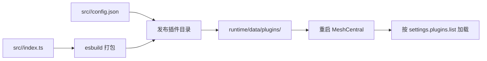

# MeshCentral TypeScript 插件开发指南

本文说明如何在 `@meshcentral/plugins` 包中开发、构建、加载和调试 MeshCentral 本地插件。

本插件库负责把 TypeScript 源码打包为 MeshCentral 可以直接加载的 CommonJS 文件。它适合随当前仓库一起开发和部署的可信插件，不用于运行来源不明的第三方代码。

## 1. 工作原理

插件从源码到运行时依次经过以下步骤：



构建脚本扫描 `src` 下的所有一级目录。每个一级目录都被视为一个独立插件，并要求包含：

```text
src/<shortName>/
  index.ts
  config.json
```

构建结果发布到：

```text
apps/meshcentral/runtime/data/plugins/<shortName>/
  <shortName>.js
  <shortName>.js.map
  config.json
```

当前 Docker Compose 会把 `apps/meshcentral/runtime/data` 挂载为容器内的 `/var/lib/meshcentral/data`。MeshCentral 因而可以从以下路径加载插件：

```text
/var/lib/meshcentral/data/plugins/<shortName>/<shortName>.js
```

## 2. 命名约束

同一个插件的下列名称必须完全一致：

| 位置 | 示例 |
| --- | --- |
| 源码目录 | `src/audit/` |
| `config.json` 的 `shortName` | `audit` |
| TypeScript 导出名称 | `export const audit` |
| 构建文件名 | `audit.js` |
| 运行时目录 | `plugins/audit/` |
| `settings.plugins.list` 条目 | `audit` |

`shortName` 建议只使用小写英文字母和数字，不使用空格、连字符或其他需要转义的字符。MeshCentral 使用该名称拼接目录、文件和 CommonJS 导出名称。

## 3. 创建插件

以下步骤创建名为 `audit` 的插件。

### 3.1 创建目录

```text
packages/meshcentral-plugins/src/audit/
  index.ts
  config.json
```

不要在 `src` 下创建与插件无关的目录。构建器会把每个一级目录都当作插件处理；共享代码应直接放在 `src` 根目录，或者放在插件目录内部。

### 3.2 编写插件入口

```typescript
import type { MeshCentralPluginFactory } from '../types.js';

export const audit: MeshCentralPluginFactory = (pluginHandler) => {
  return {
    exports: [],
    server_startup() {
      console.log('[audit] Plugin started');
    },
    serveraction(command, connection, user) {
      if (command.subAction !== 'ping') return;

      connection.send({
        action: 'plugin',
        plugin: 'audit',
        response: 'pong',
        username: user.name,
      });
    },
  };
};
```

入口必须使用具名导出，且导出名称必须等于 `shortName`。构建后的 CommonJS 模块需要满足：

```javascript
const pluginModule = require('./audit.js');
pluginModule.audit(pluginHandler);
```

不要使用默认导出，因为 MeshCentral 不会读取 `module.exports.default`。

### 3.3 编写插件配置

```json
{
  "name": "Audit Plugin",
  "shortName": "audit",
  "version": "0.1.0",
  "description": "Records selected MeshCentral events.",
  "author": "Your Team",
  "homepage": "https://github.com/your-org/your-repository",
  "changelogUrl": "https://github.com/your-org/your-repository/releases",
  "configUrl": "https://raw.githubusercontent.com/your-org/your-repository/main/packages/meshcentral-plugins/src/audit/config.json",
  "downloadUrl": "https://github.com/your-org/your-repository/archive/refs/heads/main.zip",
  "repository": {
    "type": "git",
    "url": "https://github.com/your-org/your-repository.git"
  },
  "meshCentralCompat": ">=1.1.54",
  "hasAdminPanel": false
}
```

本地白名单加载主要依赖目录、入口文件和导出名称，但仍应维护完整、有效的 `config.json`，以便后续接入 MeshCentral 插件管理功能。

不要沿用示例中的占位仓库地址。发布插件前，应将 URL 替换为真实且可访问的地址。

### 3.4 加入加载白名单

编辑 `deploy/config/meshcentral.example.json` 中的插件配置：

```json
{
  "settings": {
    "plugins": {
      "enabled": true,
      "list": ["testplugin", "audit"]
    }
  }
}
```

`list` 是本地插件的可信白名单。不要改成扫描目录后无条件加载全部插件，因为插件拥有与 MeshCentral 服务进程相同的权限。

如果实际启动时通过环境变量 `MESHCENTRAL_CONFIG_FILE` 指定了其他配置文件，也必须在该文件中加入同样的白名单条目。

## 4. 插件类型

共享类型定义位于 `src/types.ts`。

### `MeshCentralPluginFactory`

插件入口工厂接收 `pluginHandler`，返回插件对象：

```typescript
export type MeshCentralPluginFactory = (
  pluginHandler: MeshCentralPluginHandler,
) => MeshCentralPlugin;
```

### `MeshCentralPlugin`

当前类型覆盖了插件库已经使用和验证的最小能力：

| 成员 | 用途 |
| --- | --- |
| `exports` | 声明需要注入浏览器的函数名称 |
| `server_startup` | MeshCentral 启动完成后执行初始化逻辑 |
| `serveraction` | 处理浏览器通过插件通道发送的消息 |

MeshCentral 还支持更多 Hook。如果新插件需要新的 Hook，应先在 `src/types.ts` 中补充准确签名，再在插件中使用。不要通过 `any` 绕过尚未确认的参数结构。

### `pluginHandler.parent`

`pluginHandler.parent` 指向 MeshCentral 服务实例。当前类型只声明了已经预留的 `DispatchEvent` 和 `db`。使用数据库、Web 服务器或其他内部对象前，应依据固定的 MeshCentral 版本确认其真实接口，并把所需的最小类型补充到共享定义中。

这些对象属于 MeshCentral 内部 API，不具备与公开 npm API 相同的稳定性。升级 MeshCentral 后需要重新验证。

## 5. 前后端通信

浏览器可以通过 MeshCentral 控制连接向插件发送消息：

```javascript
meshserver.send({
  action: 'plugin',
  plugin: 'audit',
  subAction: 'ping'
});
```

服务端插件通过 `serveraction` 接收消息：

```typescript
serveraction(command, connection) {
  if (command.subAction !== 'ping') return;

  connection.send({
    action: 'plugin',
    plugin: 'audit',
    response: 'pong',
  });
}
```

处理消息时至少应做到：

1. 校验 `subAction` 和所有业务字段的类型。
2. 检查当前用户是否有权执行操作。
3. 不信任浏览器提供的用户 ID、设备 ID 或权限字段。
4. 返回稳定的响应结构和可识别的错误码。
5. 不在日志中输出密码、令牌、Cookie 或完整敏感载荷。

## 6. 浏览器导出函数

`exports` 中列出的函数会由 MeshCentral 转换为字符串并注入浏览器，而不是作为普通 JavaScript 模块在浏览器中加载。

例如：

```typescript
export const audit: MeshCentralPluginFactory = () => {
  return {
    exports: ['onWebUIStartupEnd'],
    onWebUIStartupEnd() {
      console.log('[audit] Web UI ready');
    },
  };
};
```

当前共享类型尚未声明 `onWebUIStartupEnd`，实际使用前应先扩展 `MeshCentralPlugin`。

浏览器导出函数必须遵守以下限制：

* 函数必须自包含，不能依赖服务端闭包变量。
* 不能访问 Node.js API，例如 `fs`、`path` 或 `process`。
* 不能依赖 esbuild 在模块作用域生成的辅助变量。
* 只能使用目标 MeshCentral 页面已经提供的浏览器全局对象。
* 函数参数和返回值应保持简单，避免依赖 TypeScript 类型擦除后的隐式行为。

需要复杂前端逻辑时，应先验证 MeshCentral 的注入方式，再决定是否拆成纯函数或独立静态资源。

## 7. 构建和加载

### 类型检查

```powershell
pnpm plugins:typecheck
```

### 构建插件

```powershell
pnpm plugins:build
```

构建器会为每个插件执行以下操作：

1. 创建 `<shortName>.tmp` 临时目录。
2. 使用 esbuild 将 `index.ts` 打包为 Node.js 22 CommonJS 单文件。
3. 生成 source map。
4. 复制 `config.json`。
5. 删除旧输出目录。
6. 将临时目录重命名为正式插件目录。

使用 `bundle: true` 可以把 npm 依赖打进插件文件，避免插件位于数据卷后无法沿目录找到 `/app/node_modules`。

### 构建并重启 MeshCentral

```powershell
pnpm dev:meshcentral:restart-with-plugins
```

该命令等价于：

```powershell
pnpm plugins:build
pnpm dev:meshcentral:restart
```

单独运行 `docker compose restart meshcentral` 不会重新编译 TypeScript。修改插件源码后，应使用组合命令，或者先手动运行 `pnpm plugins:build`。

## 8. 验证插件

### 检查容器状态

```powershell
pnpm dev:meshcentral:status
```

### 查看启动日志

```powershell
docker compose -f deploy/compose.meshcentral.yaml logs --since 2m meshcentral
```

包含 `server_startup` 的示例插件应出现类似日志：

```text
[audit] Plugin started
```

### 验证运行时文件

```powershell
docker compose -f deploy/compose.meshcentral.yaml exec -T meshcentral node -e "const plugin = require('/var/lib/meshcentral/data/plugins/audit/audit.js'); console.log(Object.keys(plugin))"
```

预期输出包含：

```text
[ 'audit' ]
```

## 9. 使用依赖和共享代码

插件可以导入当前 workspace 或 npm 包中的服务端代码：

```typescript
import { someUtility } from './some-utility.js';
```

esbuild 会把可打包依赖合并到插件输出中。开发时应注意：

* 不要把浏览器专用包导入服务端入口。
* 不要依赖安装脚本、原生二进制或运行时动态查找文件，除非已经验证容器环境。
* 使用 `__dirname`、动态 `require()` 或文件模板时，要确认打包后路径仍然成立。
* 多个插件共享代码时，可将共享模块放在 `src` 根目录，但不能放进新的一级目录。
* 插件之间不要直接引用彼此的运行时输出，应抽取共享模块或通过 MeshCentral 事件通信。

## 10. 当前构建边界

当前构建脚本只发布以下内容：

* esbuild 生成的 `<shortName>.js`。
* source map 文件。
* 插件的 `config.json`。

以下 MeshCentral 插件能力尚未接入构建脚本：

* `views/` 管理页面模板。
* `modules_meshcore/` Agent 端模块。
* 插件图片、样式表和其他静态资源。
* 独立的插件版本归档和下载包。

需要这些能力时，应修改 `scripts/build.ts`，显式复制对应目录，并为缺失文件、目标路径和覆盖行为增加验证。不要手工把未受构建器管理的文件放进运行时插件目录，因为下一次构建会删除并替换整个插件输出目录。

## 11. 安全要求

MeshCentral 插件运行在服务器进程内，可以访问数据库、会话、HTTP 路由和设备通信能力。插件代码应按服务器高权限代码审查。

最低要求如下：

* `settings.plugins.list` 只列出仓库内审查过的插件。
* 所有浏览器消息都进行结构校验和服务端权限检查。
* HTTP 路由必须复用 MeshCentral 的认证和授权上下文。
* 数据库记录使用稳定的插件前缀，避免与 MeshCentral 核心记录冲突。
* 定时器、Socket 和监听器在停用或重载时能够释放。
* 不把密钥写入源码、`config.json`、日志或浏览器导出函数。
* 升级 MeshCentral 版本后重新运行插件测试和人工验证。

## 12. 常见问题

### 重启后没有加载插件

依次检查：

1. `settings.plugins.enabled` 是否为 `true`。
2. `settings.plugins.list` 是否包含插件名称。
3. 实际启动使用的配置文件是否就是刚才修改的文件。
4. 容器内是否存在 `plugins/<shortName>/<shortName>.js`。
5. CommonJS 模块是否导出了同名工厂函数。
6. MeshCentral 日志中是否有 `Error loading plugin`。

### 构建提示找不到 `index.ts`

`src` 下存在不完整的一级目录。补齐该目录的 `index.ts` 和 `config.json`，或将非插件目录移出 `src` 一级目录。

### 修改源码后行为没有变化

只重启 MeshCentral 不会重新构建插件。运行：

```powershell
pnpm dev:meshcentral:restart-with-plugins
```

### 插件导入的依赖在容器中找不到

确认导入可以被 esbuild 静态分析并打包。动态 `require(variable)`、原生模块或运行时文件依赖可能无法自动打包，需要调整实现或部署额外资源。

### 前端导出函数报未定义变量

该函数引用了服务端模块作用域或闭包变量。将依赖改为函数内部可获得的浏览器全局对象，或把所需值通过消息显式传递。

## 13. 开发检查表

新增或修改插件后至少确认：

* 目录名、`shortName`、导出名和白名单名称完全一致。
* `config.json` 是合法 JSON，版本和兼容范围准确。
* 浏览器输入经过类型校验和权限检查。
* `exports` 中的函数不依赖服务端闭包和 Node.js API。
* 新使用的 MeshCentral Hook 已补充共享类型。
* 运行 `pnpm --filter @meshcentral/plugins lint`。
* 运行 `pnpm plugins:typecheck`。
* 运行 `pnpm plugins:build`。
* 使用 `pnpm dev:meshcentral:restart-with-plugins` 验证加载。
* 检查 MeshCentral 启动日志和容器健康状态。
