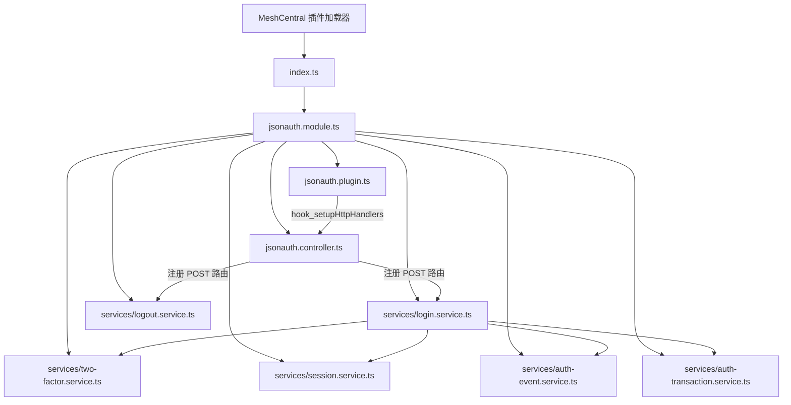
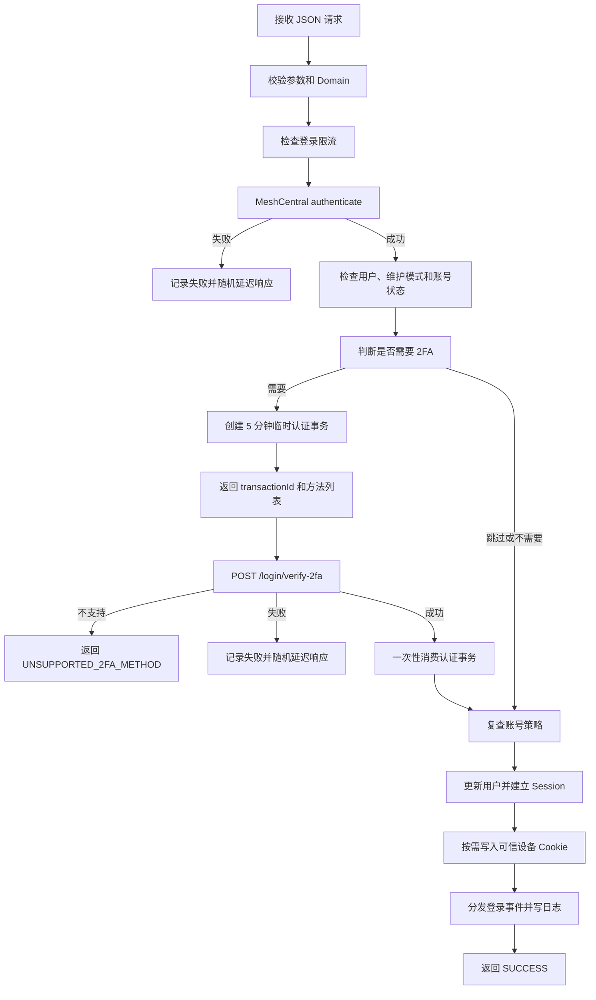

# JSON Authentication 插件实现说明

`jsonauth` 为本地 MeshCentral 账号提供 JSON 登录和退出接口。它复用 MeshCentral 原生的密码认证、登录限流、二阶段验证限流、Session、用户数据、事件总线和认证日志能力，不自行签发 JWT。

本文说明插件中每个文件的职责、文件之间的调用关系、HTTP 接口、认证流程和当前功能边界。

## 1. 功能概览

插件实现了以下能力：

- 为默认 Domain 和路径型 Domain 注册 JSON 登录接口。
- 校验用户名、密码、二阶段验证码和可信设备选项。
- 调用 MeshCentral 原生用户名密码认证。
- 复用 MeshCentral 原生登录与 2FA 防爆破限制。
- 支持 TOTP 和一次性备用恢复码。
- 使用 5 分钟、一次性临时认证事务衔接密码认证与 2FA。
- 支持可信设备 Cookie、可信 IP、Token 登录和全局配置跳过 2FA。
- 检查维护模式、密码过期和邮箱验证状态。
- 创建 MeshCentral 原生 Session。
- 可选写入可信设备 `twofactor` Cookie。
- 更新用户登录时间并持久化用户数据。
- 分发登录成功、密码失败和 2FA 失败事件。
- 写入 MeshCentral 认证日志。
- 通过 JSON 接口退出，废弃 Session 随机令牌、清除 Cookie，并分发退出事件。
- 对密码失败和 2FA 失败使用随机延迟，降低账号枚举和暴力尝试风险。

插件只处理本地用户名密码账号，不包装 LDAP、SSPI、OIDC 或 SAML 登录流程。

## 2. 文件结构

```text
jsonauth/
  config.json              # MeshCentral 插件元数据
  index.test.ts            # 登录流程和路由行为测试
  index.ts                 # 插件入口和公开 Handler 工厂
  jsonauth.controller.ts   # HTTP 路由注册
  jsonauth.module.ts       # 依赖创建与模块装配
  jsonauth.plugin.ts       # MeshCentral Hook 声明
  jsonauth.types.ts        # 插件内部类型
  services/
    auth-event.service.ts       # 认证成功与失败事件
    auth-transaction.service.ts # 临时认证事务存储与校验
    login.service.ts            # 登录主流程
    logout.service.ts           # 退出、Session 失效和 Cookie 清理
    session.service.ts          # Session 建立与清理
    two-factor.service.ts       # 2FA 检测、跳过和验证
```

## 3. 调用关系



运行时过程如下：

1. MeshCentral 调用 `index.ts` 导出的 `jsonauth` 工厂。
2. `jsonauth.module.ts` 创建 Service、Controller 和 Plugin 实例。
3. `jsonauth.plugin.ts` 将 `setupHttpHandlers()` 映射到 `hook_setupHttpHandlers`。
4. MeshCentral 执行该 Hook 时，Controller 注册登录和退出路由。
5. 密码请求进入登录 Handler，密码正确且需要 2FA 时创建临时事务。
6. 前端通过独立 2FA 接口提交事务 ID、验证方式和验证码。
7. `LoginService` 验证并消费事务，完成 Session、事件和日志流程。
8. 退出请求由 `LogoutService` 废弃 Session 随机令牌、记录事件并清理 Session Cookie。

## 4. 文件职责

### 4.1 `index.ts`

插件的对外入口，承担两项职责。

#### MeshCentral 插件工厂

```typescript
export const jsonauth = createPluginFactory(...);
```

`jsonauth` 的导出名称必须与目录名、`config.json.shortName` 和构建产物名称一致。公共 `createPluginFactory()` 会读取插件类上的装饰器元数据，生成 MeshCentral 可以加载的 `MeshCentralPlugin` 对象。

#### Handler 测试入口

```typescript
export function createJsonAuthHandler(...): MeshCentralHttpHandler
```

该函数创建独立登录 Handler，允许测试注入固定时间、同步延迟和可预测依赖，而不必启动完整 MeshCentral。

### 4.2 `jsonauth.module.ts`

负责显式创建并装配插件依赖，相当于轻量 Nest 风格的 Module。

创建的对象包括：

- `TwoFactorService`
- `SessionService`
- `AuthEventService`
- `AuthTransactionService`
- `LoginService`
- `LogoutService`
- `JsonAuthController`
- `JsonAuthPlugin`

文件还定义默认运行时依赖：

- `delay()`：使用 `setTimeout()` 延迟失败响应。
- `randomDelay()`：生成约 2 到 6 秒的随机延迟。
- `now()`：返回当前 Unix 毫秒时间。

这些依赖可以在测试中替换，因此测试不需要真实等待，也不依赖当前系统时间。

### 4.3 `jsonauth.plugin.ts`

声明插件与 MeshCentral 生命周期的连接点。

```typescript
@MeshPlugin()
export class JsonAuthPlugin {
  @PluginHook('hook_setupHttpHandlers')
  setupHttpHandlers(...) {}
}
```

该文件不实现认证业务，只将 MeshCentral 的 `hook_setupHttpHandlers` 委托给 `JsonAuthController.register()`。

### 4.4 `jsonauth.controller.ts`

负责检查运行时能力并注册 HTTP 路由。

注册前要求 MeshCentral 提供：

- `bodyParser.json`
- `authenticate`
- `checkAllowLogin`
- `setbadLogin`

如果必需 API 不可用，插件不会注册路由，并通过 `meshServer.debug()` 记录兼容性提示。

Controller 遍历全部 Domain：

- 默认 Domain 注册 `/auth/login`。
- 路径型 Domain 注册 `/<domain>/auth/login`。
- DNS 型 Domain 共用 `/auth/login`，运行时通过 `request.xdomain` 识别 Domain。
- 使用 `Set` 避免相同路径重复注册。
- JSON 请求体上限为 `16kb`。
- 每个 Domain 同时注册登录、独立 2FA 验证和退出接口。

### 4.5 `services/login.service.ts`

插件的主业务流程，负责从请求校验到登录成功响应的完整编排。

主要步骤：

1. 设置 `Cache-Control: no-store`。
2. 校验请求 Body 类型和长度。
3. 解析请求所属 Domain。
4. 拒绝 LDAP、SSPI、外部认证策略和 `nousers` 模式。
5. 校验 Domain 登录密钥。
6. 执行登录限流检查。
7. 调用 MeshCentral 原生 `authenticate()`。
8. 处理密码失败、锁定、日志和失败事件。
9. 检查用户数据和 Domain 是否匹配。
10. 检查服务器维护模式。
11. 识别或跳过 2FA；需要 2FA 时创建临时事务。
12. 检查密码过期。
13. 检查邮箱验证状态。
14. 更新时间并持久化用户数据。
15. 独立 2FA 接口验证并一次性消费临时事务。
16. 建立原生 MeshCentral Session。
17. 按需写入可信设备 Cookie。
18. 分发登录成功事件并记录认证日志。
19. 返回统一 JSON 响应。

请求校验范围：

| 字段            | 要求                      |
| --------------- | ------------------------- |
| `username`      | 必填字符串，长度 1 到 64  |
| `password`      | 必填字符串，长度 1 到 256 |
| `rememberToken` | 可选 boolean              |

### 4.6 `services/two-factor.service.ts`

负责二阶段验证方式识别、是否需要 2FA、跳过规则和验证码校验。

#### 当前直接支持

- `totp`：6 位 TOTP 动态口令，允许前后两个时间窗口。
- `backup`：8 位备用恢复码，成功后立即标记为已使用。

#### 可以跳过 2FA 的情况

- MeshCentral 配置 `no2factorauth: true`。
- 原生认证结果包含 Token 登录信息。
- 客户端 IP 匹配 Domain 的 `skip2factor` 规则。
- 请求携带有效的可信设备 `twofactor` Cookie。

IP 规则支持：

- 完整 IP，例如 `192.0.2.10`。
- 通配前缀，例如 `192.0.2.*`。
- IPv4 CIDR，例如 `192.0.2.0/24`。

#### 可以识别但不能在当前接口完成

- YubiKey
- WebAuthn
- Email
- SMS
- Messenger
- Push
- Duo

账号仅配置这些交互式方式时，接口返回 `UNSUPPORTED_2FA_METHOD`，不会绕过验证建立 Session。

### 4.7 `services/session.service.ts`

负责建立 MeshCentral 原生 Session。

具体行为：

1. 删除登录流程遗留的临时 Session 字段。
2. 设置 `request.session.userid`。
3. 设置 `request.session.ip`。
4. 优先调用 MeshCentral 原生 `webServer.setSessionRandom()`。
5. 原生方法不可用时生成 6 字节随机值并编码为 Base64。
6. 检查 `destroyedSessions`，避免复用已销毁的 Session 随机值。

该服务确保成功响应后产生的 Cookie 和 Session 可以继续用于 MeshCentral 页面及 WebSocket 连接。

### 4.8 `services/logout.service.ts`

负责以 JSON 响应完成原生 Session 退出流程：

1. 设置 `Cache-Control: no-store`。
2. 将 `userid/session.x` 写入 `destroyedSessions`，防止旧 Session 随机令牌重放。
3. 写入 `authLog` 并分发 `action: 'logout'` 事件。
4. 清空服务端 Session，并清除路径为 `/` 的 `connect.sid` Cookie。
5. 返回 `SUCCESS` 和登录页地址，不执行 302 重定向。

接口采用幂等语义：当前没有登录 Session 时仍清除 Cookie 并返回成功。

### 4.9 `services/auth-transaction.service.ts`

负责保存密码认证成功后的短期认证事务。

事务具有以下安全约束：

- ID 使用 32 字节随机值生成，不包含用户信息和密码。
- 默认有效期 5 分钟。
- 绑定用户、Domain、客户端 IP 和 User-Agent。
- 只允许使用首次响应中声明的 2FA 方法。
- 最多允许 5 次失败验证。
- 验证成功后立即删除，不能重放。
- 事务只保存在插件进程内，MeshCentral 重启后全部失效。

### 4.10 `services/auth-event.service.ts`

负责向 MeshCentral 事件总线分发认证事件。

#### 失败事件

密码错误、账号锁定或 2FA 错误时分发 `authfail` 事件，包含：

- 用户 ID 和用户名
- Domain ID
- 客户端 IP
- 浏览器和操作系统信息
- MeshCentral 消息 ID

#### 成功事件

登录成功时分发 `login` 事件，目标包括：

- `*`
- `server-users`
- 当前用户 ID
- 用户所属的每个 `server-users:<group>` 目标

事件包含安全用户信息、客户端信息、Domain、IP 和实际使用的 2FA 类型。

### 4.11 `jsonauth.types.ts`

定义插件内部类型。

#### `LoginStatus`

统一响应状态字符串联合类型，避免业务代码返回任意状态值。

#### `LoginBody`

描述登录请求 Body：

```typescript
interface LoginBody {
  username: string;
  password: string;
  token?: string;
  rememberToken?: boolean;
}
```

#### `HandlerDependencies`

描述时间、延迟和随机延迟依赖，支持测试替换。

### 4.12 `index.test.ts`

使用 Vitest 验证插件关键行为。

当前覆盖：

- 参数格式错误。
- 密码失败并保留通用错误响应。
- 登录限流与账号锁定。
- 返回 2FA 方式但不泄露邮箱地址。
- 有效 TOTP 登录并建立 Session。
- 无效 2FA 的计数与响应。
- 仅有不支持的交互式 2FA 时拒绝登录。
- 密码过期时不创建 Session。
- 原生条件下要求邮箱验证。
- 默认 Domain、路径型 Domain 和 DNS Domain 的路由注册与去重。
- 退出时废弃 Session 随机令牌、记录日志与事件并清除 Cookie。
- 未登录状态重复退出时幂等成功。
- 登录后不重复校验密码。
- 认证事务成功后不可重放。
- 认证事务超过 5 分钟后失效。

测试固定当前时间，并使用同步延迟替身，因此执行快速且结果稳定。

### 4.13 `config.json`

MeshCentral 插件元数据，定义：

- 插件名称和 `shortName`。
- 当前版本。
- 功能描述和作者。
- 仓库、配置、变更日志和下载地址。
- MeshCentral 兼容范围 `>=1.1.54 <1.1.55`。
- 不提供插件管理面板。

`shortName` 必须保持为 `jsonauth`，并与目录名、入口导出名、构建文件名和加载白名单一致。

## 5. HTTP 接口

插件提供注册检查、登录、二阶段验证和退出接口，根据 Domain 配置注册到不同路径。

```http
GET /auth/can-register
GET /<domain>/auth/can-register
POST /auth/register
POST /<domain>/auth/register
POST /auth/login
POST /<domain>/auth/login
POST /auth/login/verify-2fa
POST /<domain>/auth/login/verify-2fa
POST /auth/logout
POST /<domain>/auth/logout
Content-Type: application/json
```

注册检查接口无需 Body，返回当前 Domain 是否允许创建本地账号：

```json
{
  "allowed": true,
  "isFirstUser": false,
  "domain": "",
  "userCount": 2,
  "requiresToken": true,
  "requiresCaptcha": false
}
```

当前 Domain 没有用户时始终允许创建首个用户。已有用户时，仅当 Domain 配置 `newaccounts: true` 或 `newaccounts: 1` 才允许注册。维护模式、LDAP、SSPI、外部认证策略或全局 `nousers` 模式下返回 `allowed: false` 和 `reason`。

注册接口接受 JSON 或 URL-encoded 表单，请求字段如下：

```json
{
  "username": "alice",
  "email": "alice@example.com",
  "password": "secret",
  "token": "optional-registration-token"
}
```

接口复用 MeshCentral 用户名、邮箱、邮箱域白名单、密码策略和用户数量上限校验。密码使用与 MeshCentral 原生账号兼容的 PBKDF2-SHA384 参数生成 `salt` 和 `hash`。当前 Domain 的首个用户自动获得站点管理员权限；配置 CAPTCHA 的 Domain 暂不支持通过 JSON 注册接口创建账号。

请求示例：

```json
{
  "username": "alice",
  "password": "secret"
}
```

浏览器调用必须保留 Cookie：

```typescript
const response = await fetch('/auth/login', {
  method: 'POST',
  credentials: 'include',
  headers: { 'Content-Type': 'application/json' },
  body: JSON.stringify({
    username: 'alice',
    password: 'secret',
  }),
});
```

如果 Domain 配置了 `loginkey`，请求还必须携带：

```http
POST /auth/login?key=<login-key>
```

密码正确且需要 2FA 时返回 `transactionId`。随后调用独立接口：

```json
{
  "transactionId": "transaction-token",
  "type": "totp",
  "code": "123456",
  "rememberToken": true
}
```

退出登录请求无需 Body，但必须携带 Session Cookie：

```typescript
const response = await fetch('/auth/logout', {
  method: 'POST',
  credentials: 'include',
  headers: { 'Content-Type': 'application/json' },
});
const result = await response.json();
if (result.status === 'SUCCESS') {
  window.location.href = result.data.redirectUrl;
}
```

退出成功响应：

```json
{
  "code": 200,
  "status": "SUCCESS",
  "message": "退出登录成功",
  "data": {
    "redirectUrl": "/login"
  }
}
```

## 6. 响应格式

所有响应使用统一结构：

```json
{
  "code": 200,
  "status": "SUCCESS",
  "message": "登录成功",
  "data": {}
}
```

成功响应示例：

```json
{
  "code": 200,
  "status": "SUCCESS",
  "message": "登录成功",
  "data": {
    "userid": "user//alice",
    "username": "Alice",
    "siteadmin": true,
    "redirectUrl": "/"
  }
}
```

响应状态：

| HTTP | `status`                   | 含义                                 |
| ---- | -------------------------- | ------------------------------------ |
| 200  | `SUCCESS`                  | 登录成功并创建原生 Session           |
| 202  | `REQUIRE_2FA`              | 密码正确，需要提交二阶段验证码       |
| 400  | `PARAM_ERROR`              | 请求参数缺失或格式错误               |
| 401  | `BAD_PASSWORD`             | 用户名或密码错误                     |
| 401  | `INVALID_2FA_TOKEN`        | 二阶段验证码错误                     |
| 401  | `INVALID_AUTH_TRANSACTION` | 认证事务不存在、上下文不匹配或已使用 |
| 401  | `AUTH_TRANSACTION_EXPIRED` | 认证事务已超过 5 分钟                |
| 403  | `ACCESS_DENIED`            | 当前 Domain 或登录密钥不允许登录     |
| 403  | `PASSWORD_EXPIRED`         | 密码已过期或必须修改                 |
| 403  | `EMAIL_NOT_VERIFIED`       | 邮箱尚未验证                         |
| 423  | `ACCOUNT_LOCKED`           | 登录或 2FA 尝试被临时限制            |
| 501  | `UNSUPPORTED_2FA_METHOD`   | 账号仅配置了当前接口不支持的 2FA     |
| 503  | `MAINTENANCE_MODE`         | 服务器正在维护且用户不是站点管理员   |
| 503  | `SERVER_UNAVAILABLE`       | Domain、用户数据或认证能力不可用     |

## 7. 登录流程



## 8. 可信设备 Cookie

当以下条件全部满足时写入 `twofactor` Cookie：

- 请求传入 `rememberToken: true`。
- 已通过或以有效方式跳过 2FA。
- 2FA 不是全局禁用状态。
- Domain 没有将 `twofactorcookiedurationdays` 设置为 `0`。
- MeshCentral 提供 `encodeCookie()` 和响应 Cookie 能力。

Cookie 属性：

- `httpOnly: true`
- `secure: true`
- `sameSite` 使用 MeshCentral 配置
- 默认有效期 30 天

## 9. 当前不提供的能力

插件当前不实现：

- Session 状态查询接口。
- JWT 或刷新令牌。
- 用户注册。
- 密码修改和密码重置。
- Email 或 SMS 验证码发送。
- WebAuthn challenge 和 assertion。
- Duo、Push 或 YubiKey 交互流程。
- LDAP、SSPI、OIDC 或 SAML 登录包装。
- 跨域 CORS 配置。

## 10. 临时认证事务

第一次登录请求只提交用户名和密码。需要 2FA 时响应示例：

```json
{
  "code": 202,
  "status": "REQUIRE_2FA",
  "message": "密码验证通过，请完成二阶段验证",
  "data": {
    "transactionId": "opaque-random-token",
    "expiresIn": 300,
    "methods": [
      { "type": "totp", "supported": true },
      { "type": "webauthn", "supported": false }
    ]
  }
}
```

第二步不再提交用户名或密码。事务 ID 只用于二阶段验证，不能作为正式 Session 或 API Token 使用。

## 11. 兼容性与验证

插件按 MeshCentral `1.1.54` 的内部认证和 Session 行为实现。升级 MeshCentral 后，需要重新核对：

- `authenticate()` 的参数和回调。
- `checkAllowLogin()`、`setbadLogin()`。
- `checkAllow2Fa()`、`setbad2Fa()`。
- `request.session.userid`、`ip` 和 `x`。
- 用户登录时间字段。
- 登录成功和认证失败事件格式。
- 密码过期与邮箱验证条件。

运行测试：

```powershell
pnpm --filter @meshcentral/plugins test -- src/plugins/jsonauth/index.test.ts
```

运行完整质量检查：

```powershell
pnpm --filter @meshcentral/plugins test
pnpm --filter @meshcentral/plugins typecheck
pnpm --filter @meshcentral/plugins lint
pnpm --filter @meshcentral/plugins build
```
