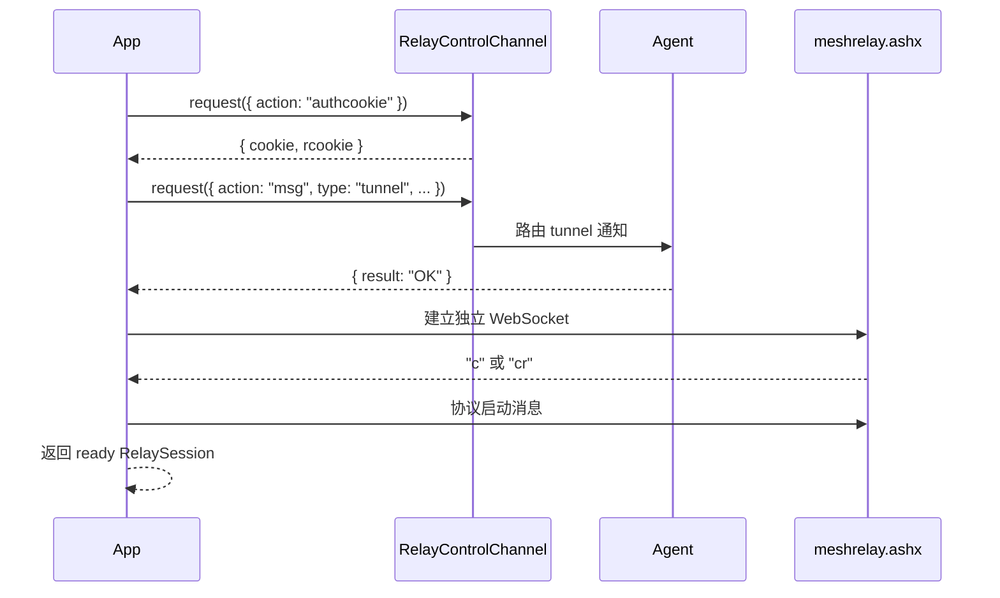

# 核心中继

## 用途与分层

核心中继负责把一个已经可用的 MeshCentral 控制通道转换成独立的 `meshrelay.ashx` WebSocket 会话。

```text
应用登录与设备状态
        |
RelayControlChannel
        |
RelayClient -> RelayConnection -> RelaySession
                                    |
              TerminalSession / FilesSession / DesktopSession
```

- `RelayClient` 编排授权、Agent tunnel 通知和连接创建。
- `RelayConnection` 管理 WebSocket、握手、启动帧、收发和状态机。
- `RelaySession` 提供面向调用方的通用发送、监听和关闭 API。
- 协议适配器解释终端、文件或桌面业务消息。

## 创建流程

```ts
import { RelayClient, RELAY_PROTOCOLS } from '@meshcentral/relay';

const client = new RelayClient({
  baseUrl: 'https://mesh.example.com/domain',
  control: meshCentralClient,
  authorizationTimeoutMs: 15_000,
  notificationTimeoutMs: 15_000,
  connectionTimeoutMs: 15_000,
  handshakeTimeoutMs: 15_000,
});

const relay = await client.createSession({
  deviceId: 'node//device-id',
  protocol: RELAY_PROTOCOLS.files,
});
```

`createSession()` 的实际流程：



Agent tunnel 响应必须包含字符串 `result`，且忽略大小写和两端空白后等于 `OK`。其他结果会抛出 `RelayAgentRouteError`。

## 启动消息

默认启动消息是当前协议号的字符串：

```ts
const relay = await client.createSession({
  deviceId,
  protocol: 5,
});

// 收到 c 或 cr 后自动发送 "5"
```

终端等协议需要自定义顺序：

```ts
const relay = await client.createSession({
  deviceId,
  protocol: RELAY_PROTOCOLS.terminal,
  onHandshakeMessage: (message) => {
    console.log('handshake:', message);
  },
  createStartupMessages: () => [
    JSON.stringify({ type: 'options', protocol: 1, cols: 120, rows: 30 }),
    '1',
  ],
});
```

所有启动帧发送完成后，状态才进入 `ready`。

## 生命周期

```text
idle -> authorizing -> notifying -> connecting -> handshaking -> ready
ready -> closing -> closed
任意失败阶段 -> error
```

| 状态 | 含义 |
| --- | --- |
| `idle` | 尚未开始 |
| `authorizing` | 正在通过控制通道申请 `cookie` 和 `rcookie` |
| `notifying` | 正在通知目标 Agent 建立 tunnel |
| `connecting` | 正在连接 relay WebSocket |
| `handshaking` | WebSocket 已打开，等待 `c` 或 `cr` |
| `ready` | 握手和启动帧已完成，可以发送协议数据 |
| `closing` | 调用方正在主动关闭 |
| `closed` | 已正常关闭 |
| `error` | 授权、路由、连接、握手或传输失败 |

## RelaySession 事件

```ts
const removeState = relay.onStateChange(({ previous, current, error }) => {
  console.log(previous, current, error);
});
const removeMessage = relay.onMessage((data) => console.log(data));
const removeError = relay.onError((error) => console.error(error));
const removeClose = relay.onClose((event) => console.log(event.code, event.reason));

removeState();
removeMessage();
removeError();
removeClose();
```

| 监听方法 | 载荷 | 用途 |
| --- | --- | --- |
| `onStateChange` | `{ previous, current, error? }` | 驱动连接 UI、日志和恢复策略 |
| `onMessage` | `string \| ArrayBuffer \| ArrayBufferView \| Blob` | 接收 ready 后的原始协议消息 |
| `onError` | `Error` | 记录或展示连接错误；错误不会自动重连 |
| `onClose` | `{ code?, reason?, wasClean? }` | 获取 WebSocket 关闭信息并释放应用资源 |

每个监听方法都返回取消监听函数。`createSession()` 选项中的 `onStateChange`、`onRawMessage`、`onError` 和 `onClose` 适合在创建阶段就开始记录数据。

`onRawMessage` 与 `onMessage` 的区别：

- `onRawMessage` 会看到握手消息以及 ready 后的数据。
- `onMessage` 只收到握手完成、状态进入 ready 之后的数据。

## 原始发送 API

```ts
relay.sendText('custom-command');
relay.sendJson({ action: 'custom' });
relay.sendBinary(new Uint8Array([1, 2, 3]));
relay.send(new Blob([payload]));
```

| 方法 | 线上数据 | 可用于 |
| --- | --- | --- |
| `sendText(text)` | 原样字符串 | 协议选择、文本协议命令、自定义扩展 |
| `sendJson(payload)` | `JSON.stringify(payload)` 的字符串 | 结构化命令、控制消息、请求参数 |
| `sendBinary(data)` | `ArrayBuffer`、TypedArray、DataView 或 Blob | 文件块、桌面命令、终端 UTF-8 输入 |
| `send(data)` | 字符串或任一支持的二进制类型 | 低层通用发送 |

发送方法不返回远端结果。结果必须由 `onMessage()` 接收，或由协议适配器将多条响应关联成 Promise 结果。连接不是 `ready` 时发送会抛出 `RelayConnectionError`。

## 超时、取消与关闭

- 授权、Agent 通知、WebSocket 连接和握手默认分别等待 15 秒。
- `createSession({ signal })` 的 `AbortSignal` 用于取消建立过程。握手完成后 abort 监听会被移除。
- `relay.cancel(reason)` 使用关闭码 `4000` 结束当前 relay。
- `relay.close()` 默认使用关闭码 `1000`。
- 意外关闭会进入 `error` 并触发 `onError`，随后触发 `onClose`。
- 包不自动重连；调用方应根据操作是否可重试来创建新会话。

协议适配器的资源释放语义：

| 方法 | 释放适配器监听 | 关闭底层 relay |
| --- | --- | --- |
| `dispose()` | 是 | 否 |
| `close()` | 是 | 是 |

## 协议号

| 常量 | 协议号 | 适配器状态 |
| --- | ---: | --- |
| `RELAY_PROTOCOLS.terminal` | 1 | `TerminalSession` |
| `RELAY_PROTOCOLS.desktop` | 2 | `DesktopSession` |
| `RELAY_PROTOCOLS.files` | 5 | `FilesSession` |
| `RELAY_PROTOCOLS.webSsh` | 11 | 只有协议常量，暂无专用 Session |
| `RELAY_PROTOCOLS.webSshFiles` | 13 | 只有协议常量，暂无专用 Session |

## 实现依据

- `src/RelayClient.ts`
- `src/RelayConnection.ts`
- `src/RelaySession.ts`
- `src/types.ts`
- `src/errors.ts`
