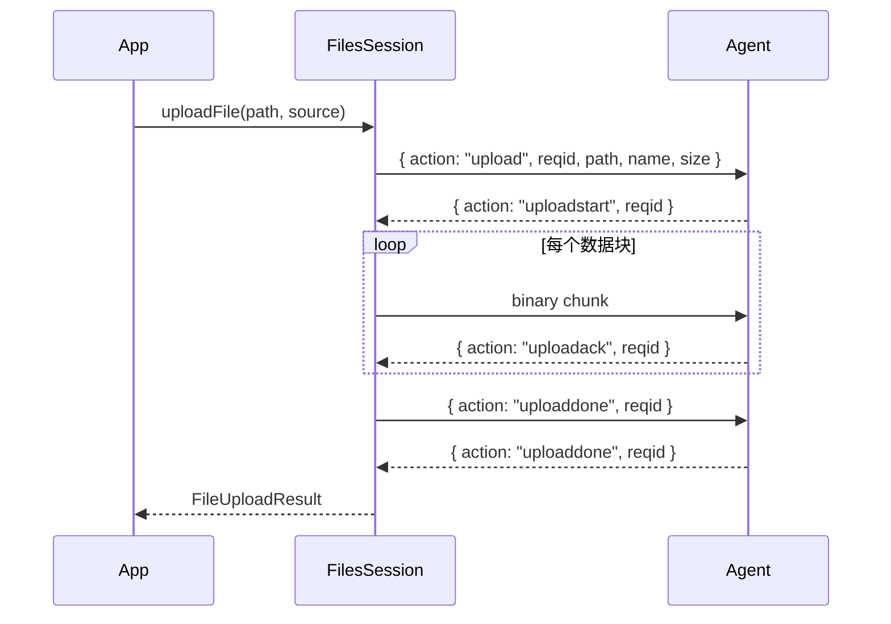

# 文件管理协议

`FilesSession` 适配 MeshCentral 文件 relay 协议 `p=5`，提供目录读取、单文件分块上传和单文件流式下载。

## 创建会话

```ts
import { FilesSession, RELAY_PROTOCOLS } from '@meshcentral/relay';

const relay = await relayClient.createSession({
  deviceId,
  protocol: RELAY_PROTOCOLS.files,
});

const files = new FilesSession(relay, {
  defaultTimeoutMs: 60_000,
  defaultChunkSize: 5 * 1024 * 1024,
  onUnhandledMessage: (message) => console.warn(message),
});
```

同一个 `FilesSession` 同时只允许一个活动操作。并发调用会抛出 `FileOperationError`，`code` 为 `busy`。需要并行传输时，应分别创建独立 relay 和 `FilesSession`。

## 读取目录

```ts
const listing = await files.listDirectory('C:\\Temp', { timeoutMs: 20_000 });

for (const entry of listing.entries) {
  console.log(entry.name, entry.path, entry.kind, entry.size, entry.modifiedAt);
}
```

读取根目录传入空字符串：

```ts
const roots = await files.listDirectory('');
```

发送消息：

```json
{
  "action": "ls",
  "reqid": "ls-1",
  "path": "C:\\Temp"
}
```

响应包含 `dir` 数组时，Promise 返回规范化后的 `DirectoryListing`。目录项 `kind` 为 `drive`、`directory`、`file` 或 `unknown`，并保留原始字段到 `raw`。

## 上传文件

### 浏览器 File

```ts
import { browserFileSource } from '@meshcentral/relay';

const result = await files.uploadFile('C:\\Temp', browserFileSource(file), {
  chunkSize: 1024 * 1024,
  onProgress: (progress) => {
    console.log(progress.state, progress.percentage);
  },
});

console.log(result.path, result.name, result.size);
```

### 自定义 UploadSource

```ts
const source = {
  name: 'demo.bin',
  size: data.byteLength,
  async read(start: number, end: number) {
    return data.slice(start, end);
  },
};

await files.uploadFile('/tmp', source);
```

`read(start, end)` 必须只返回指定范围的数据。上传不会一次性把整个文件加载到内存。

### 上传时序



进度按 Agent 已确认字节数计算，而不是只按已调用 WebSocket 发送的字节数计算。

默认分块为 5 MiB。若数据块首字节为 `0` 或 `{`（ASCII 123），会额外添加一个前导 `0`，避免 Agent 将二进制内容误判为 JSON。该转义字节不计入文件大小和进度。

## 下载文件

调用方提供 `DownloadSink`，协议层不会假设目标是浏览器内存、磁盘或 React Native 文件系统：

```ts
const chunks: Uint8Array[] = [];

const sink = {
  write(chunk: Uint8Array) {
    chunks.push(chunk);
  },
  close() {
    console.log('download complete');
  },
  abort(reason?: unknown) {
    console.error('download aborted', reason);
  },
};

const result = await files.downloadFile('/tmp/report.zip', sink, {
  totalBytes: expectedSize,
  onProgress: ({ receivedBytes, totalBytes, percentage }) => {
    console.log(receivedBytes, totalBytes, percentage);
  },
});
```

下载消息：

| 方向 | 消息 | 用途 |
| --- | --- | --- |
| 客户端到 Agent | `{ action: "download", sub: "start", id, path }` | 请求开始下载 |
| 客户端到 Agent | `{ action: "download", sub: "startack", id, ack: 1 }` | 确认开始接收 |
| 客户端到 Agent | `{ action: "download", sub: "ack", id }` | 确认一个非最终数据块 |
| 客户端到 Agent | `{ action: "download", sub: "stop", id }` | 取消下载 |
| Agent 到客户端 | download start JSON | 告知下载可以开始或返回错误 |
| Agent 到客户端 | 带 4 字节 flags 头的二进制块 | 提供文件内容；`flags & 1` 表示最终块 |

每个二进制下载帧的前 4 字节是大端 flags，后续字节才写入 sink。非最终块写入完成后发送 `ack`；最终块写入后调用 `sink.close()` 并返回 `FileDownloadResult`。

## 进度

上传 `FileUploadProgress`：

- `acknowledgedBytes`：Agent 已确认字节数。
- `sentBytes`：已发送的源文件字节数。
- `totalBytes`：源文件总大小。
- `percentage`：按确认字节计算的百分比。
- `state`：当前操作状态。

下载 `FileDownloadProgress`：

- `receivedBytes`：已写入 sink 的文件字节数。
- `totalBytes`：调用方提供时才存在。
- `percentage`：已知总大小时才存在。

## 超时和取消

`timeoutMs` 是等待远端活动的最长时间，不是整个文件操作的总截止时间。收到与当前请求匹配的目录响应、`uploadstart`、`uploadack`、`uploaddone` 或下载活动后会重置计时器。

```ts
const controller = new AbortController();
const uploading = files.uploadFile('/tmp', source, { signal: controller.signal });

controller.abort();
await uploading;
```

也可以调用：

```ts
files.cancelActive('User cancelled transfer.');
```

- 取消上传会尽力发送 `uploadcancel`。
- 取消下载会尽力发送 `download/stop`，并调用 `sink.abort(error)`。
- relay 已断开时只在本地结束，不会自动重传。

## 错误

`FileOperationError.code`：`busy`、`cancelled`、`connection-lost`、`invalid-path`、`not-found`、`permission-denied`、`protocol`、`source`、`timed-out`、`unknown`。

错误响应会从 `error`、`message`、`msg` 或 `reason` 字段提取可读信息，并尽可能映射为 `permission-denied` 或 `not-found`。

## 实现依据

- `src/protocols/files/FilesSession.ts`
- `src/protocols/files/messages.ts`
- `src/protocols/files/path.ts`
- `src/protocols/files/types.ts`
- `src/protocols/files/FilesSession.test.ts`
