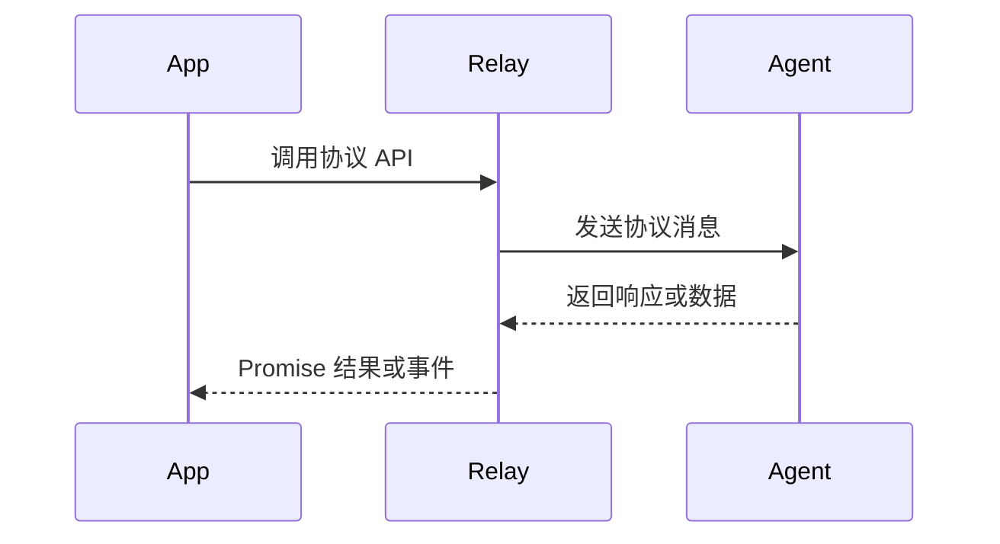

# relay 文档目录

这里存放 `@meshcentral/relay` 的详细设计与使用文档。包根 [README](../README.md) 只负责介绍用途、快速开始和文档导航；协议帧、事件语义、错误处理及测试约定应写在本目录。

## 文档索引

- [核心中继](01-core-relay.md)：架构、创建流程、生命周期、事件、原始消息和关闭语义。
- [终端协议](02-terminal.md)：启动顺序、终端输入输出、尺寸调整、RTT 和事件。
- [文件协议](03-files.md)：目录读取、上传、下载、进度、取消和消息时序。
- [桌面协议](04-desktop.md)：二进制命令、图像块、显示器信息和输入控制。
- [事件与消息速查](05-events-and-messages.md)：所有公开监听入口和可发送消息的集中索引。
- [API 与测试](06-api-and-testing.md)：公开入口、错误类型、测试替身和夹具约定。

## 如何编写详细文档

新增协议或公开能力时，优先增加独立 Markdown 文件，不要持续扩充包根 README。文件名使用两位数字前缀和小写连字符，例如：

```text
07-web-ssh.md
08-reconnection-policy.md
```

每篇协议文档建议包含以下章节：

1. **用途和边界**：该层解决什么问题，不解决什么问题。
2. **创建方式**：给出可编译的最小 TypeScript 示例。
3. **发送消息**：列出公开方法、线上的消息形状及发送目的。
4. **接收消息和事件**：说明触发条件、载荷类型及业务用途。
5. **请求与响应时序**：对有状态协议使用 Mermaid 时序图或编号步骤。
6. **错误、超时和取消**：说明错误类型、恢复责任和资源释放方式。
7. **限制与兼容性**：区分已确认行为、保留行为和未实现行为。
8. **代码与测试依据**：列出主要实现和测试文件，便于后续维护。

推荐模板：

```md
# 协议名称

## 用途

## 创建会话

## 发送消息

| API | 线上消息 | 目的 | 预期结果 |
| --- | --- | --- | --- |

## 事件

| 事件 | 载荷 | 触发时机 | 用途 |
| --- | --- | --- | --- |

## 时序

## 错误与取消

## 当前限制

## 实现依据
```

## 写作规则

- 只把包根 `src/index.ts` 和 `package.json#exports` 暴露的符号描述为公开 API。
- 消息字段必须以消息构造器、解析器和测试为依据，不根据上游实现猜测。
- 明确区分“自动发送”“公开方法发送”和“仅供低层调用者手动发送”。
- 对返回 Promise 的方法说明成功值和拒绝错误；对事件说明事件不会返回请求结果。
- 对二进制消息写明字节序、头长度、长度是否包含头部，以及数据分片规则。
- 示例优先使用协议适配器；只有调试、自定义协议或尚无适配器时才展示原始 `RelaySession`。
- 所有 `on...` 示例应展示或提及返回的取消监听函数。
- 新增文档后更新本索引和包根 README，并运行包的 lint、typecheck、test 和 build。

## Mermaid 约定

请求响应链建议使用 Mermaid：



图只描述代码已经实现或测试确认的行为。无法确认的上游消息应写入“当前限制”，而不是画成稳定流程。
