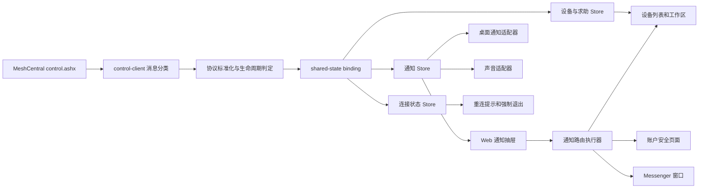
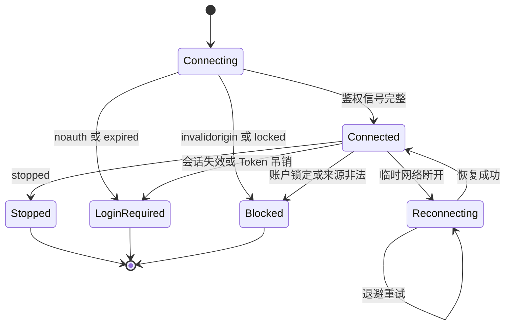

# MeshCentral Web 通知与连接生命周期实施计划

## 1. 文档目的

本文用于指导 MeshCentral Web 客户端逐步实现以下能力：

- Web 通知中心
- 浏览器桌面提醒与声音提示
- 设备状态通知订阅
- 账户及安全消息处理
- 终端求助与聊天邀请
- 控制 WebSocket 连接生命周期管理

协议依据为 [`docs/meshcentral/meshcentral-notification-evidence/`](../docs/meshcentral/meshcentral-notification-evidence/) 中基于 MeshCentral `v1.2.5`、Git Commit `02eb8f71d2ce48bdbd59e4e4d4844b7edaf0e69d` 的源码调查结论。

本文只规划客户端及共享 SDK 的实现。邮件、短信、第三方即时消息等服务端发送能力继续由 MeshCentral 服务端负责，不在本计划中重复实现。

---

## 2. 当前工程基线

当前仓库已经具备以下基础：

- `@meshcentral/control-client`
  - 控制 WebSocket 建连、鉴权、心跳和退避重连。
  - 原始消息 `message` 事件。
  - 基础 `event` 标准化。
  - 设备、设备组、用户与服务端资源 API。
- `@meshcentral/shared-state`
  - Zustand vanilla store。
  - 设备、设备组、事件和连接状态同步。
  - React Hook 与 Client-Store binding。
- `@meshcentral/web`
  - React、React Router、Ant Design、i18next。
  - 顶栏已有通知铃铛入口，但未接入真实数据，Badge 固定为 `0`。
  - 已有设备工作区及 `overview`、`desktop`、`terminal`、`files` 等路由能力。
  - 已有账户安全设置、2FA 备份码和登录 Token 管理页面。

主要缺口：

1. SDK 未区分 `event.notify`、`msg/notify`、`serverwarnings`、`devicesessions`、`stopped` 和 `close` 等专用消息。
2. 所有未知断开目前都会进入自动重连，尚未实现协议规定的“禁止重连”场景。
3. shared-state 没有通知、求助状态、服务器警告和用户通知偏好模型。
4. Web 顶栏通知入口没有抽屉、未读数、已读操作、路由和清除能力。
5. 桌面通知、声音、设备订阅和聊天邀请尚未实现。

---

## 3. 实施目标与非目标

### 3.1 实施目标

1. 所有相关服务端消息先在 SDK 中完成安全解析与标准化，再进入共享状态和 UI。
2. 通知展示、桌面提醒、声音、路由、已读状态使用统一通知模型。
3. 正确处理设备上线/离线的账户、设备组、设备三级订阅掩码。
4. 对登录失败、2FA 备份码、账户锁定、账户删除和 Token 吊销采取符合安全等级的响应。
5. 求助状态在所有在线管理员客户端之间同步，并可从通知直接进入设备处理页面。
6. 聊天邀请可从通知打开 MeshCentral Messenger，同时不把聊天内容写入全局通知状态。
7. 明确区分临时网络中断与永久拒绝，避免认证失败、会话超限等情况下无限重连。
8. Web 与未来 React Native 客户端共享协议模型和核心状态，不把浏览器 API 放入 SDK。

### 3.2 非目标

- 不在本阶段重写 `/meshrelay.ashx` Messenger 聊天协议。
- 不在客户端实现邮件、短信或机器人发送服务。
- 不把服务端通知内容上传到第三方服务。
- 不长期持久化敏感通知正文、求助文本或原始 Payload。
- 不将通知中心替代审计日志；通知是短期交互状态，审计日志仍使用事件查询能力。

---

## 4. 总体架构



### 4.1 分层职责

| 层级               | 主要职责                                                 | 禁止承担的职责                                  |
| ------------------ | -------------------------------------------------------- | ----------------------------------------------- |
| `control-client`   | 消息识别、字段校验、标准化、连接策略、发送订阅指令       | React UI、浏览器 Notification API、localStorage |
| `shared-state`     | 通知队列、未读数、偏好、求助状态、服务端警告、客户端绑定 | Ant Design 组件、打开浏览器窗口、播放音频       |
| `apps/web`         | 抽屉、卡片、Badge、设置界面、路由、桌面通知和声音        | 重新解析原始 MeshCentral 协议                   |
| MeshCentral 服务端 | 权限过滤、邮件/短信发送、会话吊销、跨客户端广播          | 客户端已读状态和本地桌面授权管理                |

---

## 5. 统一领域模型

### 5.1 通知模型

在 `@meshcentral/control-client` 定义协议无关、可序列化的模型：

```typescript
export type NotificationSource =
  | 'event-notify'
  | 'msg-notify'
  | 'help-request'
  | 'chat-request'
  | 'recording'
  | 'server-warning'
  | 'security'
  | 'device-state';

export type NotificationSeverity = 'info' | 'warning' | 'error' | 'critical';

export interface MeshCentralNotification {
  id: string;
  source: NotificationSource;
  title?: string;
  message?: string;
  titleId?: number;
  messageId?: number;
  args?: unknown[];
  tag?: string;
  icon?: string | number;
  deviceId?: string;
  groupId?: string;
  userId?: string;
  username?: string;
  sessionId?: string;
  targetUrl?: string;
  maxTimeSeconds?: number;
  occurredAt: string;
  severity: NotificationSeverity;
  raw: unknown;
}
```

约束：

- `id` 优先采用服务端 `id`；缺失时根据来源、实体、时间、模板和正文生成稳定指纹。
- `maxtime` 统一命名为 `maxTimeSeconds`，不得误当毫秒。
- `titleId/messageId/args` 保留服务端模板信息；SDK 不依赖 Web i18next。
- `severity` 由客户端规则派生，不能假定服务端存在该字段。
- `raw` 仅保存在内存中，不能写入 localStorage。

### 5.2 通知展示状态

在 shared-state 中扩展：

```typescript
export interface NotificationEntry extends MeshCentralNotification {
  read: boolean;
  readAt?: string;
  expiresAt?: string;
}

export interface NotificationState {
  notifications: NotificationEntry[];
  unreadCount: number;
  addNotification(notification: MeshCentralNotification): void;
  markNotificationRead(id: string): void;
  markAllNotificationsRead(): void;
  removeNotification(id: string): void;
  clearNotifications(): void;
}
```

建议限制：

- 内存最多保留 200 条，按发生时间倒序。
- 默认不跨登录会话持久化通知正文。
- 可只持久化无敏感内容的用户偏好；退出、账户切换和永久断开必须清空通知。
- 同一服务端 `id` 重复到达时不重复入库。
- 相同 `tag` 只用于浏览器桌面通知替换和路由，不用于删除通知中心内的历史条目。

### 5.3 求助状态模型

```typescript
export interface DeviceHelpRequest {
  deviceId: string;
  requests: Record<string, string>;
  updatedAt: string;
}
```

`devicesessions.sessions.help` 是求助当前状态的权威快照：

- 非空时更新设备求助标记。
- 为空或缺失时清除对应设备求助状态。
- `agentlog`、`msgid: 98` 用于生成通知，不作为持续状态来源。

### 5.4 连接终止模型

```typescript
export type DisconnectDisposition =
  | 'retryable'
  | 'stopped'
  | 'authentication-required'
  | 'forbidden-origin'
  | 'session-expired'
  | 'account-locked'
  | 'account-removed'
  | 'token-revoked';

export interface ConnectionTermination {
  disposition: DisconnectDisposition;
  message?: string;
  cause?: string;
  requiresLogin: boolean;
  retryAllowed: boolean;
  occurredAt: string;
}
```

---

## 6. 消息分类与标准化实施

### 6.1 SDK 新增消息通道

为 `MeshCentralClientEvents` 增加：

- `notification`
- `serverWarnings`
- `deviceSessions`
- `termination`
- `accountChanged`
- `recordingReady`

现有 `message` 事件继续保留作为低层诊断接口，但业务层不再直接解析它。

### 6.2 必须识别的消息

| 原始消息                                     | 标准化输出                                       | UI 行为                              |
| -------------------------------------------- | ------------------------------------------------ | ------------------------------------ |
| `action: event`, `event.action: notify`      | `notification`                                   | 入通知中心，可播放声音及桌面提醒     |
| `action: msg`, `type: notify`                | `notification`                                   | 入通知中心；按 tag 执行路由          |
| `event.action: agentlog`, `msgid: 98`        | `notification`，来源 `help-request`              | 入通知中心并定位设备概览             |
| `event.action: devicesessions`               | `deviceSessions`                                 | 更新求助状态，不单独生成通知         |
| `event.action: nodeconnect`                  | 设备事件；通过偏好判断后生成 `device-state` 通知 | 更新设备在线状态，可选提醒           |
| `action: serverwarnings`                     | `serverWarnings` 全量快照                        | 仅管理员设置/服务器页面展示          |
| `event.action: recording`                    | `recordingReady` 和可选通知                      | 显示录制文件已就绪                   |
| `event.action: serverinfochange`             | `serverInfo` 更新                                | 静默刷新安全策略 UI                  |
| `event.action: accountchange`                | `accountChanged`                                 | 当前用户信息与权限热更新，不创建通知 |
| `action: stopped` 或 `event.action: stopped` | `termination`                                    | 禁止自动重连，清理状态并提示原因     |
| `action: close`                              | `termination`                                    | 按 cause 决定登录、2FA 或错误提示    |

### 6.3 国际化模板

第一阶段至少内置已确认的 `titleid: 1~6`、`msgid: 1~34` 映射，分别加入 Web 的 `zh-CN` 和 `en-US` 资源。

解析优先级：

1. 已知 `titleId/messageId`：使用本地语言模板与 `args` 格式化。
2. 未知模板 ID：使用服务端 `title/value` 后备文本。
3. 两者均缺失：使用按来源定义的通用说明，不展示 `undefined` 或空卡片。

模板格式化必须只执行文本替换，不把服务端文本当 HTML 渲染，避免 XSS。

---

## 7. Web 通知中心

### 7.1 顶栏入口

改造顶栏铃铛：

- Badge 绑定真实 `unreadCount`。
- `0` 时隐藏数字。
- 点击打开右侧通知抽屉。
- 为按钮增加无障碍名称和未读数量描述。

### 7.2 通知抽屉

建议组件结构：

```text
apps/web/src/features/notifications/
  NotificationCenter.tsx
  NotificationList.tsx
  NotificationItem.tsx
  notificationPresentation.ts
  notificationRouting.ts
  BrowserNotificationService.ts
  NotificationSoundService.ts
  useNotificationEffects.ts
```

抽屉功能：

- 全部/未读筛选。
- 通知按“今天、昨天、更早”分组。
- 单条标记已读、删除。
- 全部已读、全部清空。
- 展示来源图标、严重程度、时间、设备/用户上下文。
- 点击先标记已读，再执行路由。
- `maxTimeSeconds` 到期时自动从通知中心移除，并关闭对应桌面通知。

### 7.3 路由规则

| 条件                               | 目标                                        |
| ---------------------------------- | ------------------------------------------- |
| `tag === desktop` 且有 `deviceId`  | `/devices/:deviceId/workspace?tab=desktop`  |
| `tag === terminal` 且有 `deviceId` | `/devices/:deviceId/workspace?tab=terminal` |
| `tag === files` 且有 `deviceId`    | `/devices/:deviceId/workspace?tab=files`    |
| 求助通知且有 `deviceId`            | `/devices/:deviceId/workspace?tab=overview` |
| `tag === backupcodes`              | `/profile?tab=security&action=backup-codes` |
| `tag` 以 `meshmessenger/` 开头     | 打开同源 `/messenger?id=...` 独立窗口       |
| 合法同源 `targetUrl`               | 打开对应路由或窗口                          |
| 无法识别                           | 仅打开通知抽屉，不执行跳转                  |

路由执行前需验证设备仍存在且用户仍有权限。外部 URL 默认拒绝；若未来开放，必须采用明确 allowlist 和 `noopener,noreferrer`。

---

## 8. 桌面提醒与声音

### 8.1 浏览器桌面通知

实现独立 `BrowserNotificationService`：

- 仅在 `Notification.permission === 'granted'` 时发送。
- 权限请求必须由用户在设置界面主动点击触发，不能在页面加载时自动弹出。
- 使用通知 `tag` 作为系统通知替换键。
- 使用 `maxTimeSeconds * 1000` 关闭系统通知。
- 点击系统通知时聚焦现有窗口并执行与通知中心相同的安全路由。
- `visibilityState === 'visible'` 时默认只入通知中心，不重复弹出桌面通知；安全高危或用户明确开启“前台也提醒”时例外。
- 注销和永久断开时关闭所有仍存活的系统通知实例。

### 8.2 声音提示

实现独立 `NotificationSoundService`：

- 仅当本地偏好 Bit `1` 开启时播放。
- 必须处理浏览器自动播放限制；首次用户交互后解锁音频。
- 短时间连续通知进行节流，例如 2 秒内只播放一次，避免设备批量上线造成声音风暴。
- 默认只对新增、未重复、需要用户注意的通知播放。
- 提供设置页“播放测试声音”按钮。

### 8.3 用户偏好

Web 本地偏好建议使用版本化键：

```text
meshcentral.notifications.preferences.v1
```

只保存：

- 是否播放声音。
- 是否显示设备组名。
- 是否启用浏览器桌面提醒。
- 前台页面是否仍弹出桌面提醒。
- Web 设备上线/下线全局开关。

不得保存认证信息、求助正文、通知原始 Payload 或用户安全消息。

---

## 9. 设备状态订阅

### 9.1 掩码必须分域

账户本地掩码和服务端设备/组掩码不能共用同一个枚举，因为 Bit `16` 含义不同。

```typescript
export const enum LocalNotificationMask {
  Sound = 1,
  DeviceConnected = 2,
  DeviceDisconnected = 4,
  IntelAmt = 8,
  ShowGroupName = 16,
}

export const enum ServerNotificationMask {
  DeviceConnected = 2,
  DeviceDisconnected = 4,
  IntelAmt = 8,
  EmailConnected = 16,
  EmailDisconnected = 32,
  EmailHelpRequest = 64,
  MessagingConnected = 128,
  MessagingDisconnected = 256,
  MessagingHelpRequest = 512,
}
```

禁止通过类型转换混用两套掩码。

### 9.2 有效订阅计算

收到 `nodeconnect` 后，Web 端按以下来源做按位或：

1. 账户本地通知设置。
2. `userInfo.links[groupId].notify` 的设备组设置。
3. `userInfo.notify[groupId]` 的用户组级覆盖。
4. `userInfo.notify[deviceId]` 的设备级覆盖。

实现时需扩展 `UserInfoLink` 和 `UserInfo` 标准化模型以保留 `notify` 数据。

### 9.3 设置界面

实施两类设置：

1. **Web 本地提醒设置**
   - 声音。
   - 上线通知。
   - 下线通知。
   - AMT 通知。
   - 标题显示设备组名。
   - 桌面通知权限状态和授权入口。
2. **服务端设备/组订阅设置**
   - Web 上线/下线。
   - 邮件上线/下线/求助。
   - 即时消息上线/下线/求助。

SDK 增加封装方法：

- `notifications.updateGroupSubscription(groupId, mask)`，发送 `changemeshnotify`。
- `notifications.updateDeviceSubscription(deviceId, mask)`，发送 `changeusernotify`。

设置保存成功后，以服务端回推的账户数据为准，不进行永久乐观覆盖；失败时恢复原值并显示错误。

### 9.4 设备状态防抖

- 同一设备、同一连接通道、同一状态在短时间内重复上报只生成一条通知。
- 设备快照同步不得生成上线/下线通知，只有实时 `nodeconnect` 事件可以触发。
- 应区分 Agent、CIRA、AMT 和 MQTT 连接位，避免某一通道断开但设备仍可管理时错误显示“设备完全离线”。

---

## 10. 安全消息处理

### 10.1 响应等级

| 场景                             | 行为                                                 |
| -------------------------------- | ---------------------------------------------------- |
| 登录失败次数 `msgid: 12`         | warning 通知、未读、允许桌面提醒和声音               |
| 密码修改成功/失败 `msgid: 17~21` | success/error 通知，定位账户设置                     |
| 邮箱验证完成                     | info/success 通知                                    |
| 磁盘配额超限                     | warning 通知                                         |
| 2FA 备份码未生成                 | 当前用户信息派生 warning 通知，tag 为 `backupcodes`  |
| 当前账户权限变化                 | 静默更新 `userInfo` 和 UI capability，不生成普通通知 |
| 账户锁定、删除、Token 吊销       | critical 终止处理，清空授权状态并返回登录页          |

### 10.2 2FA 备份码派生通知

该通知不是服务端下发的显式 notify，需要在账户信息同步完成后执行规则判断：

- 已启用 2FA。
- 尚无可用备份码。
- 当前会话尚未生成过相同派生通知。

需要先确认现有 `UserInfo` 是否能够区分“已启用 2FA”和“已有备份码”；若协议字段不足，扩展 userinfo 标准化，不用猜测。

### 10.3 权限热更新

处理当前账户 `accountchange` 时：

1. 替换 `userInfo`。
2. 重新计算菜单和操作 capability。
3. 清理用户已失去权限的设备、设备组和敏感详情缓存。
4. 如果当前路由已无权限，重定向到允许访问的安全页面。
5. 不显示普通 Toast，避免把权限事件误当操作回执。

---

## 11. 终端求助与聊天邀请

### 11.1 求助通知

收到 `agentlog` 且 `msgid === 98` 时：

- 标准化为 `help-request` 通知。
- 标题包含设备名称；正文使用终端用户名和求助说明。
- 按本地偏好触发声音和桌面通知。
- 点击进入设备工作区 Overview。

求助文本属于可能敏感的数据：

- 仅保存在内存。
- 不写入 localStorage。
- UI 必须按纯文本渲染。
- 注销、永久断开或权限丢失时立即清除。

### 11.2 求助状态与处理

收到 `devicesessions` 时维护设备级求助状态：

- 设备列表显示求助标记。
- 工作区 Overview 显示求助详情与更新时间。
- 多名管理员同时查看时，状态以最新快照同步。
- 清空快照后自动移除设备标记；已有通知保留为历史，除非服务端发送跨会话清除消息。

后续增加“关闭求助”操作：

```json
{
  "action": "msg",
  "type": "localapp",
  "nodeid": "node//...",
  "appid": "...",
  "value": { "cmd": "cancelhelp" }
}
```

只有协议中能取得有效 `appid` 且用户具备设备权限时才显示按钮。关闭请求发出后进入处理中状态，最终以 `devicesessions` 空快照确认完成，不直接在本地伪造成功。

### 11.3 聊天邀请

`msg/notify`、`msgid: 11` 或 `tag` 以 `meshmessenger/` 开头时：

- 标准化为 `chat-request`。
- 显示发起人、邀请时间和“接受”操作。
- 接受后使用同源 `/messenger?id=<tag>&title=<username>` 打开独立窗口。
- 使用固定窗口名称复用同一聊天窗口。
- URL 参数必须编码，禁止把未验证 URL 直接传给 `window.open`。
- 弹窗被浏览器阻止时，在当前页面给出可点击的明确提示。
- 聊天文本、文件和 WebRTC 数据继续由 `/meshrelay.ashx` 处理，不进入通知 store。

---

## 12. 连接生命周期处理

### 12.1 当前问题

现有客户端在非手动关闭、非显式认证拒绝的情况下统一进入 `scheduleReconnect()`。这会导致 `stopped`、`noauth`、`invalidorigin`、账户锁定等永久拒绝场景继续重试。

### 12.2 新状态机



### 12.3 判定规则

禁止自动重连：

- `action: stopped`。
- `event.action: stopped`。
- `action: close` 且 `cause` 为 `noauth`、`invalidorigin`、`expired`、`banned` 或 `locked`。
- `msg` 表示 `tokenrequired`、`emailvalidationrequired` 等需要用户交互的场景。
- 服务端因当前账户删除、锁定或当前登录 Token 撤销而主动关闭。

允许自动重连：

- 没有收到终止协议消息的异常网络断开。
- 短暂代理、网关或服务器网络故障。

对于“服务端无终止报文直接正常关闭”的模糊情况，第一版可采用：

- WebSocket `1000` 且不是客户端主动关闭：先执行一次 Session 探测。
- Session 无效则转登录页，不再重连。
- Session 有效且无锁定证据时才进入有限退避重连。

### 12.4 状态清理

永久终止时：

1. 停止心跳和重连定时器。
2. 拒绝所有未完成请求。
3. 关闭桌面通知和敏感模态框。
4. 清空通知、求助、设备、设备组、账户与服务端授权快照。
5. 清除只属于当前会话的派生状态。
6. 按终止类型展示安全文案。
7. 需要登录时跳转 `/login`，并保留非敏感原因代码用于页面提示。

临时网络中断时：

- 保留设备和通知缓存，但标记为可能过期。
- 顶栏展示重连状态和当前尝试次数。
- 重连成功后重新同步设备、组、用户信息和服务端警告。
- 快照同步期间不触发设备状态提醒。

---

## 13. 建议代码变更范围

### 13.1 `packages/control-client`

建议新增：

```text
src/notifications/
  types.ts
  normalizers.ts
  templates.ts
  subscriptions.ts
src/lifecycle/
  termination.ts
```

建议修改：

- `src/types.ts`：事件通道、通知、求助、警告和终止类型。
- `src/protocol/codec.ts`：消息分类和 push 解码。
- `src/protocol/normalizers.ts`：保留 `userinfo.notify`、link notify、设备会话及相关事件字段。
- `src/client/GatewayClient.ts`：在关闭前记录终止意图并决定是否重连。
- `src/index.ts`：导出公共 API。

### 13.2 `packages/shared-state`

建议新增或拆分：

```text
src/notifications.ts
src/notificationSelectors.ts
src/helpRequests.ts
```

建议修改：

- `src/types.ts`：扩展 store 类型。
- `src/store.ts`：通知、警告、求助和终止状态 actions。
- `src/binding.ts`：订阅 SDK 新事件并写入 store。
- `src/react.ts`、`src/index.ts`：导出 selectors 和 hooks。

若 store 继续增长，应使用 Zustand slice 组合，而不是持续扩大单一文件。

### 13.3 `apps/web`

建议新增：

```text
src/features/notifications/
src/features/notification-settings/
src/components/device-workspace/DeviceHelpRequestCard.tsx
```

建议修改：

- `src/app/AppLayout.tsx`：真实 Badge 和通知中心入口。
- `src/app/AppRouter.tsx`：必要的设置/安全深链路支持。
- `src/pages/ProfilePage.tsx`：通知和安全入口联动。
- `src/pages/DeviceWorkspacePage.tsx`：求助详情与处理。
- `src/i18n/locales/zh-CN.ts`、`en-US.ts`：通知模板和生命周期文案。
- 全局样式：通知抽屉、严重程度、求助状态和断线提示。

---

## 14. 分阶段实施顺序

### 阶段 0：协议测试基线

目标：先把调查结论固化为自动化测试，防止 UI 开发时反复猜协议。

任务：

- 将脱敏 fixtures 引入 `control-client` 测试。
- 为每类消息建立解码快照/断言。
- 对未知字段、字段缺失和错误类型做容错测试。
- 建立 `maxtime` 秒转毫秒、tag、模板回退和 ID 指纹测试。

完成标准：所有 evidence fixtures 均可被分类，未知消息不会导致客户端崩溃。

### 阶段 1：SDK 通知与生命周期内核

目标：完成业务无关的协议层。

任务：

- 新增通知、求助、警告和终止类型。
- 实现消息分类与标准化。
- 扩展事件通道。
- 实现永久终止与可重连判定。
- 添加订阅更新资源 API。

完成标准：无需 React 即可通过单元测试完整模拟通知、求助和断线流程。

### 阶段 2：共享状态

目标：建立 Web 与未来 App 可复用的状态层。

任务：

- 增加 notification/help/serverWarnings/termination slices。
- 实现去重、容量限制、过期、已读与清理。
- binding 订阅 SDK 事件。
- 在连接重建和永久终止时执行差异化清理。

完成标准：store 测试覆盖多通知、重复通知、过期、求助清除和终止清理。

### 阶段 3：基础通知中心

目标：用户能够在 Web 中查看和处理通知。

任务：

- 顶栏 Badge。
- 通知抽屉和卡片。
- 已读、全部已读、删除、清空。
- 通知深链路。
- i18n 模板。

完成标准：fixtures 可在真实 UI 中正确展示并路由。

### 阶段 4：桌面通知、声音和设置

目标：提供可控的浏览器外提醒。

任务：

- 桌面授权设置。
- Notification 实例管理。
- 声音解锁、测试和节流。
- 本地偏好版本迁移。

完成标准：授权、拒绝、不可用、前台/后台和自动关闭场景均有测试或手工验证记录。

### 阶段 5：设备状态订阅

目标：按账户、组、设备配置生成正确的上线/下线提醒。

任务：

- 扩展 userinfo notify 标准化。
- 实现两套掩码枚举和有效值计算。
- 增加组/设备设置界面和保存命令。
- 实现 nodeconnect 防抖和通道判定。

完成标准：Bit `16` 在两种域中不会混淆，快照加载不会生成误报。

### 阶段 6：安全、求助与聊天

目标：完成需要专用业务交互的通知。

任务：

- 登录失败、备份码和账户设置通知。
- accountchange 权限热更新。
- 账户锁定/删除/Token 吊销退出。
- 设备求助标记、详情和取消求助。
- 聊天邀请及 Messenger 窗口。

完成标准：多管理员求助同步、权限丢失、聊天弹窗阻止和强制退出均可复现并符合预期。

### 阶段 7：稳定性与发布

目标：完成生产可用性验证。

任务：

- 进行通知风暴、频繁重连和多标签页测试。
- 检查内存泄漏、Notification 实例和 Timer 释放。
- 增加运行日志和诊断事件，但不记录敏感正文。
- 灰度发布，观察未知消息率和永久断线误判率。

完成标准：构建、类型检查、lint、单元测试和核心 E2E 流程全部通过。

---

## 15. 测试计划

### 15.1 `control-client` 单元测试

至少覆盖：

- `event.notify` 与 `msg/notify`。
- `titleid/msgid/args` 及后备文本。
- `maxtime` 单位。
- 求助 `agentlog` 和 `devicesessions`。
- 聊天邀请 tag。
- `serverwarnings` 全量替换。
- `recording` 文件就绪事件。
- `nodeconnect` 各连接位。
- `stopped`、`close/noauth`、`close/invalidorigin` 禁止重连。
- 异常网络关闭允许退避重连。
- 账户锁定/删除的模糊物理关闭处理。

### 15.2 shared-state 单元测试

至少覆盖：

- 通知 ID 去重。
- 相同 tag 不删除历史通知。
- 未读计数。
- 自动过期。
- 200 条容量上限。
- 求助快照更新与清除。
- 永久终止清空敏感状态。
- 临时断开保留缓存。
- 重连快照不触发设备状态通知。

### 15.3 Web 组件测试

至少覆盖：

- Badge 数量和隐藏规则。
- 抽屉筛选、已读、删除和清空。
- 所有 tag 路由。
- 桌面权限三态：default、granted、denied。
- 音频播放失败不会影响通知入库。
- 服务端文本按纯文本显示。
- 聊天弹窗被阻止时的回退提示。
- 权限热更新后菜单和当前页面处理。

### 15.4 集成与手工验证

使用本地 MeshCentral 环境执行：

1. 邮箱验证通知。
2. 人为产生登录失败次数警告。
3. 设备上线/下线和组/设备掩码组合。
4. 两个管理员同时接收并清除终端求助。
5. 用户到用户聊天邀请。
6. 远程会话录制完成。
7. 管理员锁定测试账户。
8. 撤销当前登录 Token。
9. 停止 MeshCentral 服务。
10. 断网后恢复，确认只在临时网络中断时重连。

---

## 16. 可观测性与隐私

### 16.1 可记录指标

- 按来源统计收到的消息数量。
- 标准化失败数量和未知 action/type 数量。
- 通知去重数量。
- 桌面通知成功/不可用/权限拒绝状态。
- 重连次数和最终处置类型。
- 订阅设置保存成功/失败数量。

### 16.2 禁止记录内容

- 求助正文。
- 通知完整正文。
- 聊天内容。
- 用户 Token、Cookie、2FA 数据。
- 原始 WebSocket Payload 全量内容。

诊断日志只记录 action、type、msgid、字段是否存在和脱敏实体类型。

---

## 17. 风险与应对

| 风险                                  | 影响               | 应对                                                    |
| ------------------------------------- | ------------------ | ------------------------------------------------------- |
| MeshCentral 版本间消息字段变化        | 通知丢失或错误分类 | 宽松读取、严格输出；保留未知消息诊断；fixtures 固化版本 |
| `1000` 正常关闭无法区分锁定与网络行为 | 错误重连或错误退出 | Session 探测、有限重试、记录最近 termination 消息       |
| 设备批量重连形成通知风暴              | UI 和声音不可用    | 去重、节流、批量摘要、容量上限                          |
| 浏览器阻止桌面通知或音频              | 用户收不到外部提醒 | 明确权限状态、测试入口、页面内通知始终可用              |
| Bit `16` 语义混淆                     | 错发邮件或错误标题 | 分离枚举与类型，禁止跨域复用，增加专项测试              |
| 求助文本包含恶意内容                  | XSS 或隐私泄露     | 纯文本渲染、不持久化、退出时清空                        |
| 通知点击打开不安全 URL                | 跳转攻击           | 同源路由、allowlist、编码参数、noopener/noreferrer      |
| 多标签页重复桌面提醒                  | 重复打扰           | 后续使用 BroadcastChannel 选举单一提醒标签页            |

---

## 18. 验收标准

功能达到以下条件后可视为完成：

1. 顶栏未读数与通知抽屉使用真实服务端消息。
2. `event.notify`、`msg/notify`、求助、聊天、录制、安全和设备状态均能标准化展示。
3. 通知支持已读、删除、全部已读、清空、自动过期和正确深链路。
4. 桌面通知与声音由用户明确授权和偏好控制，失败不影响页面通知。
5. 设备通知正确合并账户、设备组和设备级配置，且两种 Bit `16` 不混淆。
6. 求助状态能在多管理员之间同步，关闭操作以服务端快照确认。
7. 聊天邀请只能打开合法的同源 Messenger 路径。
8. `stopped`、认证失败、非法来源、锁定、删除和 Token 吊销不会自动重连。
9. 临时网络中断能够按退避策略恢复，并在恢复后重新同步快照。
10. 永久终止会清除通知、求助和授权缓存，不残留敏感信息。
11. 中英文文案完整，不直接渲染服务端 HTML。
12. 相关包的类型检查、lint、单元测试和 Web 构建全部通过。

---

## 19. 建议交付里程碑

| 里程碑            | 交付内容                                    | 前置依赖   |
| ----------------- | ------------------------------------------- | ---------- |
| M1 协议内核       | 消息分类、通知模型、终止判定、fixtures 测试 | 无         |
| M2 状态与基础 UI  | notification store、Badge、抽屉、路由       | M1         |
| M3 提醒与订阅     | 桌面通知、声音、本地偏好、设备/组订阅       | M2         |
| M4 安全与协作     | 安全消息、求助、聊天、权限热更新            | M1、M2     |
| M5 生命周期稳定版 | 永久终止、Session 探测、重连恢复、清理      | M1、M2     |
| M6 发布验收       | 集成测试、性能、隐私检查、灰度观察          | M3、M4、M5 |

建议优先完成 M1、M2 和 M5。连接生命周期与状态清理是安全边界，不应等所有视觉功能完成后再补。
