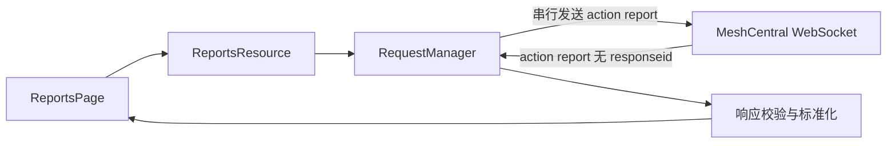

# Web 报表功能实施计划

## 1. 背景

MeshCentral 控制 WebSocket 提供 `action: "report"` 报表接口，可查询以下数据：

1. 远程会话记录；
2. 用户流量汇总；
3. 用户登录记录；
4. 数据库记录数量。

当前 Web 应用已经具备控制通道、资源 API、权限能力、设备和设备组状态，但“审计日志”仍使用占位页面。该功能计划在不绕过现有 `@meshcentral/control-client` 架构的前提下，将报表接口封装为类型安全的资源 API，并在 Web 端增加统一报表页面。

相关现有代码：

- 控制客户端：[`packages/control-client/src/client/MeshCentralClient.ts`](../packages/control-client/src/client/MeshCentralClient.ts)
- 请求匹配：[`packages/control-client/src/client/requestManager.ts`](../packages/control-client/src/client/requestManager.ts)
- 资源 API：[`packages/control-client/src/resources/`](../packages/control-client/src/resources/)
- Web 路由：[`apps/web/src/app/AppRouter.tsx`](../apps/web/src/app/AppRouter.tsx)
- Web 导航：[`apps/web/src/app/AppLayout.tsx`](../apps/web/src/app/AppLayout.tsx)
- UI 权限：[`packages/control-client/src/permissions/uiCapabilities.ts`](../packages/control-client/src/permissions/uiCapabilities.ts)
- 中英文文案：[`apps/web/src/i18n/locales/`](../apps/web/src/i18n/locales/)

## 2. 建设目标

### 2.1 功能目标

在 Web 端新增“报表”页面，支持：

- 按时间范围查询报表；
- 根据报表类型切换有效的分组和筛选条件；
- 展示远程会话、用户流量、用户登录和数据库记录数据；
- 按服务端返回的分组展示明细和汇总；
- 正确处理权限限制、空数据、连接断开、超时和静默拒绝；
- 支持中英文界面；
- 在窄屏下保持基本可用。

### 2.2 架构目标

- 协议细节统一封装在 `@meshcentral/control-client`；
- React 页面不直接调用原始 WebSocket `send()`；
- 请求参数和响应数据使用明确的 TypeScript 类型；
- 对无 `responseid` 的响应执行串行化匹配，避免并发请求串包；
- 保持现有页面、控制通道和实时事件功能行为不变。

## 3. 首期范围

### 3.1 纳入范围

| 类型 | 报表       | 首期状态 | 可见用户                           |
| ---- | ---------- | -------: | ---------------------------------- |
| `1`  | 远程会话   |     实现 | 已登录用户；服务端决定可见数据范围 |
| `2`  | 用户流量   |     实现 | 具有用户管理能力的管理员           |
| `3`  | 用户登录   |     实现 | 已登录用户；管理员可查看更大范围   |
| `4`  | 数据库记录 |     实现 | 仅全站最高管理员                   |

前端权限只负责隐藏无意义的入口和筛选项，最终授权始终由 MeshCentral 服务端完成。

### 3.2 不纳入首期

- PDF、Excel 或 CSV 导出；
- 报表定时生成和邮件发送；
- 服务端报表缓存；
- 自定义列、拖拽列和保存视图；
- 多个报表请求并发执行；
- 修改 MeshCentral 服务端报表协议；
- 将报表数据写入共享状态或长期缓存。

## 4. 页面与交互设计

### 4.1 路由和导航

新增路由：

```text
/monitoring/reports
```

调整方案：

1. 在“监控与事件”导航组中增加“报表”；
2. 将当前 `/monitoring/audit` 占位路由重定向到 `/monitoring/reports`，避免已有书签失效；
3. 页面标题显示“监控与事件 / 报表”；
4. 无权查看管理类报表的用户仍可查看自己的远程会话和登录记录。

预计修改：

- [`apps/web/src/app/AppRouter.tsx`](../apps/web/src/app/AppRouter.tsx)
- [`apps/web/src/app/AppLayout.tsx`](../apps/web/src/app/AppLayout.tsx)
- 新增 `apps/web/src/pages/ReportsPage.tsx`
- 新增 `apps/web/src/assets/styles/reports.css`

### 4.2 页面布局

页面由四个区域组成：

1. **报表类型**：远程会话、用户流量、用户登录、数据库记录；
2. **查询条件**：时间范围、分组方式、设备组、是否显示流量；
3. **状态区域**：连接状态、权限提示、查询错误或空状态；
4. **结果区域**：分组标题、明细表格和分组汇总。

建议桌面端使用顶部筛选卡片加下方结果表格；移动或窄屏环境中筛选控件换行，结果表格允许横向滚动。

### 4.3 条件联动

| 报表类型   |         时间范围 | 分组方式         |     设备组 | 显示流量 |
| ---------- | ---------------: | ---------------- | ---------: | -------: |
| 远程会话   |             显示 | 用户、设备、日期 |       显示 |     显示 |
| 用户流量   |             显示 | 固定为用户       | 管理员可选 |     隐藏 |
| 用户登录   |             显示 | 用户、日期       |       隐藏 |     隐藏 |
| 数据库记录 | 隐藏或只读默认值 | 固定为用户占位值 |       隐藏 |     隐藏 |

约束：

- `start` 必须小于 `end`；
- 请求时间戳转换为秒级整数；
- 按日期分组时自动发送浏览器 IANA 时区和当前语言；
- 用户登录报表不得发送 `groupBy: 2`；
- 数据库记录报表虽然不使用时间范围，SDK 仍生成合法的 `start < end` 参数；
- 查询执行期间禁用重复提交，但允许用户修改下一次查询条件。

### 4.4 默认值

- 默认报表：远程会话；
- 默认时间范围：最近 24 小时；
- 默认分组：按用户；
- 默认设备组：全部有权访问的设备组；
- 默认显示会话流量：开启；
- 默认每个分组按时间倒序展示；
- 用户点击“查询”后才发送请求，筛选变化不自动请求。

## 5. 控制客户端设计

### 5.1 新增类型

在 `packages/control-client/src/types.ts` 或独立的 `reports.types.ts` 中定义：

```typescript
export type ReportType = 1 | 2 | 3 | 4;
export type ReportGroupBy = 1 | 2 | 3;

export interface ReportQuery {
  type: ReportType;
  groupBy: ReportGroupBy;
  start: number;
  end: number;
  timezone?: string;
  timezoneOffset?: number;
  language?: string;
  deviceGroupId?: string;
  showTraffic?: boolean;
}

export interface ReportColumn {
  id: string;
  title: string;
  format?: string;
  align?: 'center' | 'left' | 'right';
  sumBy?: boolean | string;
}

export interface ReportGroup<TEntry extends ReportEntry = ReportEntry> {
  entries: TEntry[];
}

export interface ReportResult<TEntry extends ReportEntry = ReportEntry> {
  groupFormat?: 'user' | 'nodemesh';
  columns: ReportColumn[];
  groups: Record<string, ReportGroup<TEntry>>;
}
```

同时为四类条目分别定义联合类型：

- `RemoteSessionReportEntry`；
- `UserTrafficReportEntry`；
- `UserLoginReportEntry`；
- `DatabaseRecordReportEntry`。

响应解析不得盲目信任服务端字段，至少验证：

- `data` 为对象；
- `columns` 为数组；
- `groups` 为对象；
- 每个分组的 `entries` 为数组；
- 数值字段为有限数字；
- 非法条目被过滤或触发协议错误，行为需要由测试固定。

### 5.2 新增 ReportsResource

新增：

```text
packages/control-client/src/resources/reports.ts
```

职责：

- 校验请求类型、分组方式和时间范围；
- 根据报表类型限制可用的 `groupBy`；
- 将 SDK 字段映射为服务端字段：`timezone -> tz`、`timezoneOffset -> tf`、`language -> l`、`deviceGroupId -> devGroup`；
- 发送 `action: "report"`；
- 使用比普通请求更长的超时时间，建议默认 `15_000ms`；
- 标准化服务端响应；
- 将服务端静默拒绝最终表现为 `MeshCentralRequestTimeoutError`，供 UI 转换成可理解的提示。

在 `MeshCentralClient` 中增加：

```typescript
readonly reports: ReportsResource;
```

并从包入口导出资源类及相关类型。

### 5.3 无 responseid 响应匹配

`report` 响应不回传 `responseid`，需要在
[`packages/control-client/src/client/requestManager.ts`](../packages/control-client/src/client/requestManager.ts)
的 `RESPONSE_ID_OPTIONAL_ACTIONS` 中加入 `report`。

预期行为：

1. 同一客户端中的报表请求按 `action` 串行执行；
2. 前一个请求完成或超时后才发送下一个请求；
3. 响应通过唯一待处理的 `action: "report"` 请求匹配；
4. 不影响带 `responseid` 的其他资源请求；
5. 即使调用方并发调用 `reports.query()`，底层也不会同时存在多个无法区分的报表请求。



## 6. 权限设计

### 6.1 新增应用能力

建议在 `ApplicationUiCapabilities` 增加：

- `viewReports`：已登录且已取得用户信息时为 `true`；
- `viewUserTrafficReports`：全站管理员或具有 `ManageUsers` 权限；
- `viewDatabaseRecordReports`：仅 `siteadmin === 0xFFFFFFFF`。

如果不希望把“已登录”建模为权限，可只增加后两项管理能力，并让远程会话和用户登录报表对所有已登录用户开放。

### 6.2 页面防护

- 页面本身不要求 `viewAllEvents`，因为普通用户可查看自身数据；
- 用户流量选项根据 `viewUserTrafficReports` 显示；
- 数据库记录选项根据 `viewDatabaseRecordReports` 显示；
- 设备组筛选仅显示当前状态中已加载的设备组；
- 服务端拒绝后不尝试通过前端绕过权限，也不自动扩大查询范围。

## 7. 结果渲染设计

### 7.1 列处理

服务端返回 `columns`，但前端不应直接将未知格式当作可执行配置。建立允许列表：

| `format`   | 渲染方式                              |
| ---------- | ------------------------------------- |
| `datetime` | 本地日期时间                          |
| `time`     | 本地时间                              |
| `node`     | 根据设备状态解析名称，缺失时显示 ID   |
| `mesh`     | 根据设备组状态解析名称，缺失时显示 ID |
| `user`     | 提取并显示用户名称，保留完整 ID 提示  |
| `protocol` | 映射会话协议名称                      |
| `seconds`  | 可读时长                              |
| `bytes`    | 可读字节数                            |
| `2fa`      | 双因子方式标签                        |
| `records`  | 数据库记录类型名称                    |
| 未知值     | 安全文本显示                          |

列标题使用服务端 `title` 作为语义键，但由前端固定映射到本地化文案；未知标题显示原始文本，不使用动态 HTML。

### 7.2 分组标题

- `groupFormat: "user"`：显示用户名；
- `groupFormat: "nodemesh"`：解析设备和设备组；
- 日期分组：显示服务端返回的日期键；
- 固定组键 `"0"`：不展示无意义的组标题，只展示单表。

### 7.3 汇总

根据 `sumBy` 生成表尾汇总：

- `sumBy: true`：对该列全部求和；
- `sumBy: "protocol"`：按协议分别汇总；
- 无 `sumBy`：不汇总；
- 空值不参与求和；
- 非有限数字按无效值处理。

首期优先保证正确展示服务端条目；复杂的按协议汇总可在基本查询稳定后作为同一功能的第二个提交完成。

## 8. 状态和错误处理

### 8.1 页面状态

页面需要覆盖：

- 控制通道连接中；
- 控制通道已断开；
- 首次未查询；
- 查询中；
- 查询成功且有数据；
- 查询成功但无数据；
- 参数验证失败；
- 请求超时；
- 服务端响应格式非法。

### 8.2 超时文案

由于服务端可能对非法参数或越权请求静默返回，超时提示不应直接断言网络故障。建议文案：

> 报表请求未收到响应。请检查查询条件、账号权限和控制通道状态后重试。

页面保留“重新查询”按钮，不自动无限重试，避免连续发送昂贵查询。

### 8.3 竞态处理

即使底层请求串行，页面仍使用请求序号或取消标记，确保旧查询在组件卸载或新查询完成后不会覆盖当前结果。

## 9. 国际化

在以下文件增加同构键：

- [`apps/web/src/i18n/locales/zh-CN.ts`](../apps/web/src/i18n/locales/zh-CN.ts)
- [`apps/web/src/i18n/locales/en-US.ts`](../apps/web/src/i18n/locales/en-US.ts)

建议命名空间：

```text
navigation.reports
reports.title
reports.types.remoteSessions
reports.types.userTraffic
reports.types.userLogins
reports.types.databaseRecords
reports.filters.*
reports.columns.*
reports.protocols.*
reports.states.*
reports.errors.*
```

协议名称、登录结果和 2FA 类型全部通过本地映射显示，不直接依赖服务端英文标题。

## 10. 文件变更清单

### 10.1 Control Client

- 修改 `packages/control-client/src/client/requestManager.ts`
- 修改 `packages/control-client/src/client/MeshCentralClient.ts`
- 修改 `packages/control-client/src/types.ts`，或新增 `reports.types.ts`
- 新增 `packages/control-client/src/resources/reports.ts`
- 修改 `packages/control-client/src/index.ts`
- 新增 `packages/control-client/src/resources/reports.test.ts`
- 补充 `packages/control-client/src/client/requestManager.test.ts`

### 10.2 Web

- 新增 `apps/web/src/pages/ReportsPage.tsx`
- 新增 `apps/web/src/pages/ReportsPage.test.tsx`
- 新增 `apps/web/src/features/reports/reportPresentation.ts`
- 新增 `apps/web/src/features/reports/reportPresentation.test.ts`
- 新增 `apps/web/src/assets/styles/reports.css`
- 修改 `apps/web/src/app/AppRouter.tsx`
- 修改 `apps/web/src/app/AppLayout.tsx`
- 修改 `apps/web/src/i18n/locales/zh-CN.ts`
- 修改 `apps/web/src/i18n/locales/en-US.ts`
- 视实现选择修改 `packages/control-client/src/permissions/uiCapabilities.ts` 及其测试

## 11. 测试计划

### 11.1 SDK 单元测试

覆盖：

1. 四种合法请求的字段转换；
2. `start >= end` 被本地拒绝；
3. 非法 `type` 和 `groupBy` 被拒绝；
4. 用户登录报表拒绝 `groupBy: 2`；
5. 日期分组缺少时区或语言时的默认值行为；
6. 响应列、分组和条目正常解析；
7. 空 `groups` 正常返回；
8. 畸形响应被拒绝或过滤；
9. `report` 无 `responseid` 时可按 action 匹配；
10. 两个并发报表调用实际按顺序发送；
11. 静默响应最终触发超时且不阻塞后续请求。

### 11.2 Web 单元测试

覆盖：

1. 不同报表类型显示正确筛选项；
2. 用户登录报表不出现“按设备”；
3. 权限不足时隐藏用户流量和数据库记录；
4. 查询按钮在断线和加载期间禁用；
5. 秒级请求时间转换正确；
6. 空报表显示空状态；
7. 超时显示权限和条件提示；
8. 字节、时长、协议、用户、设备和日期格式化正确；
9. 分组和固定组 `"0"` 渲染正确；
10. 未知列格式安全降级为文本。

### 11.3 集成验证

使用具备不同权限的测试账号验证：

- 普通用户；
- 用户管理员；
- 全站最高管理员。

每类账号检查：

- 可见报表类型；
- 设备组筛选范围；
- 服务端返回的数据边界；
- 空时间段；
- 非法时间范围；
- 断开和恢复控制通道；
- 连续快速提交两个查询；
- 大时间范围查询的响应时间和浏览器渲染表现。

## 12. 实施阶段

### 阶段一：协议和 SDK

1. 定义请求、响应和条目类型；
2. 实现 `ReportsResource`；
3. 将 `report` 纳入无 `responseid` 串行请求；
4. 为协议校验、超时和串行行为编写测试；
5. 从 `MeshCentralClient` 和包入口导出功能。

完成标准：调用 `client.reports.query()` 可稳定获得标准化报表结果。

### 阶段二：页面基础能力

1. 创建报表页面、路由和导航；
2. 实现类型选择和条件联动；
3. 实现查询、加载、空状态和错误状态；
4. 完成远程会话和用户登录报表展示；
5. 添加中英文文案和页面测试。

完成标准：普通用户可以查询并查看自身远程会话及登录记录。

### 阶段三：管理类报表

1. 增加用户流量报表；
2. 增加数据库记录报表；
3. 完成管理权限控制；
4. 实现求和和按协议汇总；
5. 使用管理员账号完成集成验证。

完成标准：管理员只能看到其权限允许的报表，四类结果均能正确展示。

### 阶段四：体验和回归

1. 完成响应式布局；
2. 检查大数据量表格性能；
3. 执行 control-client 和 Web 的测试、类型检查、Lint 与构建；
4. 修复本功能引入的回归问题；
5. 更新项目功能说明。

## 13. 验证命令

实施后按由小到大的顺序执行：

```powershell
pnpm --filter @meshcentral/control-client test
pnpm --filter @meshcentral/web test
pnpm --filter @meshcentral/control-client typecheck
pnpm --filter @meshcentral/web typecheck
pnpm --filter @meshcentral/control-client lint
pnpm --filter @meshcentral/web lint
pnpm --filter @meshcentral/web build
```

如果工作区包之间的类型变更导致局部命令无法覆盖，再执行：

```powershell
pnpm test
pnpm typecheck
pnpm lint
pnpm build
```

## 14. 验收标准

- Web 导航可以进入报表页面；
- `/monitoring/audit` 不再展示占位页面，并可兼容跳转到报表页；
- 四种报表均通过 `client.reports` 调用，不存在页面直接发送 WebSocket 消息；
- 同一连接上并发调用报表不会发生响应串包；
- 所有请求使用秒级时间戳，所有响应时间按毫秒级正确显示；
- 用户登录报表无法选择或发送 `groupBy: 2`；
- 普通用户看不到仅管理员可用的报表选项；
- 非最高管理员看不到数据库记录报表；
- 空数据、超时、断线和非法响应都有明确状态；
- 中文和英文界面没有缺失键；
- 新增单元测试通过；
- Web 构建、类型检查和 Lint 通过。

## 15. 风险与缓解措施

| 风险                       | 影响                 | 缓解措施                                                             |
| -------------------------- | -------------------- | -------------------------------------------------------------------- |
| 响应不含 `responseid`      | 并发请求可能匹配错误 | 将 `report` 纳入按 action 串行队列                                   |
| 服务端静默拒绝             | 用户误认为页面卡死   | 使用专用超时和明确提示，不无限重试                                   |
| 大时间范围返回大量数据     | 页面卡顿、查询耗时   | 默认最近 24 小时；首期限制建议查询跨度；表格分页或虚拟化作为后续优化 |
| 服务端列结构动态变化       | 固定表格遗漏字段     | 使用允许列表驱动的动态列，并为未知格式安全降级                       |
| 前端权限与服务端权限不一致 | 入口可见但请求超时   | 前端仅做体验优化，错误提示引导检查权限，服务端继续作为授权边界       |
| 设备或用户已被删除         | 无法解析显示名       | 回退显示原始 ID，不能丢弃记录                                        |
| 时区和语言不一致           | 日期分组结果异常     | 统一从浏览器时区及当前 i18n 语言生成请求参数                         |

## 16. 后续增强方向

首期稳定后可评估：

- CSV 导出；
- URL 保存查询条件；
- 常用时间范围快捷选项；
- 服务端支持 `responseid` 后移除 action 串行限制；
- 表格虚拟滚动；
- 报表查询跨度限制和服务端分页；
- 报表视图保存、定时生成和发送；
- 仪表盘增加远程会话和登录安全摘要。
