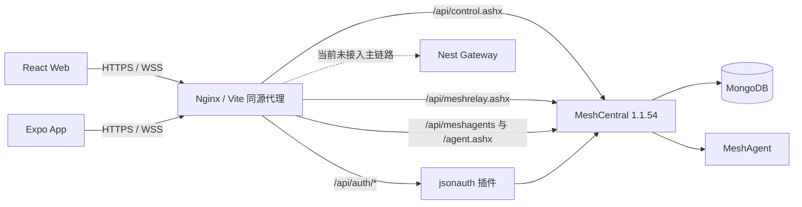

# MeshCentral 控制台发布路线图与 TODO

> 本文以当前 Monorepo、生产部署契约和已实现代码为准，覆盖 `apps/web`、`apps/gateway`、`apps/meshcentral`、`packages/meshcentral-plugins`、`packages/control-client`、`packages/relay`、`packages/shared-state` 与 `deploy`。
>
> 当前生产目标不是由 Nest Gateway 代理全部 MeshCentral 协议。Web 通过同源 Nginx 入口访问认证、控制、Relay 和 Agent 资源；认证由运行在 MeshCentral 内的 `jsonauth` 插件提供，控制与 Relay 直接进入 MeshCentral。Nest Gateway 已存在，但尚未接入当前浏览器主链路。

## 状态约定

- `[ ]` 尚未开始或没有可验证实现
- `[~]` 已有代码或部署契约，但缺少集成、真实环境验证、测试或发布闭环
- `[x]` 已实现，并有足够代码或测试证据作为后续工作的稳定基础
- `[!]` 受目标 MeshCentral/Agent 协议、上游版本或当前架构限制

功能状态按以下层级分别评估：

| 层级    | 判断标准                                                     |
| ------- | ------------------------------------------------------------ |
| UI      | 页面、交互、加载、空数据、错误、断线和无权限状态完整         |
| Client  | `control-client`、`relay` 和 `shared-state` 已封装稳定接口   |
| Plugin  | `jsonauth` 等插件已复用 MeshCentral 原生认证、授权和事件能力 |
| Server  | MeshCentral、MongoDB、配置和持久卷行为明确                   |
| Proxy   | Nginx/Vite 路由、Cookie、WebSocket、Agent 和访问日志规则明确 |
| Tests   | 单元、集成、E2E 或真实 Agent 验证覆盖关键成功与失败流程      |
| Release | 镜像、配置生成、Secret、健康检查、升级和回滚形成闭环         |

---

## 当前架构基线



### 组件职责

- `apps/web`：浏览器控制台、登录与 MFA 页面、权限门控、设备和用户管理、远程桌面、终端与文件 UI。
- `apps/app`：Expo 移动端工程。已有登录、设备、事件、账户、分组和批量操作页面原型，并接入 Control/shared-state；认证安全边界、Relay 和真实移动端验收尚未完成，不按 Web 完成度计算。
- `apps/gateway`：NestJS 服务，已实现候选登录代理、Swagger 和健康检查，但当前 Web `/api/auth/*`、控制与 Relay 流量不经过它。
- `apps/meshcentral`：固定并运行 MeshCentral `1.1.54`，构建镜像时安装仓库插件并修复上游运行文件。
- `packages/meshcentral-plugins`：提供 `jsonauth` 等 MeshCentral 插件；认证 API 复用原生账号、Session、限流、事件和认证日志。
- `packages/control-client`：无框架依赖的控制 WebSocket SDK、请求关联、重连、协议标准化和资源 API。
- `packages/relay`：`p=1` 终端、`p=2` 桌面和 `p=5` 文件 Relay SDK。
- `packages/shared-state`：Zustand 状态、选择器、React Hook 和控制客户端绑定。
- `deploy`：全局 YAML 配置契约、Compose、Secret 和生成配置的部署输入。

### 认证与数据边界

- Web 调用同源 `/api/auth/*`，由 MeshCentral 内的 `jsonauth` 插件处理，不经过 Nest Gateway。
- 登录成功后使用 MeshCentral 原生 HttpOnly Session Cookie 建立控制和 Relay 连接。
- 浏览器不把密码、认证 Cookie、登录 key 或长期管理 token 写入 Web Storage 或 WebSocket URL。
- MeshCentral 使用 MongoDB 持久化账号、设备、事件和配置。
- 当前没有独立于 MeshCentral 的控制台业务数据库；通知偏好、自定义规则和扩展审计没有额外持久化层。
- Nginx 是生产环境唯一公网入口，负责 TLS、静态 Web、HTTP/WSS、Relay、Agent 和下载流量分发。

### 必须尽快确定的架构决策

- [x] 生产登录由 MeshCentral `jsonauth` 插件承担，Nest Gateway 不参与浏览器认证主链路。
- [x] `config.example.yaml` 与 `deploy/config/production.example.yaml` 的 `proxy.routes.login` 均指向 MeshCentral。
- [x] Nest Gateway 保留为未来业务聚合层，不代理当前认证、控制或 Relay 主链路。
- [x] Gateway README、部署说明和 Compose 主链路依赖已按上述职责调整。
- [x] 控制 SDK、共享状态、Web/App Provider 与界面文案已统一为 MeshCentral 控制连接术语；旧环境变量名仅作为兼容回退。

---

## 当前实现基线

以下项目表示已有可复用实现，不等于已经满足生产发布定义。

### 服务端与部署

- [x] MeshCentral 上游版本固定为 `1.1.54`，升级可以显式执行和回归。
- [x] MeshCentral Docker 镜像构建和插件同步机制已经实现。
- [x] `jsonauth` 插件已提供登录、MFA 验证、退出、注册能力查询和注册 API。
- [x] 开发环境可通过 Vite 同源代理访问认证、控制、Relay 和 Agent 路径。
- [x] 生产 YAML Schema、Compose 服务边界、Secret 和持久卷契约已经定义。
- [x] MongoDB 基础设施 Compose 已可用于开发环境。
- [~] Nest Gateway 已实现登录候选接口、Swagger、存活和就绪检查，但未接入当前 Web 主链路。
- [~] 生产 Compose 已定义 `config-init`、MongoDB、MeshCentral、Gateway 和 Nginx，但缺少全部可运行镜像和配置生成器。

### Web、Client 与 Relay

- [x] Cookie 登录、TOTP、备用码、可信设备 Cookie、退出和注册流程已有实现。
- [x] 控制 SDK 已具备请求超时、心跳、退避重连、请求关联和主要资源 API。
- [x] 设备列表、设备组、用户、用户组及授权编辑已有实质页面和控制 API。
- [x] 实时与历史事件页面已支持筛选、合并、去重和脱敏原始数据查看。
- [x] 命令窗口支持单设备与批量目标、Shell、输出流和危险命令确认。
- [~] 远程终端、远程桌面和文件 Relay 的核心协议与 UI 已接入；终端和桌面已有有限真实证据，文件仍以模拟测试为主，尚缺完整权限矩阵与浏览器 E2E。
- [x] 文件浏览、上传、下载、新建、重命名、复制、移动、删除、ZIP 与多选操作已有实现。
- [~] 个人资料已支持头像、邮箱、密码、TOTP、邮件二次验证、备份码和 WebAuthn 管理，尚缺页面集成测试和目标版本真实回读验证。
- [x] Dashboard 已使用服务器统计和真实时间线数据，并区分加载、失败、断线、空数据和单采样状态。
- [~] 设备工作台概览已合并真实历史与实时设备事件，不再包含静态模拟事件；监控与安全等标签仍有占位内容。
- [~] 全局搜索、通知和帮助仅有界面入口或占位交互。

---

## 阶段 0：架构收敛与文档校准

**优先级：P0。目标：确保代码、配置、部署文档和路线图描述同一条生产链路。**

- [~] 按 UI、Client、Plugin、Server、Proxy、Tests、Release 七层重新盘点现有能力。Web 层已开始校准，服务端和部署层仍需逐项关联证据。
- [~] 终端和桌面任务已有代码位置、协议依据、自动化测试及手工采集环境；其他复杂任务仍需补充统一模板、负责人和前置依赖。
- [~] 已通过“当前实现基线”、七层判断标准和功能完成定义区分页面/SDK 实现与生产发布；仍需按具体能力单独记录真实 MeshCentral/Agent 验证和 Release 状态。
- [~] Control、Relay 和权限已有单元测试及协议文档，终端已有部分脱敏真实夹具，桌面已有采集工具和静态协议核查；认证、文件、Agent 与桌面真实成功/失败样本仍需补齐。
- [~] Gateway README、部署 README、生产 Compose 和全局配置示例已统一当前主链路；根 README 与 Web/App/测试环境变量示例仍有旧完成度、Gateway 命名和路径描述。
- [ ] 每次功能或架构变更同步更新本文，不再集中补写完成状态。

**阶段完成标准：** 登录、控制、Relay、Agent、配置和持久化流量均能定位到唯一生产路径，不存在互相冲突的配置示例。

---

## 阶段 1：生产部署闭环

**优先级：P0，当前最主要的发布阻塞项。**

### 1.1 配置生成器

- [ ] 实现 `config` CLI，读取全局 YAML、环境变量和 Docker secrets。
- [ ] 生成 `gateway.json`、`meshcentral.json`、`nginx.conf`、`web-runtime-config.json` 和 `manifest.json`。
- [ ] 使用 Schema 校验端口、Origin、路由、Cookie、MongoDB、Secret 路径、TLS 和持久卷配置。
- [ ] 全部生成成功后原子发布，禁止服务读取部分更新的配置。
- [ ] 在 manifest 中记录 Schema 版本、源配置哈希、目标 MeshCentral 版本和构建版本。
- [ ] 为开发、测试、预发布和生产配置准备可执行示例及错误示例测试。

### 1.2 生产镜像与编排

- [x] MeshCentral 镜像已经实现，并固定上游版本和插件构建输入。
- [ ] 实现 Web/Nginx 生产镜像，包含静态资源、运行时配置和代理配置加载。
- [ ] 实现 Gateway 生产镜像，并让 Gateway 实际读取生成的 `gateway.json`。
- [ ] 实现配置初始化器镜像和启动命令。
- [ ] 验证 `compose.production.yaml` 可从空环境完成启动、健康检查和登录。
- [ ] 验证 MongoDB、MeshCentral 数据、文件、备份和录制持久卷的升级与恢复。
- [ ] 增加镜像版本固定、SBOM、漏洞扫描和发布签名策略。

### 1.3 Nginx、TLS 与网络

- [~] 登录、控制、Relay、Agent 下载和 Agent WebSocket 路由已在 YAML 契约中定义，尚缺 Nginx 生成器和真实代理验证。
- [~] YAML 已定义 HTTP、WebSocket 和 Agent 超时及部分压缩选项，尚缺 Nginx Upgrade、上传体积、缓存和压缩规则实现与验证。
- [~] TLS Secret、HSTS、可信代理和 Origin 限制已有配置契约，尚缺证书链、TLS 版本和运行环境验证。
- [~] 配置契约已声明对 `/api/meshrelay.ashx` 和 `/agent.ashx` 隐藏查询参数，尚缺生成后的 Nginx 日志验证。
- [ ] 验证控制台 Origin 与 MeshCentral/Agent Origin 分离时的 Cookie、下载和 Agent 注册行为。
- [ ] 为错误路由、插件未加载、上游不可用和证书错误提供明确健康诊断。

### 1.4 运维与恢复

- [~] MongoDB 已有 Compose 健康检查，Gateway 已有 liveness/readiness；MeshCentral、Nginx、依赖失败传播和生产编排验证仍缺失。
- [ ] 建立 MongoDB 与 MeshCentral 文件、配置和录制数据的备份恢复演练。
- [ ] 建立 MeshCentral、插件、MongoDB 和 Nginx 的升级及回滚流程。
- [ ] 固定目标 MeshCentral/Agent 兼容矩阵，并记录上游安全更新策略。
- [ ] 增加部署后冒烟测试和版本清单输出。

**阶段完成标准：** 使用受控 YAML 与 Secret 可重复生成配置、构建镜像、启动完整生产 Compose，并通过登录、控制、Relay、Agent 和持久化冒烟测试。

---

## 阶段 2：认证、会话与安全基线

**优先级：P0。**

### 2.1 `jsonauth` 与会话

- [x] 登录、TOTP、备用码、可信设备 Cookie、退出和注册 API 已接入 MeshCentral 原生 Session。
- [x] 浏览器不持久化可还原密码或认证 Cookie。
- [x] 登录页已按稳定状态码映射提示，不直接展示底层 `Error.message`。
- [~] 页面刷新后已尝试使用 Cookie 恢复控制连接，尚缺过期、撤销和服务端重启测试。
- [~] 控制连接认证失败时已有本地清理路径，尚缺连接成功后 Session 被撤销的完整自动退出验证。
- [~] `jsonauth` 已接入账户锁定、登录/二次验证失败记录、密码过期和维护模式分支及单测，尚缺目标 MeshCentral 配置实测。
- [~] 生产配置已定义 Session 时长、`SameSite` 和 IP 检查，可信设备 Cookie 已覆盖 `HttpOnly`/`Secure` 单测；原生 Session Cookie 全属性仍需实测。
- [ ] 验证最后一个管理员、自操作限制和并发修改的 MeshCentral 拒绝行为。

### 2.2 Relay 生命周期

- [~] 桌面、终端和文件面板会在卸载或控制连接断开时清理各自会话。
- [ ] 建立全局 Relay 会话注册表，退出、Session 失效和应用关闭时统一取消全部会话。
- [~] Control、Relay 和各面板已区分部分认证、取消、超时、连接丢失和协议错误，尚未形成统一的 Relay 生命周期与用户提示模型。
- [ ] 限制自动重连次数和退避窗口，避免无限重连或重复 Agent tunnel。

### 2.3 SSO 与认证扩展

- [!] 当前 Web 登录流程仅支持 `jsonauth` 已封装的本地认证能力；OIDC、SAML、LDAP、SSPI、邮件和短信验证尚未接入。
- [ ] 调研目标 MeshCentral 版本的 OIDC/SAML 原生跳转和回调流程。
- [ ] 根据 MeshCentral 域配置动态展示可用登录方式。
- [ ] 实现忘记密码或明确交由管理员重置，并避免伪造本地流程。

**阶段完成标准：** 登录、MFA、恢复、撤销、退出、锁定、限流和全部 Relay 清理均有自动化测试及目标版本验证。

---

## 阶段 3：权限、错误与前端稳定性

**优先级：P0。**

### 3.1 有效权限模型

- [x] 已区分站点权限、设备组权限、单设备直接授权、用户组继承和 `removeRights`。
- [~] 菜单、管理路由、设备列表和工作台页签已接入统一能力模型，仍有页面使用局部布尔判断。
- [~] 已区分桌面查看、桌面输入和剪贴板写入能力，录制权限及目标版本真实权限矩阵仍未完成。
- [~] 终端、命令、批量操作、用户、用户组和授权页面已有较多统一能力门控，仍需逐按钮盘点和服务端拒绝验证。
- [~] URL 直达已有路由能力门控，批量移动已有目标过滤测试；完整角色矩阵、路由集成测试和 MeshCentral 拒绝测试仍缺失。

### 3.2 错误模型

- [~] Control 和 Relay 已有认证、连接、路由、握手、协议、超时和取消等错误，分类仍未统一。
- [ ] 统一认证、授权、校验、冲突、会话过期、网关、Agent 路由、超时、取消和未知结果错误码。
- [ ] 为错误提供稳定用户提示、`retryable`、关联 ID 和安全的诊断详情。
- [ ] 删除页面直接拼接底层 `Error.message` 的路径。
- [ ] 对仅确认“请求已发送”的操作显示等待确认或结果未知，不宣称远端成功。
- [ ] 统一 Toast 去重、同类错误聚合和重试入口。

### 3.3 稳定性与可观测性

- [ ] 增加全局 React 错误边界和路由/页面级降级状态。
- [ ] 建立本地操作 ID，关联页面操作、`responseid`、设备 ID 和 Relay 会话 ID。
- [ ] 注入 Web 构建版本、Git 版本、MeshCentral 版本、插件版本和 Agent 版本。
- [ ] 接入前端异常、性能和关键流程监控，并执行统一脱敏。
- [ ] 统一密码、token、Cookie、认证查询、命令参数和文件路径的日志脱敏规则。

**阶段完成标准：** 同一权限和错误语义可被路由、页面、Control、Relay 与诊断信息复用，服务端拒绝或无响应不会被 UI 误报成功。

---

## 阶段 4：自动化测试与发布门禁

**优先级：P0。**

### 4.1 测试基础设施

- [~] 已有 Vitest、Testing Library 以及 Control、Relay、权限、文件和 MFA 的单元测试。
- [ ] 引入 Playwright 浏览器 E2E。
- [~] 已有 Fake WebSocket、Fake Relay、协议夹具和桌面采集校验器，尚缺独立回放服务与假 Agent。
- [~] 已有用户 CRUD、Windows 终端和桌面采集数据，认证、权限、文件、失败流程及多平台稳定数据仍不完整。
- [~] 真实采集已通过 `RUN_MANUAL_INTEGRATION=1` 与普通测试隔离并默认跳过，但仓库尚无 CI 工作流和独立真实环境作业。

### 4.2 关键流程

- [~] 受保护路由、登录、Cookie 恢复和退出已有运行时代码，缺少完整集成与 E2E。
- [ ] 覆盖登录成功、密码错误、账户锁定、限流、MFA、Cookie 过期和插件不可用。
- [ ] 覆盖 Session 撤销、控制断开、离线恢复、重复登录和全部 Relay 清理。
- [ ] 覆盖不同权限用户的菜单、路由、按钮、URL 直达和 MeshCentral 拒绝。
- [~] Control resource 层已覆盖设备、设备组、用户、用户组和授权的主要请求/响应单测，尚缺页面集成和浏览器 E2E。
- [~] 批量移动、电源、命令和文件上传已有目标过滤或结果汇总实现，尚缺统一的页面集成、失败场景和浏览器 E2E。
- [~] 桌面、终端和文件已有建立、断开、取消及超时单测，权限拒绝真实夹具、有限重连和浏览器流程仍缺失。

### 4.3 CI 门禁

- [ ] 在 CI 中依次执行格式检查、Lint、类型检查、单测、构建和 E2E。
- [ ] 保存失败截图、Trace、协议摘要、服务日志和关联 ID。
- [ ] 构建并启动生产 Compose 执行部署冒烟测试。
- [ ] 禁止关键测试或安全扫描失败的版本发布。
- [ ] 为不稳定测试设置责任人和修复期限，不长期无条件重试。

建议门禁：

```text
pnpm format:check
pnpm lint
pnpm typecheck
pnpm test
pnpm build
pnpm e2e
pnpm deploy:smoke
```

---

## 阶段 5：核心远程管理能力收尾

**优先级：P1。**

### 5.1 设备与设备组

- [~] 设备工作台已接入系统、网络、运行时间、Agent 版本和事件数据，标签、指标完整性及目标版本真实回读仍需验证。
- [ ] 删除设备后回读资源或事件，确认最终成功、失败或未知。
- [~] 已有设备组成员、批量移动和授权管理页面及权限分类逻辑，尚缺完整集成测试和真实服务端拒绝验证。
- [x] 设备列表已按有效能力提供桌面、终端和文件独立入口。
- [~] 设备工作台静态模拟事件已删除；仍需清理无法追溯来源的推算指标。

### 5.2 命令

- [~] 已有实时输出、本地时长、超时和断线未知状态。
- [~] 命令已过滤离线或不支持目标，并保留逐设备输出及失败/未知结果；并发控制和结果导出仍未实现。
- [ ] 将模板和历史记录迁移到可控、可脱敏、可审计的存储模型。
- [ ] 验证危险命令权限和 MeshCentral 原生事件。
- [!] 标准输出/错误输出分类、真实退出码和远端取消依赖目标 Agent 协议支持。

### 5.3 终端与桌面

- [~] Windows CMD 已有单环境脱敏协议证据；关闭、resize、Linux 和 macOS Agent 仍未完成真实验证。
- [~] Windows CMD 握手和帧形状已有真实证据，PowerShell、Linux/macOS 默认 Shell、ANSI 和 Unicode 输入仍未实测。
- [~] 桌面鼠标、滚轮、扩展键、组合键和失焦释放已有编码或 UI 实现，尚缺真实输入、输入法和跨平台采集验证。
- [ ] 验证远端空剪贴板、权限拒绝和写入确认。
- [ ] 增加显示器选择和有限自动重连。
- [~] 桌面会话代码已区分部分控制、超时和断线状态，真实采集目前仅覆盖未录制连接与首屏；只读、`cr` 录制和异常断线仍缺失。
- [ ] 增加移动端终端辅助键和桌面触控输入。

### 5.4 文件

- [~] 批量上传已支持覆盖和跳过策略，设备文件操作及自动重命名策略仍未完成。
- [~] 批量上传已支持失败任务重试和本次任务终态汇总，持久化传输历史及远端最终确认仍未完成。
- [~] 单测已覆盖默认 5 MiB 分块、零字节、部分危险路径和 ACK 顺序，尚缺真实 Agent 大文件、特殊字符、深层目录和并发验证。
- [~] 取消、超时和 Relay 关闭已有单测，页面刷新和重复提交仍未覆盖。
- [~] 已确认请求 ID、ACK 顺序分块和取消行为，尚未发现分块校验或远端续传查询能力。
- [!] 未确认远端续传状态前，不得只依靠前端 offset 宣称支持断点续传。

---

## 阶段 6：事件、审计与历史数据

**优先级：P1。**

- [ ] 定义统一 `AuditEvent`，包含用户、动作、目标、结果、来源、时间和关联 ID。
- [~] 实时事件页已合并历史与推送，并归一化部分设备、`relaylog` 和 Agent 日志；账户事件和本地操作尚未收敛为统一 `AuditEvent`。
- [~] `jsonauth` 已产生登录、退出和认证失败事件，终端已有部分 `relaylog` 证据；设备、用户、权限、命令、文件和全部远程会话覆盖仍需验证。
- [ ] 区分成功、失败和结果未知，不伪造远端成功状态。
- [~] 事件详情和协议采集器已有递归脱敏，尚未形成覆盖命令、文件、认证和应用日志的统一策略与测试。
- [ ] 实现独立审计页面，支持用户、动作、目标、结果、来源和时间筛选。
- [ ] 支持权限受控的详情查看和本地导出。
- [~] Dashboard 和设备工作台已使用服务器历史事件生成在线、离线和状态变化数据，尚缺目标环境完整性验证。
- [~] Dashboard 已提供 24 小时、7 天和 30 天窗口及加载、失败、单采样提示，事件保留完整性、延迟和缺失范围仍需验证。
- [x] 删除 Dashboard 使用当前状态复制生成的伪历史趋势，数据不足时显示明确状态。
- [!] MeshCentral 未产生或未保存的可信审计与离线历史，无法由浏览器可靠补齐。

---

## 阶段 7：产品完整性

**优先级：P2/P3，在生产、权限、测试和审计基线完成后推进。**

### 7.1 告警、通知与搜索

- [ ] 调研并验证 MeshCentral 原生通知、邮件、Webhook、MeshBot 或插件能力。
- [ ] 对原生支持的设备状态和事件规则提供配置 UI。
- [ ] 基于当前 Session 事件实现临时通知中心和详情跳转。
- [ ] 实现设备名称、设备 ID、IP、设备组和用户全局搜索。
- [ ] 增加搜索防抖、加载、空状态、错误、键盘导航和最近搜索。
- [!] 浏览器关闭后的持续规则、Webhook 重试和跨设备未读同步需要服务端持久化能力。

### 7.2 账户与系统设置

- [~] 个人资料、邮箱、密码和 MFA 管理已有实现，缺少页面集成测试和真实版本回读验证。
- [ ] 验证会话列表、指定会话注销和全部会话注销协议。
- [~] 设备概览已展示连接和 Agent 版本，尚缺统一的 Web 构建、MeshCentral、插件及 Agent 诊断页。
- [ ] 展示或配置心跳、超时、重连、上传并发和带宽参数。
- [ ] 展示 MeshCentral 安全、Session、通知和事件保留配置；仅在原生能力支持时允许修改。
- [~] Web 已支持中英文切换，时区、日期格式和主题偏好尚未实现。
- [ ] 提供帮助、文档、问题反馈和版本信息入口。

### 7.3 响应式与可访问性

- [~] 已有桌面和移动响应式样式，尚未形成桌面、平板和移动端完整验收矩阵。
- [~] 移动端已有侧栏折叠和菜单入口，尚未实现带遮罩、外部关闭和导航后关闭的抽屉行为。
- [~] 多数 Ant Design 控件具备基础键盘能力，远程工具、自定义菜单和弹窗尚未完成专项验收。
- [~] 部分按钮、筛选器和详情视图已有 ARIA 标签，焦点管理和屏幕阅读器流程仍不完整。
- [ ] 检查颜色对比度和非颜色状态提示。
- [~] 设备工作台和用户详情已有局部 `prefers-reduced-motion`，尚未覆盖全站动画与过渡。

---

## 移动端与站点边界

- [~] `apps/app` 已形成登录、设备、事件、账户、分组和批量操作的事实范围，仍需形成正式第一阶段边界并移除超范围占位。
- [~] App 已复用 `control-client` 和 `shared-state`，尚未接入 Relay，也未完成文件系统、剪贴板和安全存储差异验证。
- [ ] 定义移动端认证 Cookie 或其他安全 Session 传递方案。
- [ ] 为移动端设备列表、通知、审批和轻量远程操作建立独立路线图。
- [~] `apps/site` 已作为独立 Next.js 产品站实现，部署职责和与控制台 Web/Nginx 镜像的边界仍需补充文档。

---

## 推荐迭代顺序

### 迭代 A：架构与生产闭环

- [x] 确定 `jsonauth` 与 Nest Gateway 的最终认证职责。
- [x] 统一配置契约和登录路由。
- [ ] 实现配置生成器和 Web/Nginx 镜像；Gateway 镜像随未来 `aggregation` 接入单独推进。
- [ ] 跑通完整生产 Compose、健康检查和部署冒烟测试。
- [ ] 建立升级、备份、恢复和回滚流程。

### 迭代 B：安全与测试门禁

- [~] 完成 Session 撤销、限流、锁定和 Relay 全局清理；限流和锁定已有实现基础，全局 Relay 清理仍缺失。
- [~] 统一权限、错误和关联 ID；权限模型已有基础，错误和关联 ID 尚未统一。
- [~] 引入 Playwright 和协议回放服务；已有 Fake WebSocket、夹具和采集工具，Playwright 与独立回放服务未实现。
- [~] 覆盖认证、权限、设备、用户和远程会话关键流程；资源层单测较多，集成和 E2E 仍缺失。
- [ ] 建立 CI、镜像扫描和生产 Compose 门禁。

### 迭代 C：核心体验收尾

- [x] 删除设备工作台模拟数据和 Dashboard 伪历史趋势。
- [~] 完成文件冲突、失败重试和最终结果；批量上传已有跳过/覆盖和失败重试，设备文件操作仍缺最终结果模型。
- [~] 验证桌面输入、剪贴板、显示器与终端 resize；连接和首屏已有单环境证据，其余仍需真实采集。
- [ ] 完成多平台 Agent 兼容矩阵。
- [~] 建立事件归一化和审计页面；事件已有部分归一化，统一模型和独立审计页未实现。

### 迭代 D：产品扩展

- [~] 验证历史时间线完整性、保留窗口和目标环境结果，并实现全局搜索。
- [ ] 接入可验证的 MeshCentral 告警与通知能力。
- [~] 完成系统设置、会话管理和诊断页面；个人资料与部分连接信息已实现，会话控制和统一诊断仍缺失。
- [~] 完成响应式与可访问性验收；已有响应式样式和部分语义标签，系统验收仍缺失。
- [~] 按独立范围推进 Expo App；已有页面原型和 Control/shared-state 接入，认证安全方案、Relay 和真实验收仍未完成。

---

## 功能完成定义

功能只有满足与其风险相匹配的以下条件，才可标记为 `[x]`：

- UI 具备加载、空数据、错误、无权限、断线和恢复状态。
- Client、Plugin、Server 与 Proxy 的职责和接口稳定，不由页面拼装原始协议。
- 目标 MeshCentral/Agent 版本的真实协议样本已验证并脱敏保存。
- MeshCentral 执行最终认证、授权和输入校验，客户端门控不代替服务端安全。
- 操作成功、失败和结果未知均有准确反馈。
- 可审计操作产生可查询、可关联和可脱敏的原生事件；无法产生时明确标记架构限制。
- 核心逻辑具备单元或集成测试，关键用户流程具备 E2E。
- 配置、Secret、镜像、健康检查、部署、升级和回滚文档同步更新。
- 相关发布门禁全部通过。

若目标 MeshCentral/Agent 协议能力尚未确认，应标记为 `[!]` 或 `[~]`，不得通过前端推断或模拟结果标记完成。需要持续后台执行、跨浏览器同步、额外业务持久化或不可抵赖审计的能力，必须先明确由 MeshCentral、插件、Nest Gateway 或未来独立服务承担。
